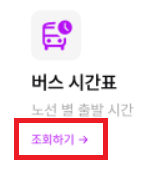
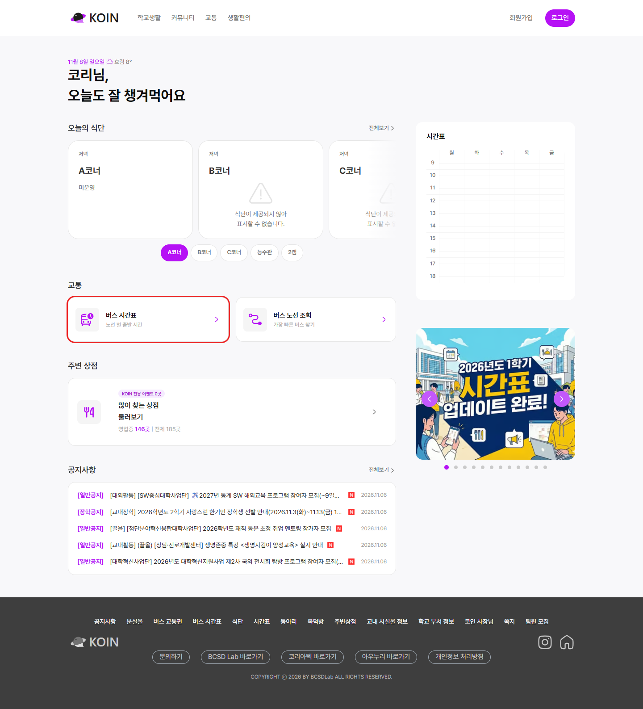
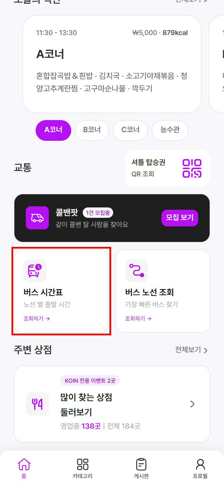

# 1-7 버스 시간표 클릭

원문 페이지 ID: a990221954bc827cb049812194ccf592

> 원문 스냅샷. 명세 확정·앱 배포·수집 완료를 뜻하지 않습니다.

## 원문 속성

```json
{
  "platform": [
    "ANDROID",
    "IOS",
    "WEB"
  ],
  "url": "source-page-id:a990221954bc827cb049812194ccf592",
  "구분": "홈화면",
  "상태": "완료",
  "생성일": "2026-11-12T05:08:00.408Z",
  "이벤트 이름": "1-7 버스 시간표 클릭"
}
```

<details>
<summary>과거 로깅</summary>

- event\_label : bus\_timetable
- value : 버스 시간표 조회하기
- event\_category : click





</details>

<details>
<summary>새 로깅</summary>

- 설명: 메인 화면 교통 영역에서 버스 시간표 카드를 클릭해 버스 시간표 화면으로 들어가는 경우
- screen\_view: <code>main</code>
- event\_name: <code>DA2</code>
- event\_label: <code>main__main__bus_entry__timetable_entry__click</code>
- value: 버스 시간표
- event\_category: <code>click</code>

### 참고사진 (기능 표시)

<b>웹</b>

<b>참고사진 · 웹 (Stage 실제 화면)</b>

2026-11-08 [Stage 실제 서비스](https://stage.koreatech.in/) · PC 1440px 브라우저에서 직접 촬영했다. 빨간 테두리는 해당 명세의 버튼 위치다. 현재 WEB 위치 확인에는 이 실제 화면을 우선한다. 모바일 사진·기존 로깅 필드·DB 플랫폼 속성은 유지한다. 화면 확인은 SDK 전송·GA4 수집 검수 완료를 뜻하지 않는다.



<b>모바일</b>

<b>참고사진 · 모바일</b>

모바일 — 버스 시간표 카드 (출처: stage 실제 캡처, 빨간 네모 = 클릭 위치)


</details>
