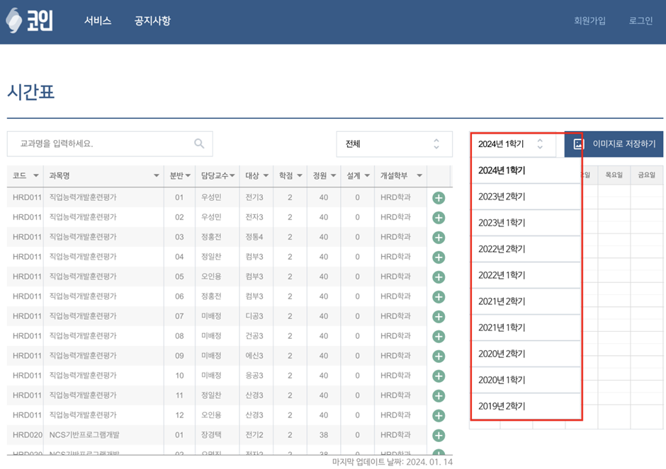
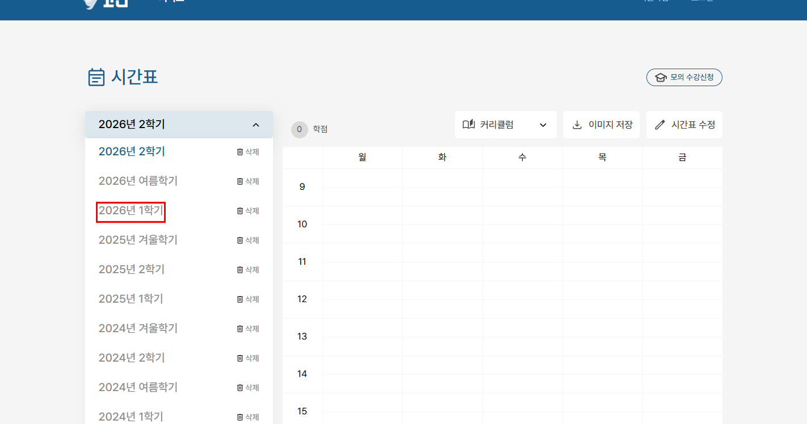

# 2-7. 시간표_학기 드롭다운 (클릭)

원문 페이지 ID: a9c0221954bc8215bb76813a25ddbf3c

> 원문 스냅샷. 명세 확정·앱 배포·수집 완료를 뜻하지 않습니다.

## 원문 속성

```json
{
  "platform": [
    "WEB"
  ],
  "url": "source-page-id:a9c0221954bc8215bb76813a25ddbf3c",
  "상태": "완료",
  "생성일": "2026-11-12T05:08:09.423Z",
  "이벤트 이름": "2-7. 시간표\\_학기 드롭다운 (클릭)",
  "태그": [
    "시간표"
  ]
}
```

<details>
<summary>과거 로깅</summary>

- event\_label : “timetable”
- value : “click\_semester\_\{학기\}”
- event\_category : “click”
- 참고 이미지


</details>

<details>
<summary>새 로깅</summary>

- 설명: 웹 시간표 화면 왼쪽 위 학기 드롭다운을 열고 학기 하나를 골라 그 학기 시간표로 바꾸는 경우
- screen\_view: <code>timetable</code>
- event\_name: <code>DA1</code>
- event\_label: <code>timetable__timetable__semester_manage__select</code>
- value: \{연도\}\_\{학기\} (예: 2026\_1학기)
- event\_category: <code>select</code>

### 참고사진 (기능 표시)

<columns>
<column ratio="50">
<b>웹</b>

<b>참고사진 · 웹</b>

웹 — 학기 드롭다운 학기 선택 (출처: stage 실제 캡처, 빨간 네모 = 클릭 위치)


</column>
<column ratio="50">
<b>모바일</b>

<b>참고사진 · 모바일</b>

해당 없음 (웹 전용)
</column>
</columns>
</details>
