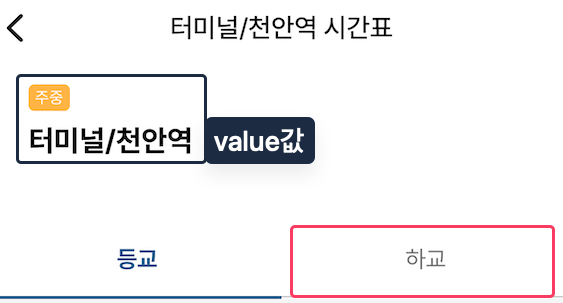
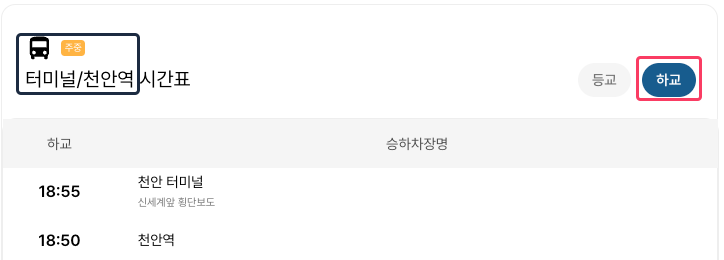
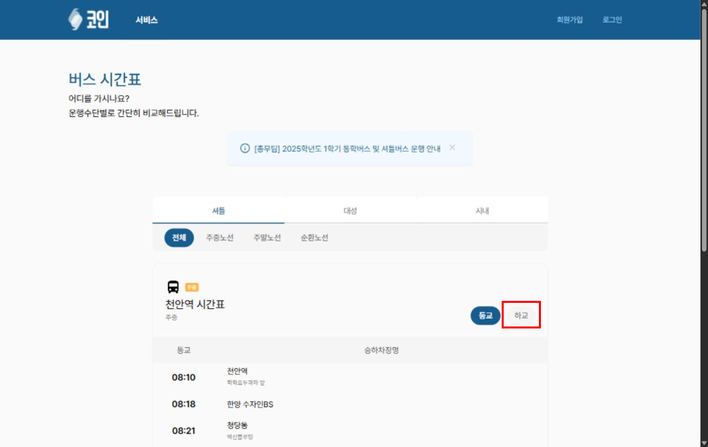
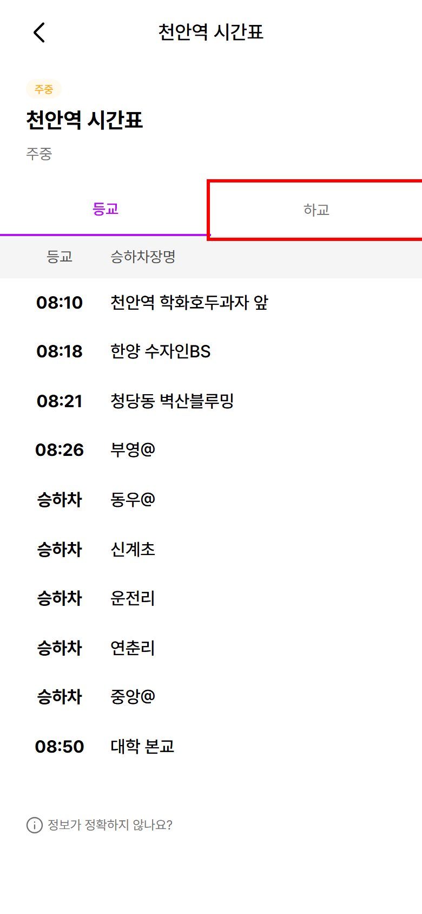

# 4-8. 셔틀버스_하교_클릭 (세부 노선 변경시 업데이트 필요)

원문 페이지 ID: aa30221954bc82f3b70e81a00d15406b

> 원문 스냅샷. 명세 확정·앱 배포·수집 완료를 뜻하지 않습니다.

## 원문 속성

```json
{
  "platform": [
    "ANDROID",
    "IOS",
    "WEB"
  ],
  "url": "source-page-id:aa30221954bc82f3b70e81a00d15406b",
  "구분": "셔틀버스 시간표",
  "상태": "로깅 필요",
  "생성일": "2026-11-08T10:51:40.094Z",
  "이벤트 이름": "4-8. 셔틀버스\\_하교\\_클릭 (세부 노선 변경시 업데이트 필요)",
  "태그": [
    "4. 버스 시간표"
  ]
}
```

<details>
<summary>이전 로깅</summary>

- event\_label : “go\_home”
- value : <b><span color="orange">이 버튼을 누른 위치 </span></b><span color="orange">(세부 노선 변경시 업데이트 필요)</span>
  - “순환\_천안 계절학기 순환셔틀”, “주중\_터미널/천안역”, “주말\_일학습병행대학 천안시내” 등
- event\_category : “click”
- 참고사진





AND, IOS, WEB(Mobile view)





WEB

</details>

<details>
<summary>새 로깅 (26.10.17)</summary>

- 설명: 셔틀버스 시간표 상세 화면에서 하교를 클릭하는 경우
- screen\_view: <code>bus_timetable_detail</code>
- event\_name: <code>DA1</code>
- event\_label: <code>bus__bus_timetable_detail__filter__to_home__click</code>
- value: \{노선 구분\}\_\{세부 노선\} (예: 주중\_천안역)
- event\_category: <code>click</code>

<details>
<summary>검토사항</summary>

- 통합 가이드: [로깅 통합 가이드](3c30221954bc8214b1c481c5bbb6fba5.md)
- 웹/모바일 참고사진 추가 완료 (stage 캡처에 빨간 네모, 2026-10-28).
- label DA2 기준 정렬 (2026-10-27): <code>bus__bus_timetable_detail__to_home__click</code> → <code>bus__bus_timetable_detail__filter__to_home__click</code>
</details>

### 참고사진 (기능 표시)

<columns>
<column ratio="50">
<b>웹</b>

<details>
<summary>참고사진 · 웹</summary>





WEB · 빨간 네모: 셔틀 상세 하교 선택. stage 실제 화면 캡처에 위치 표시.

</details>
</column>
<column ratio="50">
<b>모바일</b>

<details>
<summary>참고사진 · 모바일</summary>

모바일 — 셔틀버스 하교 클릭 (출처: stage 실제 캡처, 빨간 네모 = 클릭 위치)


</details>
</column>
</columns>
</details>
