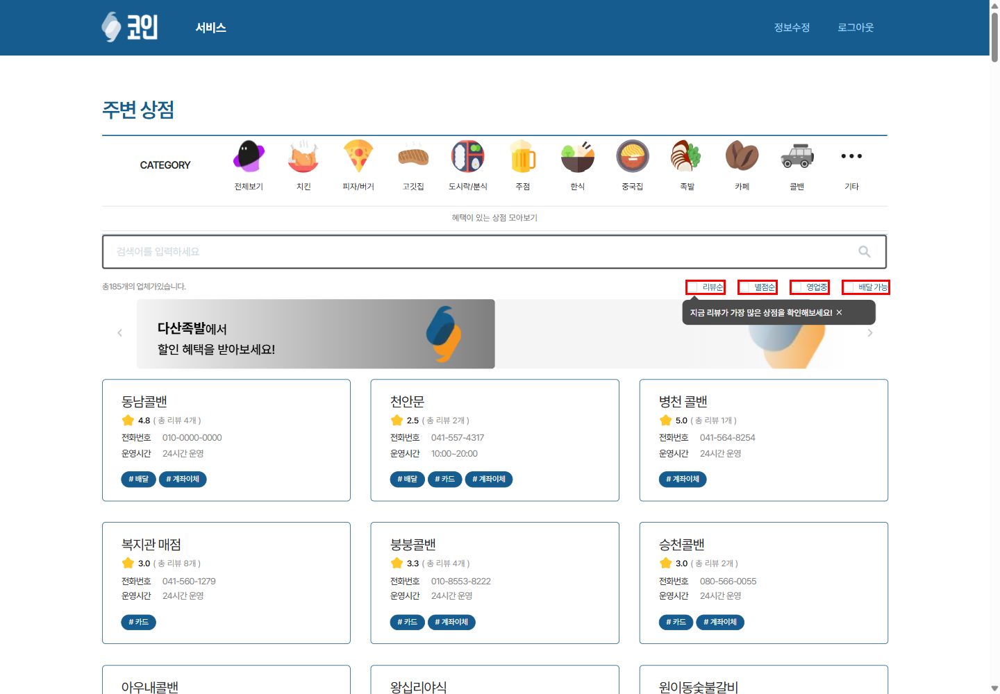

# 2-5~8 상점 카테고리 토글 

원문 페이지 ID: aab0221954bc834794a60194a438130f

> 원문 스냅샷. 명세 확정·앱 배포·수집 완료를 뜻하지 않습니다.

## 원문 속성

```json
{
  "platform": [
    "WEB",
    "ANDROID",
    "IOS"
  ],
  "url": "source-page-id:aab0221954bc834794a60194a438130f",
  "상태": "완료",
  "생성일": "2026-11-12T05:07:36.797Z",
  "이벤트 이름": "<p>\n2-5\\~8 상점 카테고리 토글 \n</p>",
  "태그": [
    "2. 상점 카테고리"
  ]
}
```

<details>
<summary>과거 로깅</summary>

<span color="orange">event\_params.key</span>

<ul>
<li>
event\_label : shop\_can
</li>
<li>
value : 

- check\_delivery\_\{카테고리\}
- check\_review\_\{카테고리\}
- check\_star\_\{카테고리\}
- check\_open\_\{카테고리\}
</li>
<li>
event\_category : click 
</li>
</ul>


---

상점카테고리에서 토글을 클릭하는 횟수를 파악하고자 하는 이벤트 입니다.


<p>
현재 웹만 존재하는 상황. 
</p>


<p>
→ 체크 되었을때만 이벤트를 카운트 해주시면 됩니다. 
</p>

---

<h3>
오류 사항 
</h3>

[해결 (1)](8700221954bc827cabe281c196352cbc.md)
</details>

<details>
<summary>새 로깅</summary>

- 설명: 상점 목록 화면에서 배달·리뷰·별점·영업중 체크박스가 해제 상태에서 선택 상태로 바뀔 때 1회 기록한다. 선택 해제에는 기록하지 않는다.
- screen\_view: <code>shop_list</code>
- event\_name: <code>DA1</code>
- event\_label: <code>shop__shop_list__filter__checkbox__select</code>
- value: \{켠 필터\} → 배달 / 리뷰 / 별점 / 영업중 (예: 영업중)
- event\_category: <code>select</code>

### 참고사진 (상점 목록 필터 체크)

<columns>
<column ratio="50">
<b>웹</b>

<b>참고사진 · 웹</b>





WEB · stage 실제 리뷰순·별점순·영업중·배달 가능 체크박스. 빨간 테두리=필터들. 2026-10-30.

</column>
<column ratio="50">
<b>모바일</b>

<b>참고사진 · 모바일</b>

없음
</column>
</columns>
</details>
