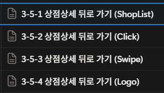
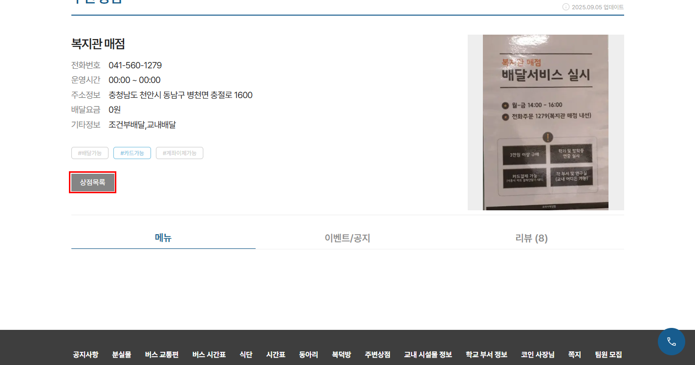
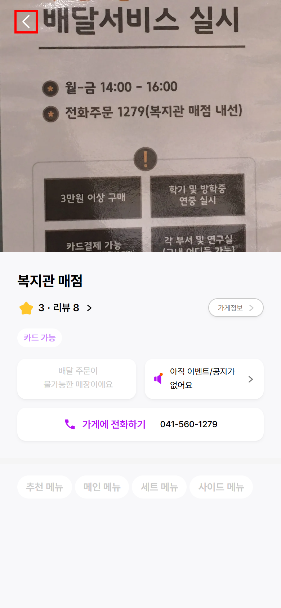
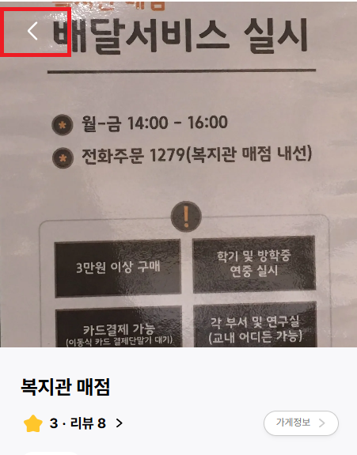

# 3-5-1 상점상세 뒤로 가기 (ShopList)

원문 페이지 ID: ac90221954bc8338883b010cbe6c633e

> 원문 스냅샷. 명세 확정·앱 배포·수집 완료를 뜻하지 않습니다.

## 원문 속성

```json
{
  "platform": [
    "WEB"
  ],
  "url": "source-page-id:ac90221954bc8338883b010cbe6c633e",
  "상태": "완료",
  "생성일": "2026-11-08T10:51:48.217Z",
  "이벤트 이름": "3-5-1 상점상세 뒤로 가기 (ShopList)",
  "태그": [
    "3. 상점 상세 페이지"
  ]
}
```

<details>
<summary>이전 로깅</summary>

<span color="orange">event\_params.key</span>

<ul>
<li>
event\_label : shop\_detail\_view\_back
</li>
<li>
value : \{상점이름\} 
</li>
<li>
event\_category : 

- ShopList
</li>
<li>
current\_page : \{돌아간 카테고리\}
</li>
<li>
duration\_time : 상점 상세보기에서 카테고리로 돌아간 시간.
</li>
</ul>

---

<p> </p>

<p>
카테고리 의미 
</p>

<ul>
<li>
‘상점목록’ 클릭으로 상점카테고리 페이지로 돌아가는 것. 
</li>
</ul>


<p>
시간 관련 주의 사항: 
</p>

<ol>
<li>
상점 상세보기 페이지에서 어떠한 행위를 해도 상관이 없음. <br />즉 상점 상세보기를 들어온 시간부터 상점 상세보기를 떠난 시간까지 측정 
</li>
</ol>

---

<h3>
오류사항 
</h3>

<span color="yellow_bg">햄버거로 나가는걸 측정하지 못하고 있음. </span>

<p>
웹: 
</p>

<p>
상점 목록으로 나가면 swipe 이벤트가 찍히고 있음. 
</p>


<p>
안드: 
</p>

<p>
swipe → click 
</p>

---

[해결 (1)](7380221954bc827fbb2a8141e7980b93.md)
</details>

<details>
<summary>새 로깅 (26.10.17)</summary>

- 설명: 상점 상세 화면에서 나가는 경우
- screen\_view: <code>shop_detail</code>
- event\_name: <code>DA1</code>
- event\_label: <code>shop__shop_detail__navigation__back__click</code>
- value: \{나가는 방법\} → 상점목록 / 뒤로가기 / 스와이프 / 로고 (예: 뒤로가기) — 3-5-2\~4 통합
- event\_category: <code>click</code>

<details>
<summary>검토사항</summary>

- 통합 가이드: [로깅 통합 가이드](3c30221954bc8214b1c481c5bbb6fba5.md)
- 논의 사항: 상점상세 뒤로 가기 click만 냅두고 나머지는 다 날리는게 어떤가?? 현재 이렇게 4가지가 있는데 한개로 합치기..
- label DA2 기준 정렬 (2026-10-27): <code>shop__shop_detail__back__click</code> → <code>shop__shop_detail__navigation__back__click</code>


</details>

### 참고사진 (상점 상세 뒤로가기)

<columns>
<column ratio="50">
<b>웹</b>

<details>
<summary>참고사진 · 웹</summary>

웹 — 상점목록 버튼 클릭 (출처: stage 실제 캡처, 빨간 네모 = 클릭 위치)


</details>
</column>
<column ratio="50">
<b>모바일</b>

<details>
<summary>참고사진 · 모바일</summary>

모바일 — 뒤로가기 클릭 (출처: stage 실제 캡처, 빨간 네모 = 클릭 위치)




</details>
</column>
</columns>
</details>
