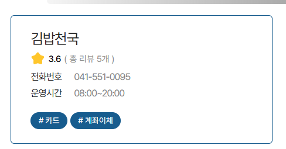
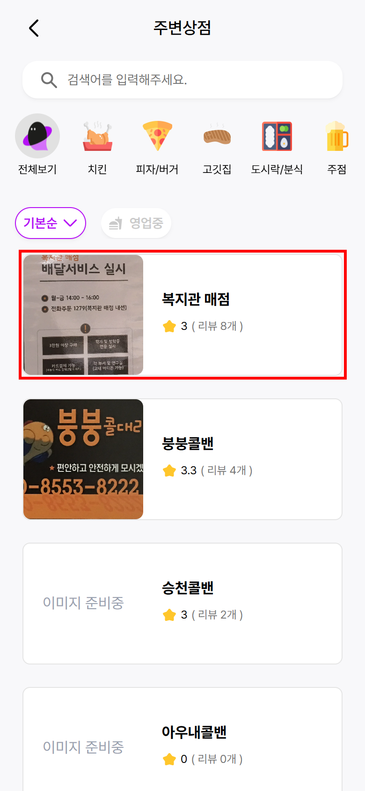
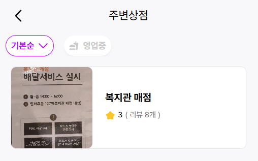

# 3-1 상점 카테고리 → 상점상세 (클릭) 

원문 페이지 ID: ac90221954bc833c923a81c3d2685f43

> 원문 스냅샷. 명세 확정·앱 배포·수집 완료를 뜻하지 않습니다.

## 원문 속성

```json
{
  "platform": [
    "WEB",
    "ANDROID",
    "IOS"
  ],
  "url": "source-page-id:ac90221954bc833c923a81c3d2685f43",
  "상태": "완료",
  "생성일": "2026-11-08T10:51:50.059Z",
  "이벤트 이름": "<p>\n3-1 상점 카테고리 → 상점상세 (클릭) \n</p>",
  "태그": [
    "3. 상점 상세 페이지"
  ]
}
```

<details>
<summary>이전 로깅</summary>

<span color="orange">event\_params.key</span>

<ul>
<li>
event\_label : shop\_click
</li>
<li>
value : \{상점이름\} 
</li>
<li>
event\_category : click 
</li>
<li>
previous\_page : \{카테고리\}
</li>
<li>
current\_page : \{상점이름\}
</li>
<li>
duration\_time : 상점 카테고리에서 상점상세 페이지로 들어간 시간(ms) 
</li>
</ul>


---

<p>
상점카테고리에서 상점 상세 페이지로 들어가는 시간을 파악하고자 합니다. 
</p>

<p>
검색을 해서 이동하는 경우도 포함하여 시간을 계산합니다.  
</p>

---

<h3>
오류 사항 
</h3>

[해결 (1)](f6d0221954bc8234b0cd01e4bbe48ade.md)
</details>

<details>
<summary>새 로깅 (26.10.17)</summary>

- 설명: 상점 목록 화면에서 가게를 클릭해 상점 상세 화면으로 들어가는 경우
- screen\_view: <code>shop_list</code>
- event\_name: <code>DA1</code>
- event\_label: <code>shop__shop_list__shop_detail__entry__click</code>
- value: \{상점이름\} → ex) OO치킨, OO피자 등등 (예: 복지관 매점)
- event\_category: <code>click</code>

<details>
<summary>검토사항</summary>

- 통합 가이드: [로깅 통합 가이드](3c30221954bc8214b1c481c5bbb6fba5.md)
- label DA2 기준 정렬 (2026-10-27): <code>shop__shop_list__shop__click</code> → <code>shop__shop_list__shop_detail__entry__click</code>
</details>

### 참고사진 (상점 카드 클릭)

<columns>
<column ratio="50">
<b>웹</b>

<details>
<summary>참고사진 · 웹</summary>

웹 — 상점 카드 클릭 (출처: 기존 캡처)


</details>
</column>
<column ratio="50">
<b>모바일</b>

<details>
<summary>참고사진 · 모바일</summary>

모바일 — 상점 카드 클릭 (출처: stage 실제 캡처, 빨간 네모 = 클릭 위치)




</details>
</column>
</columns>
</details>
