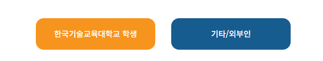
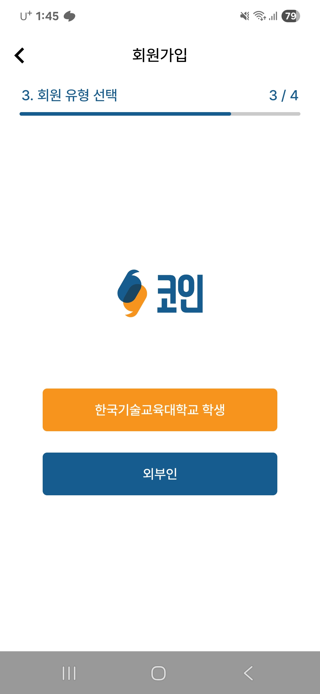
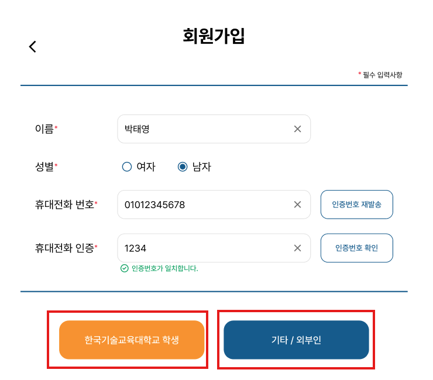

# 1-7 정보입력_학생_외부인_구분(클릭)

원문 페이지 ID: ad00221954bc82feac15819c93a4c6ff

> 원문 스냅샷. 명세 확정·앱 배포·수집 완료를 뜻하지 않습니다.

## 원문 속성

```json
{
  "platform": [
    "WEB"
  ],
  "url": "source-page-id:ad00221954bc82feac15819c93a4c6ff",
  "구분": "정보입력",
  "상태": "로깅 필요",
  "생성일": "2026-11-08T10:51:22.926Z",
  "이벤트 이름": "1-7 정보입력\\_학생\\_외부인\\_구분(클릭)",
  "태그": [
    "회원가입"
  ]
}
```

<details>
<summary>이전 로깅</summary>

- event\_label : “create\_account”
- value : “학생” or “외부인”
- event\_category : “click”
- custom\_session\_id : \{sign\_up\}\_\{0\}\_\{플랫폼\}\_\{세션시작시간\}\_\{랜덤값\}

학생을 클릭하면 학생, 외부인을 클릭하면 외부인으로 로깅해주시면 됩니다.


<b>웹</b>




<b>모바일</b>




</details>

<details>
<summary>새 로깅 (26.10.04)</summary>

- 설명: 회원가입에서 학생·외부인 구분을 클릭할 때 기록한다. WEB 본인인증 경로와 모바일 선택 화면 모두 같은 논리 화면 user\_type\_selection을 사용한다.
- event\_name: <code>DA2</code>
- screen\_view: <code>user_type_selection</code>
- event\_label: <code>account__user_type_selection__sign_up__user_type__click</code>
- value: 학생 또는 외부인
- event\_category: <code>click</code>
- custom\_session\_id : \{sign\_up\}\_\{0\}\_\{플랫폼\}\_\{세션시작시간\}\_\{랜덤값\}

학생을 클릭하면 학생, 외부인을 클릭하면 외부인으로 로깅해주시면 됩니다.

<details>
<summary>검토사항</summary>

- 웹·모바일 공통 계약 (2026-11-05 사용자 승인): 같은 기능의 screen\_view와 event\_label은 플랫폼과 관계없이 아래 공통값을 사용한다. 기존 플랫폼별 화면명 유지 지시는 이 결정으로 대체한다. 플랫폼은 기존 DB 속성으로 구분하며 value·event\_name·event\_category·기존 전송 시점·이전 로깅·사진은 유지한다. 실제 SDK 적용·배포·단일 전송은 미확인이다. 공통값: <code>user_type_selection</code> / <code>account__user_type_selection__sign_up__user_type__click</code>. 대표 명세는 [1-7 정보입력_학생_외부인_구분(클릭)](0df0221954bc834d901d017386141c37.md)이며 [1-7 정보입력_학생_외부인_구분(클릭)](ad00221954bc82feac15819c93a4c6ff.md)는 WEB 대응 명세다. 본인인증 코드 발송·검증의 다른 명세는 변경하지 않는다.
- 방식 A 반영 (2026-10-28 사용자 확인): 승인된 기존 event\_category <code>click</code>을 복원하고 label 마지막 구간을 일치시켰다. <code>account__identity_verification__sign_up__user_type__select</code> → <code>account__identity_verification__sign_up__user_type__click</code>. label 끝에 맞춰 category를 바꾼 과거 후속 메모는 이 결정으로 대체한다. 기존 value·event\_name·플랫폼·전송 시점은 유지하며 성공/실패 이벤트를 새로 만들지 않는다.
- label 통일 (2026-10-27): <code>account__identity_verification__sign_up__user_type_select</code> → <code>account__identity_verification__sign_up__user_type__select</code>
- 승인 category 복원 확인 (2026-10-28): 이전 사용자 방식 A 승인에 따라 기존 click을 유지한다. label 끝 단어만 click에 맞추며, category를 select/submit/toggle로 변경하라는 과거 후속 메모는 철회한다.
</details>

<details>
<summary>참고사진 (기능 표시)</summary>

<b>웹</b>




</details>
</details>
