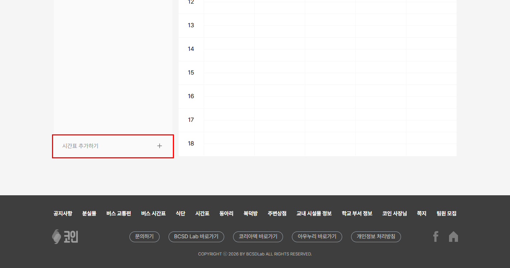

# 2-24. (웹) 시간표_시간표 추가하기 (클릭) - 추가된 로깅

원문 페이지 ID: ad30221954bc8226905a0113fd1068c2

> 원문 스냅샷. 명세 확정·앱 배포·수집 완료를 뜻하지 않습니다.

## 원문 속성

```json
{
  "platform": [
    "WEB"
  ],
  "url": "source-page-id:ad30221954bc8226905a0113fd1068c2",
  "상태": "로깅 필요",
  "생성일": "2026-11-12T05:08:09.645Z",
  "이벤트 이름": "2-24. (웹) 시간표\\_시간표 추가하기 (클릭) - 추가된 로깅",
  "태그": [
    "시간표"
  ]
}
```

<details>
<summary>과거 로깅</summary>

- 없음 (새로 추가한 로깅)
</details>

<details>
<summary>새 로깅</summary>

- 설명: 웹 시간표 화면 왼쪽 시간표 목록 아래 시간표 추가하기 버튼을 클릭해 선택한 학기에 새 시간표를 만드는 경우 (비로그인이면 로그인 안내 팝업이 뜸)
- screen\_view: <code>timetable</code>
- event\_name: <code>DA1</code>
- event\_label: <code>timetable__timetable__timetable_manage__add__click</code>
- value: 시간표 추가하기
- event\_category: <code>click</code>

### 참고사진 (기능 표시)

<columns>
<column ratio="50">
<b>웹</b>

<b>참고사진 · 웹</b>

웹 — 시간표 추가하기 (출처: stage 실제 캡처, 빨간 네모 = 클릭 위치)


</column>
<column ratio="50">
<b>모바일</b>

<b>참고사진 · 모바일</b>

해당 없음 (웹 전용)
</column>
</columns>
</details>
