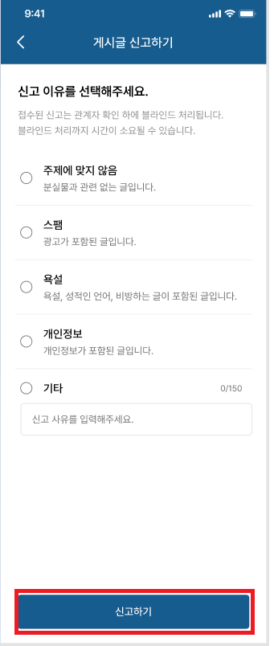
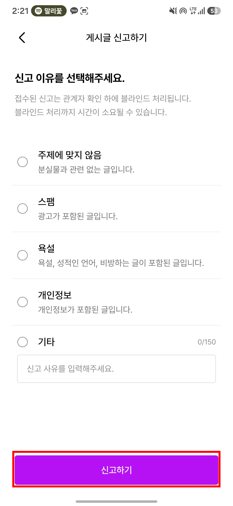

# 11-14.분실물_게시글신고하기_신고하기_클릭

원문 페이지 ID: ad60221954bc8236855581b2e7057454

> 원문 스냅샷. 명세 확정·앱 배포·수집 완료를 뜻하지 않습니다.

## 원문 속성

```json
{
  "platform": [
    "ANDROID",
    "IOS",
    "WEB"
  ],
  "url": "source-page-id:ad60221954bc8236855581b2e7057454",
  "상태": "완료",
  "이름": "11-14.분실물\\_게시글신고하기\\_신고하기\\_클릭",
  "태그": [
    "11.분실물"
  ]
}
```

<details>
<summary>과거 로깅</summary>

- 설명:  게시글 신고하기에서 신고하기 버튼 클릭
- event\_label : “item\_post\_report\_confirm”
- value : <s>\{”주제에 맞지 않음”, ”스팸”, ”욕설”, ”개인정보”, ”기타”\} 5가지 값중 선택된 값을 추가</s>

→ value : “신고하기”

- event\_category : “click”
- 참고사진



WEB


Mobile\_Web\_VIEW


</details>

<details>
<summary>새 로깅</summary>

- 설명: 게시글 신고하기에서 신고하기 버튼 클릭
- screen\_view: <code>lost_item_report</code>
- event\_name: <code>DA2</code>
- event\_label: <code>board__lost_item_report__lost_item_report__submit</code>
- value: 신고하기
- event\_category: <code>submit</code>

### 참고사진 (기능 표시)

<columns>
<column ratio="50">
<b>웹</b>

<b>참고사진 · 웹</b>

PC 웹 — 신고 모달 제출 (기존 로깅 캡처)


</column>
<column ratio="50">
<b>모바일</b>

<b>참고사진 · 모바일</b>

모바일 — 별도 신고 화면의 신고하기


</column>
</columns>
</details>
