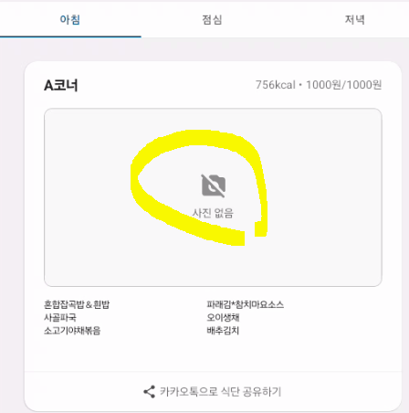
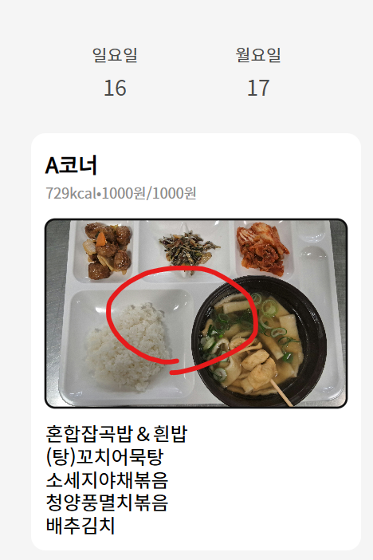
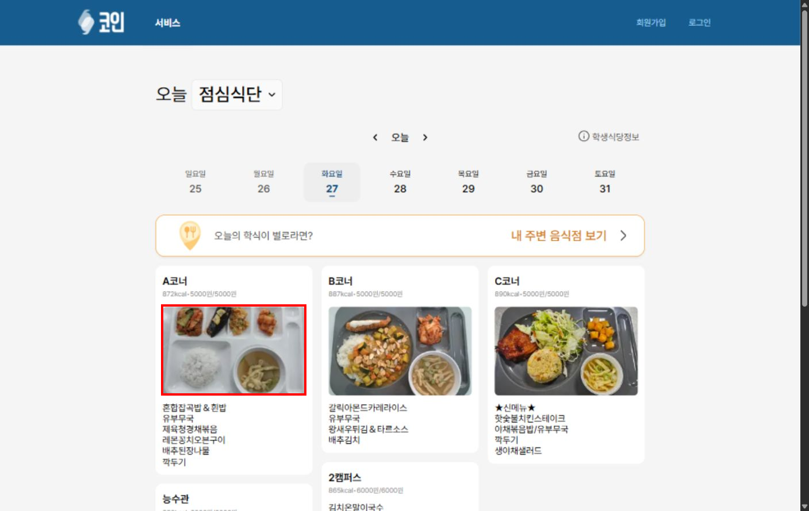
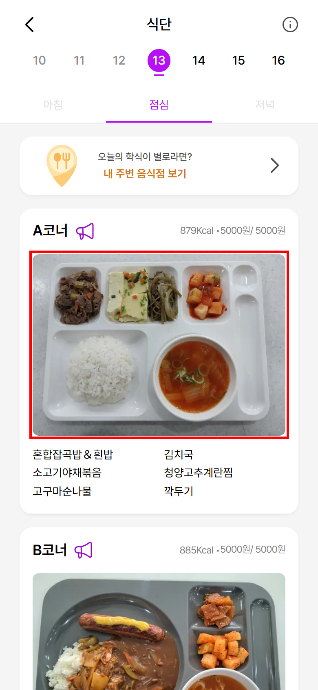

# 4-1. 식단_코너 사진_클릭

원문 페이지 ID: ae70221954bc83039c5401fa69a8ab05

> 누락 원본 복구 스냅샷. 원본의 과거값·검토 기록을 보존하며 생성 계약으로 자동 승인하지 않습니다.

대조 기록: [87개 원본 복구 및 8개 차이 정리](../recovery-review.md)

관련 기존 보관본: [4-1. 식단_코너 사진_클릭](b3d0221954bc828fbdf7014674efb010.md)

## 원문 속성

```json
{
  "platform": [
    "ANDROID",
    "IOS",
    "WEB"
  ],
  "url": "source-page-id:ae70221954bc83039c5401fa69a8ab05",
  "상태": "완료",
  "생성일": "2026-11-08T10:51:37.464Z",
  "이름": "4-1. 식단\\_코너 사진\\_클릭",
  "태그": [
    "4. 식단 상세_사진"
  ]
}
```

<details>
<summary>이전 로깅</summary>


- 설명 : 식단페이지에서 아침 A코너 사진 클릭
- event\_label : “menu\_image”
- value : “아침\_A코너<b>”</b>
- event\_category : “click”
- 참고사진





- 웹





</details>


<details>
<summary>새 로깅 (26.10.17)</summary>


- 설명: 식단 화면에서 코너의 식단 사진을 클릭하는 경우
- screen\_view: <code>cafeteria</code>
- event\_name: <code>DA1</code>
- event\_label: <code>cafeteria__cafeteria__photo_view__open__click</code>
- value: \{식사 시간\}\_\{코너\} (예: 아침\_A코너)
- event\_category: <code>click</code>

<details>
<summary>검토사항</summary>


- 통합 가이드·후속: [로깅 통합 가이드](3c30221954bc8214b1c481c5bbb6fba5.md)
- 웹 참고사진 추가 완료 (stage 캡처에 빨간 네모, 2026-10-28)
- label DA2 기준 정렬 (2026-10-27): <code>cafeteria__cafeteria__photo__click</code> → <code>cafeteria__cafeteria__photo_view__open__click</code>

</details>


### 참고사진 (코너 사진 클릭)


<b>웹</b>

<details>
<summary>참고사진 · 웹</summary>





WEB · 빨간 네모: 식단 코너 사진 클릭. stage 실제 화면 캡처에 위치 표시.


</details>


<b>모바일</b>

<details>
<summary>참고사진 · 모바일</summary>


모바일 — 코너 식단 사진 클릭 (출처: stage 실제 캡처, 빨간 네모 = 클릭 위치)





</details>


</details>
