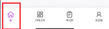

# 2-1 네비게이션 바 홈 클릭 

원문 페이지 ID: aef0221954bc826481d601be32054523

> 원문 스냅샷. 명세 확정·앱 배포·수집 완료를 뜻하지 않습니다.

## 원문 속성

```json
{
  "platform": [
    "ANDROID",
    "IOS",
    "WEB (모바일)"
  ],
  "url": "source-page-id:aef0221954bc826481d601be32054523",
  "구분": "네비게이션 바",
  "상태": "완료",
  "생성일": "2026-11-12T05:08:01.512Z",
  "이벤트 이름": "<p>\n2-1 네비게이션 바 홈 클릭 \n</p>"
}
```

<details>
<summary>과거 로깅</summary>

- event\_label : nav\_home
- value : 홈
- event\_category : click





</details>

<details>
<summary>새 로깅</summary>

<b>홈</b>

- 설명: 공용 하단 네비게이션 바에서 홈 항목을 클릭할 때 기록한다.
- screen\_view: <code>main</code>
- event\_name: <code>DA2</code>
- event\_label: <code>main__main__navigation__main_entry__click</code>
- value: 홈
- event\_category: <code>click</code>
</details>
