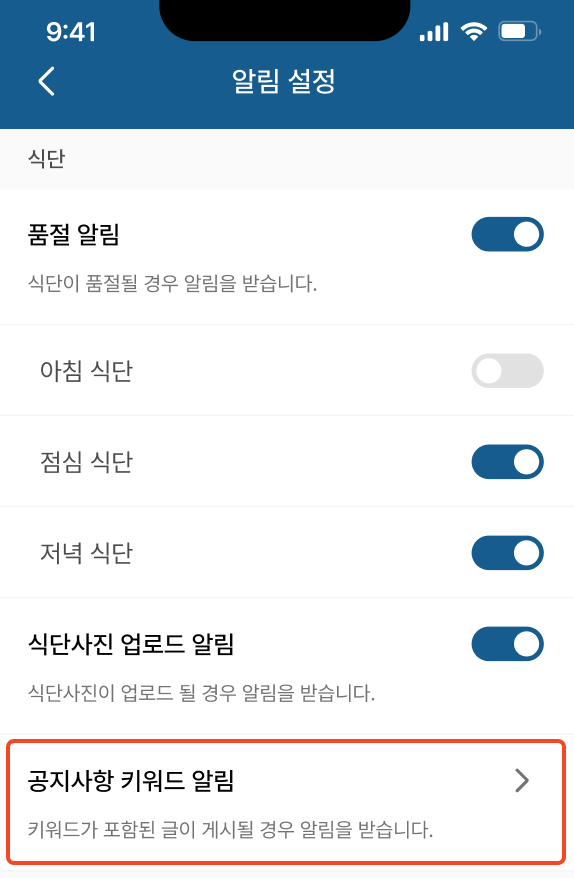

# 7-9. 알림설정_공지사항 키워드 알림_클릭

원문 페이지 ID: af30221954bc83cf83db0147d223ce81

> 누락 원본 복구 스냅샷. 원본의 과거값·검토 기록을 보존하며 생성 계약으로 자동 승인하지 않습니다.

대조 기록: [87개 원본 복구 및 8개 차이 정리](../recovery-review.md)

관련 기존 보관본: [7-9. 알림설정_공지사항 키워드 알림_클릭](44b0221954bc83669fd4013b52482bfb.md), [7-9. 알림설정_공지사항 키워드 알림_클릭](bc70221954bc82ebb8a001134a251684.md)

## 원문 속성

```json
{
  "platform": [
    "ANDROID",
    "IOS"
  ],
  "url": "source-page-id:af30221954bc83cf83db0147d223ce81",
  "상태": "완료",
  "이름": "7-9. 알림설정\\_공지사항 키워드 알림\\_클릭"
}
```

<ul>
<li>
설명 : <u>공지사항/키워드</u> 관리 페이지로 이동
</li>
<li>

주의사항
 : 클릭 가능한 모든 요소(텍스트, 화살표) 로깅
</li>
<li>
event\_label : “notification\_manage\_keyword”
</li>
<li>
value : “공지사항 키워드 알림<b>”</b>
</li>
<li>
event\_category : “click” 
</li>
<li>
참고사진





</li>
</ul>
