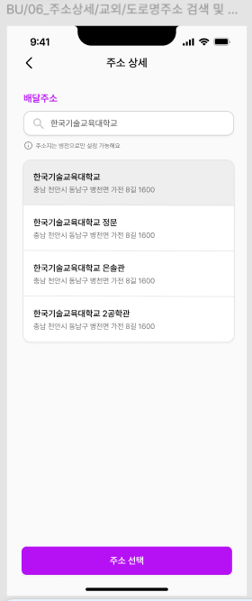

# 7-10 결제 → 교외 주문 페이지 주소 선택 (6월 29일 수정)

원문 페이지 ID: afc0221954bc82b3821b018ef3086267

> 원문 스냅샷. 명세 확정·앱 배포·수집 완료를 뜻하지 않습니다.

## 원문 속성

```json
{
  "platform": [
    "WEB"
  ],
  "url": "source-page-id:afc0221954bc82b3821b018ef3086267",
  "상태": "로깅 필요",
  "생성일": "2026-11-08T10:51:31.994Z",
  "이벤트 이름": "7-10 결제 → 교외 주문 페이지 주소 선택 (6월 29일 수정)",
  "태그": [
    "7. 결제 페이지"
  ]
}
```




하단의 주소 선택 버튼 클릭 시 찍히는 로깅입니다


<span color="orange">event\_params.key</span>

<ul>
<li>
event\_label : payment\_off\_campus\_addressClick
</li>
<li>
value : 주소명
</li>
<li>
event\_category : 

<ul>
<li>
click 
</li>
</ul>
</li>
</ul>
