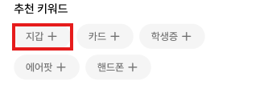
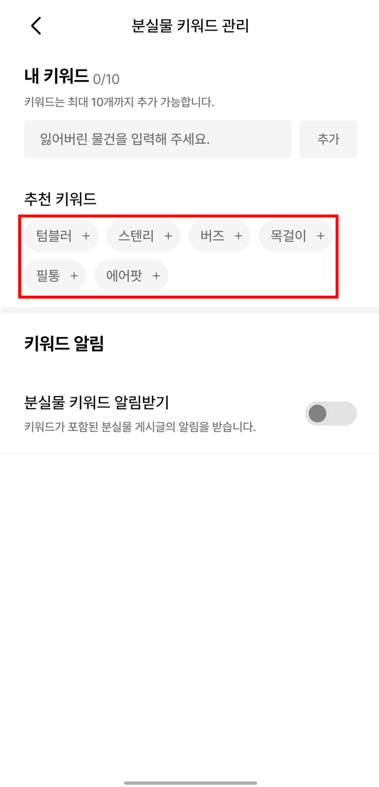

# 12-3. 추천 키워드_클릭

원문 페이지 ID: b050221954bc825aaec701909e8386e1

> 원문 스냅샷. 명세 확정·앱 배포·수집 완료를 뜻하지 않습니다.

## 원문 속성

```json
{
  "platform": [
    "ANDROID",
    "IOS"
  ],
  "url": "source-page-id:b050221954bc825aaec701909e8386e1",
  "상태": "로깅 필요",
  "이름": "12-3. 추천 키워드\\_클릭",
  "태그": [
    "12. 분실물 키워드"
  ]
}
```

<details>
<summary>이전 로깅</summary>

- 설명: 추천 키워드에 있는 키워드 클릭
- event\_label: “lost\_item\_keyword\_recommend”
- value: \{”지갑”, ”카드”, ”학생증”, ”에어팟”, ”핸드폰”\} 5가지 값을 추가
- event\_category: “click”
- 참고사진


</details>

<details>
<summary>새 로깅 (26.10.12) — 초안</summary>

- 설명: 추천 목록에서 키워드를 선택하는 순간 실제 선택한 키워드를 전송한다. 추천 목록은 바뀔 수 있다.
- screen\_view: <code>lost_item_keyword_manage</code>
- event\_name: <code>DA2</code>
- event\_label: <code>board__lost_item_keyword_manage__keyword_manage__recommended_keyword__select</code>
- value: <code>{클릭한 추천 키워드}</code> — 동적 STRING. 클릭한 시점에 화면에 표시된 추천 키워드를 매핑해 전송하며 고정 다섯 값으로 제한하지 않는다.
- event\_category: <code>select</code>

<details>
<summary>검토사항</summary>

- label 통일 (2026-10-27): <code>board__lost_item_keyword_manage__keyword_manage__recommended_keyword_select</code> → <code>board__lost_item_keyword_manage__keyword_manage__recommended_keyword__select</code>
</details>

### 참고사진 (기능 표시)

<columns>
<column ratio="50">
<b>웹</b>

화면 정의에 웹 화면 없음.
</column>
<column ratio="50">
<b>모바일</b>

<details>
<summary>참고사진 · 모바일</summary>

모바일 — 추천 키워드


</details>
</column>
</columns>
</details>
