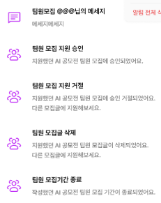

# 1-2 알림 클릭 내부

원문 페이지 ID: b070221954bc83b8a6ba81237e905425

> 원문 스냅샷. 명세 확정·앱 배포·수집 완료를 뜻하지 않습니다.

## 원문 속성

```json
{
  "title": "1-2 알림 클릭 내부"
}
```

- event\_label : notification\_list
- value : \{콜벤팟\} or \{천원의 아침\} or \{게시판\} or \{팀원모집 @@@님의 메시지\} 등등 제목에 맞게 해주시면 됩니다
- event\_category : click





