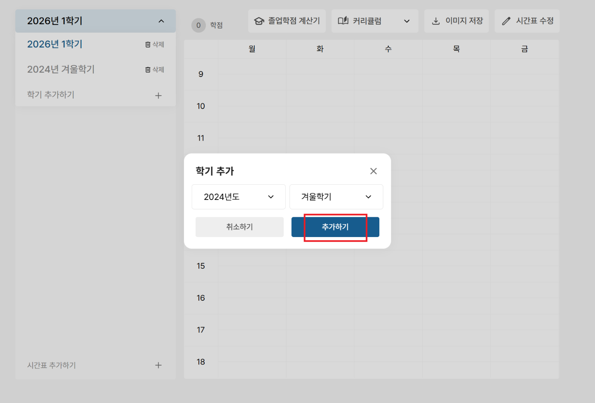
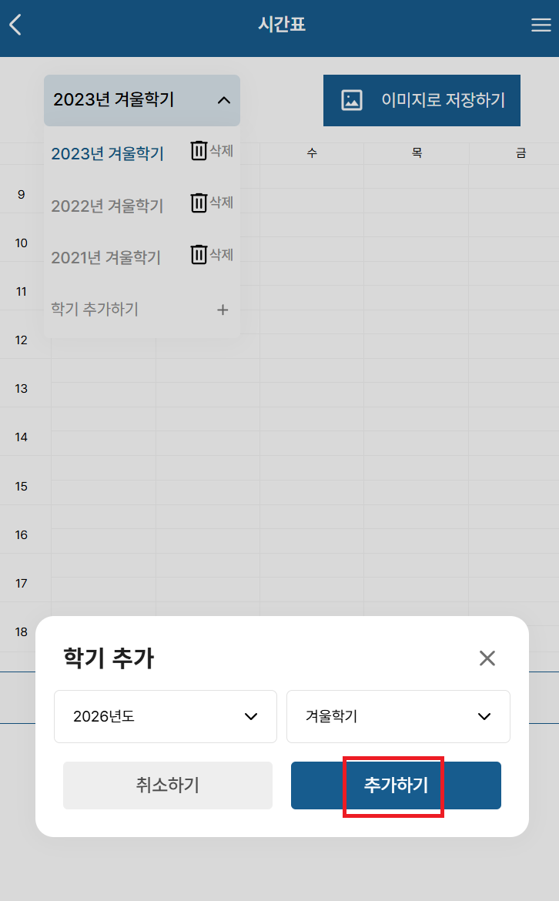
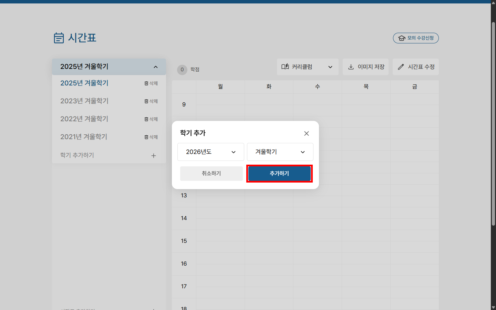
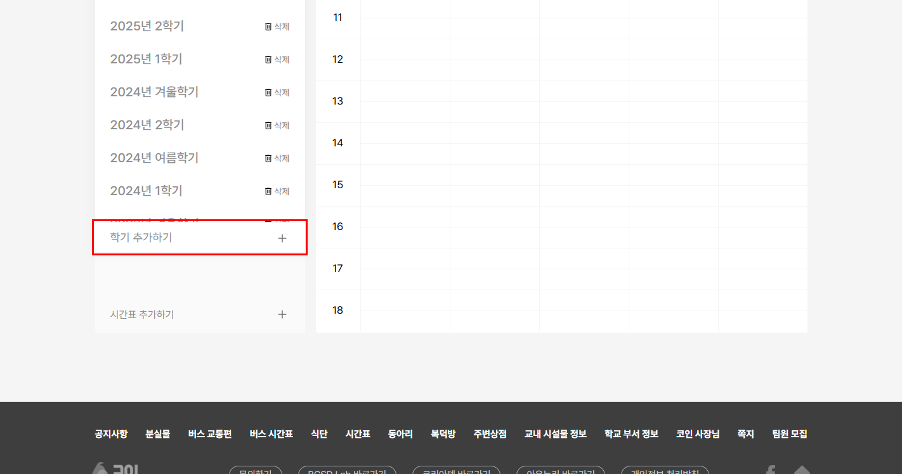
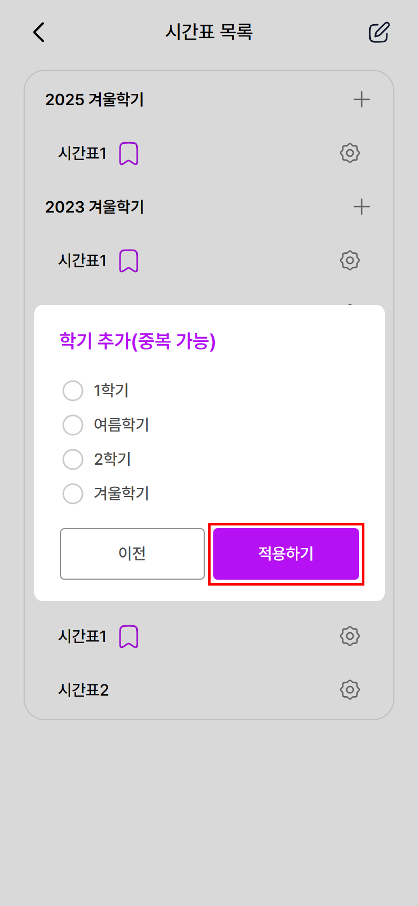

# 2-13. (웹, 반응형 앱) 시간표_학기 추가 (클릭)

원문 페이지 ID: b120221954bc833aacc381d3ebdcd8bf

> 원문 스냅샷. 명세 확정·앱 배포·수집 완료를 뜻하지 않습니다.

## 원문 속성

```json
{
  "platform": [
    "ANDROID",
    "IOS",
    "WEB"
  ],
  "url": "source-page-id:b120221954bc833aacc381d3ebdcd8bf",
  "상태": "로깅 필요",
  "생성일": "2026-11-08T10:51:27.946Z",
  "이벤트 이름": "2-13. (웹, 반응형 앱) 시간표\\_학기 추가 (클릭)",
  "태그": [
    "시간표"
  ]
}
```

<details>
<summary>이전 로깅</summary>

- event\_label : “timetable”
- value : “semester\_add”
- event\_category : “click”
- 참고 이미지

<details>
<summary>웹</summary>


</details>

<details>
<summary>앱</summary>


</details>
</details>

<details>
<summary>새 로깅 (26.10.17)</summary>

- 설명: 웹 시간표 화면 학기 드롭다운 맨 아래 '학기 추가하기' → 학기 추가 팝업에서 연도·학기를 고르고 추가하기를 누르는 경우 (모바일은 시간표 목록 화면 오른쪽 위 학기 편집에서 추가)
- screen\_view: <code>timetable</code>
- event\_name: <code>DA1</code>
- event\_label: <code>timetable__timetable__semester_manage__edit_apply__click</code>
- value: 웹 \{연도\}\_\{학기\} (예: 2026\_겨울학기) / 모바일 \{추가 또는 삭제\}\_\{연도\}\_\{학기\}, 여러 학기를 한 번에 바꾸면 쉼표로 이음 (예: 추가\_2026\_겨울학기) · 모바일은 적용하기 한 번에 추가와 삭제가 같이 처리되는 구조라 라벨을 하나로 합침 (2-14와 같은 라벨)
- event\_category: <code>click</code>

<details>
<summary>검토사항</summary>

- 웹·모바일 공통 계약 (2026-11-05 사용자 승인): 같은 기능의 screen\_view와 event\_label은 플랫폼과 관계없이 아래 공통값을 사용한다. 기존 플랫폼별 화면명 유지 지시는 이 결정으로 대체한다. 플랫폼은 기존 DB 속성으로 구분하며 value·event\_name·event\_category·기존 전송 시점·이전 로깅·사진은 유지한다. 실제 SDK 적용·배포·단일 전송은 미확인이다. 공통값: <code>timetable</code> / <code>timetable__timetable__semester_manage__edit_apply__click</code>. 학기 편집의 추가·삭제 확정/적용을 공통 계약으로 묶는다. 대표 명세는 [2-13. (웹, 반응형 앱) 시간표_학기 추가 (클릭)](b120221954bc833aacc381d3ebdcd8bf.md)이며 [2-14. (웹, 반응형 앱) 시간표_학기 삭제_확정 (클릭)](21b0221954bc821b934c01419c9752cd.md)는 삭제 경로 설명이다. 모바일에서 추가·삭제를 한 번에 적용하면 1개 이벤트만 전송한다. WEB의 기존 value는 연도·학기만 포함하므로 이 공통 라벨과 value만으로 추가/삭제를 구별할 수 없고, value 변경은 이번 범위에 포함하지 않는다.
- 통합 가이드·후속: [로깅 통합 가이드](3c30221954bc8214b1c481c5bbb6fba5.md)
- 모바일: stage 모바일 웹은 학기 편집 → 연도 선택 → 학기 체크 → 적용하기 방식
- label DA2 기준 정렬 (2026-10-27): <code>timetable__timetable__semester_add__click</code> → <code>timetable__timetable__semester_manage__add__click</code>
- label DA2 기준 정렬 (2026-10-27): <code>timetable__timetable_list__semester_edit__apply__click</code> → <code>timetable__timetable_list__semester_manage__edit_apply__click</code>
- 이전 플랫폼 분리안 (2026-11-05 공통 계약으로 대체됨) (2026-10-27): <code>timetable__timetable_list__semester_manage__edit_apply__click</code>의 기준 명세는 [2-13. (웹, 반응형 앱) 시간표_학기 추가 (클릭)](b120221954bc833aacc381d3ebdcd8bf.md). 모바일 학기 편집 적용 한 번에 추가·삭제를 함께 처리한다. 웹의 추가·삭제 라벨은 각각 유지한다. 같은 사용자 동작은 한 번만 전송하며, 문서가 여러 개라는 이유로 추가 이벤트를 보내지 않는다. 기존 value·플랫폼·발생 시점은 유지한다.
</details>

### 참고사진 (기능 표시)

<columns>
<column ratio="50">
<b>웹</b>

<details>
<summary>참고사진 · 웹</summary>

웹 — 학기 추가 팝업의 추가하기 (출처: stage 실제 캡처, 로그인 상태, 빨간 네모 = 클릭 위치)



웹 — 학기 추가 버튼 (출처: stage 실제 캡처, 빨간 네모 = 학기 추가 팝업을 여는 버튼)


</details>
</column>
<column ratio="50">
<b>모바일</b>

<details>
<summary>참고사진 · 모바일</summary>

모바일 — 학기 편집 → 연도 선택 → 다음 → 학기 추가(중복 가능)에서 학기를 고르고 적용하기 (출처: stage 실제 캡처, 로그인 상태, 빨간 네모 = 클릭 위치)


</details>
</column>
</columns>
</details>
