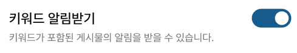
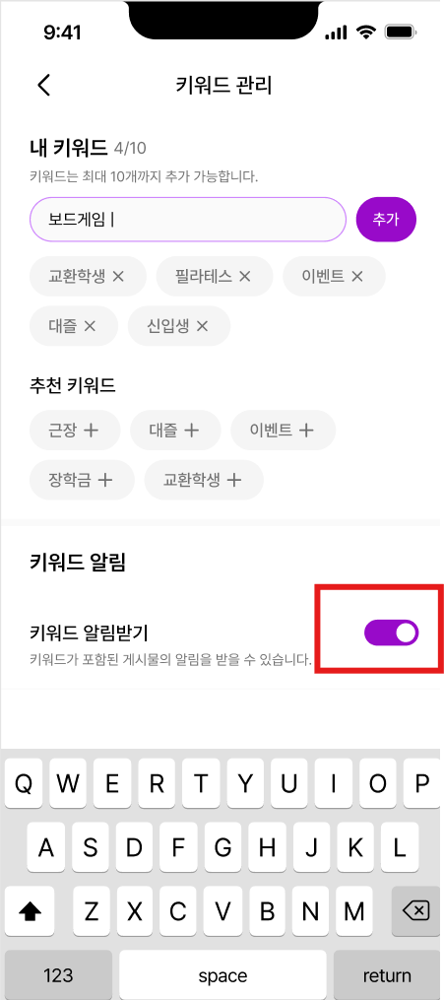

# 7-8. 키워드 알림받기_토글

원문 페이지 ID: b190221954bc83039ca4016d14761051

> 원문 스냅샷. 명세 확정·앱 배포·수집 완료를 뜻하지 않습니다.

## 원문 속성

```json
{
  "platform": [
    "ANDROID",
    "IOS"
  ],
  "url": "source-page-id:b190221954bc83039ca4016d14761051",
  "상태": "로깅 필요",
  "이름": "7-8. 키워드 알림받기\\_토글",
  "태그": [
    "7. 키워드 관리(APP)"
  ]
}
```

<details>
<summary>이전 로깅</summary>



- 주의 사항 : <b>로그인 시</b>에만 ON 가능


</details>

<details>
<summary>새 로깅 (26.10.05) — 초안</summary>

- 설명: 키워드 관리 화면에서 키워드 알림받기 상태 변경.
- screen\_view:<code>notice_keyword_manage</code>
- event\_name: <code>DA2</code>
- event\_label: <code>board__notice_keyword_manage__keyword_manage__notification__toggle</code>
- value: 알림 켜기 또는 알림 끄기
- event\_category: <code>toggle</code>

<details>
<summary>검토사항</summary>

- label 통일 (2026-10-27): <code>board__notice_keyword_manage__keyword_manage__notification_toggle</code> → <code>board__notice_keyword_manage__keyword_manage__notification__toggle</code>
</details>

<details>
<summary>참고사진 · 모바일</summary>

<b>모바일</b>


</details>
</details>
