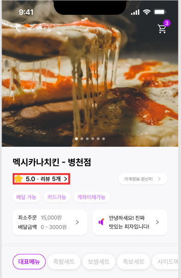

# 4-1 상점상세 리뷰 (클릭) 

원문 페이지 ID: b240221954bc82bca989014ef1bf9231

> 원문 스냅샷. 명세 확정·앱 배포·수집 완료를 뜻하지 않습니다.

## 원문 속성

```json
{
  "platform": [
    "ANDROID",
    "IOS",
    "WEB"
  ],
  "url": "source-page-id:b240221954bc82bca989014ef1bf9231",
  "상태": "완료",
  "생성일": "2026-11-12T05:07:39.731Z",
  "이벤트 이름": "<p>\n4-1 상점상세 리뷰 (클릭) \n</p>",
  "태그": [
    "4. 리뷰 페이지"
  ]
}
```




<span color="orange">event\_params.key</span>

<ul>
<li>
event\_label : shop\_detail\_view\_review
</li>
<li>
value : \{상점이름\} 
</li>
<li>
event\_category : click
</li>
</ul>


---


