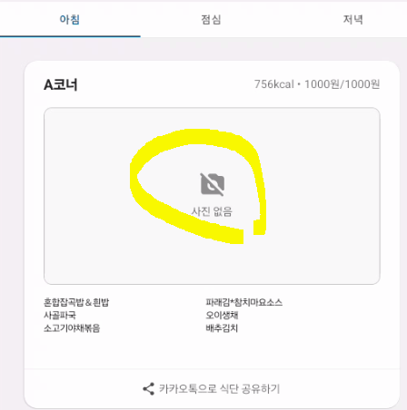
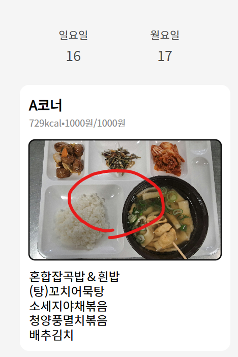
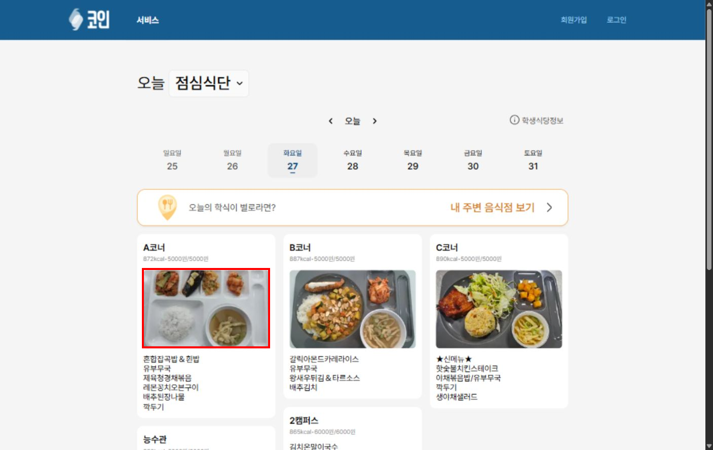
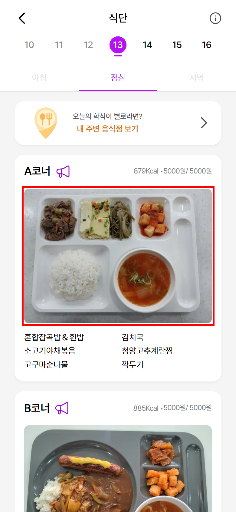

# 4-1. 식단_코너 사진_클릭

원문 페이지 ID: b3d0221954bc828fbdf7014674efb010

> 원문 스냅샷. 명세 확정·앱 배포·수집 완료를 뜻하지 않습니다.

## 원문 속성

```json
{
  "platform": [
    "ANDROID",
    "IOS",
    "WEB"
  ],
  "url": "source-page-id:b3d0221954bc828fbdf7014674efb010",
  "상태": "완료",
  "생성일": "2026-11-12T05:07:48.971Z",
  "이름": "4-1. 식단\\_코너 사진\\_클릭",
  "태그": [
    "4. 식단 상세_사진"
  ]
}
```

<details>
<summary>과거 로깅</summary>

- 설명 : 식단페이지에서 아침 A코너 사진 클릭
- event\_label : “menu\_image”
- value : “아침\_A코너<b>”</b>
- event\_category : “click”
- 참고사진



- 웹


</details>

<details>
<summary>새 로깅</summary>

- 설명: 식단 화면에서 코너의 식단 사진을 클릭하는 경우
- screen\_view: <code>cafeteria</code>
- event\_name: <code>DA1</code>
- event\_label: <code>cafeteria__cafeteria__photo_view__open__click</code>
- value: \{식사 시간\}\_\{코너\} (예: 아침\_A코너)
- event\_category: <code>click</code>

### 참고사진 (코너 사진 클릭)

<columns>
<column ratio="50">
<b>웹</b>

<b>참고사진 · 웹</b>





WEB · 빨간 네모: 식단 코너 사진 클릭. stage 실제 화면 캡처에 위치 표시.

</column>
<column ratio="50">
<b>모바일</b>

<b>참고사진 · 모바일</b>

모바일 — 코너 식단 사진 클릭 (출처: stage 실제 캡처, 빨간 네모 = 클릭 위치)


</column>
</columns>
</details>
