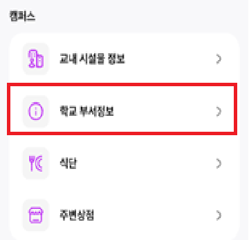
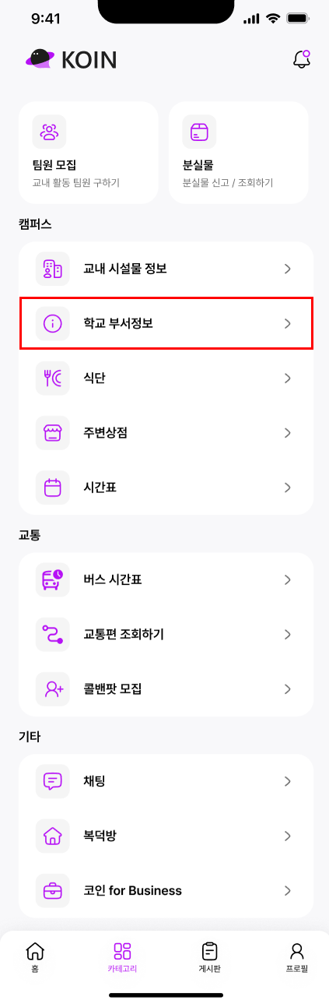

# [레거시] 1-0-2 학교 부서정보 접근 (카테고리 진입)

원문 페이지 ID: b3e0221954bc8207884301a20c45b662

> 원문 스냅샷. 명세 확정·앱 배포·수집 완료를 뜻하지 않습니다.

## 원문 속성

```json
{
  "platform": [
    "ANDROID",
    "IOS"
  ],
  "url": "source-page-id:b3e0221954bc8207884301a20c45b662",
  "구분": "학교 부서정보",
  "상태": "레거시",
  "생성일": "2026-11-08T10:52:07.459Z",
  "이벤트 이름": "\\[레거시\\] 1-0-2 학교 부서정보 접근 (카테고리 진입)"
}
```

<callout icon="📁" color="gray_bg">
<b>레거시 보존 · 현행 기준은 홈화면 리디자인</b>

- 2026-11-05 사용자 지시: 홈화면 리디자인의 로깅은 모두 유지하고, 겹치는 다른 서비스 명세를 레거시로 보존한다.
- 카테고리 학교 부서 정보의 현행 기준: [3-6 카테고리 내부 클릭 (현재 로깅) 2026.08.30 이후 찍히는 로깅](bb10221954bc8337aae781494584adee.md).
- 이 페이지는 별도 신규 구현·추가 전송 대상이 아니다. 아래 라벨·value·category·event\_name·screen\_view·사진·플랫폼과 이전 로깅은 이력으로 보존한다.
- 이전의 ‘이 페이지가 대표’·‘두 문서 별개 유지’·‘같은 라벨 문서 계약’ 설명은 이 최신 결정으로 대체한다. 홈 명세의 라벨·값·필드는 이번 작업에서 변경하지 않는다.
- 실제 SDK의 옛 라벨 중단·전환·단일 전송은 미확인이다. 이 문서 정리는 운영 코드나 데이터의 삭제·변경을 뜻하지 않는다.
</callout>

<details>
<summary>이전 로깅</summary>

- event\_label : category\_campus
- value : 학교 부서정보
- event\_category : click





</details>

<details>
<summary>이관 전 새 로깅 (2026-10-15) — 수정 초안 — 레거시 보존</summary>

- 설명: 앱 카테고리 화면에서 학교 부서정보를 클릭한다.
- screen\_view: <code>main_category</code>
- event\_label: <code>department__main_category__department_entry__category_entry__click</code>
- event\_name: <code>DA2</code>
- event\_category: <code>click</code>
- value: 학교 부서정보

<details>
<summary>검토사항</summary>

- 통합 가이드·후속: [로깅 통합 가이드](3c30221954bc8214b1c481c5bbb6fba5.md)
- label 통일 (2026-10-27): <code>department__main_category__department_entry__category_entry</code> → <code>department__main_category__department_entry__category_entry__click</code>
- 공통 대응 문서: [3-6 카테고리 내부 클릭 (현재 로깅) 2026.08.30 이후 찍히는 로깅](bb10221954bc8337aae781494584adee.md). 사용자 확정: 1-0-2는 학교 부서 서비스 진입, 링크한 3-6은 공용 카테고리 메뉴 클릭 명세로 별개 유지한다. 기능명 department\_entry와 category\_navigation으로 구분하며 한쪽을 합치거나 대체하지 않는다. 1-1 부서 내부 분류 선택도 별개다. 기존 value 공백 차이는 유지하고 실제 수집 검수는 후속 작업이다.
</details>

<details>
<summary>참고사진 (기능 표시)</summary>

<b>모바일 (ANDROID, IOS) / 캡처 출처는 아래 참조</b>

화면 정의에 제공된 카테고리 캡처. 실제 Android 캡처 출처는 미확인; 메뉴 위치 참고.


</details>
</details>
