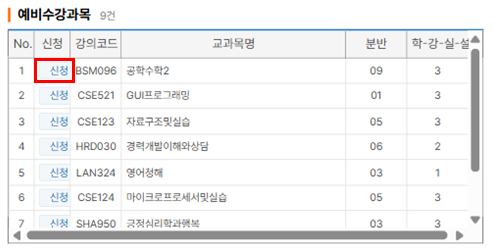

# 1-4. 모의수강신청_예비수강과목 신청 클릭

원문 페이지 ID: b430221954bc8256803481c7e8fddcd7

> 원문 스냅샷. 명세 확정·앱 배포·수집 완료를 뜻하지 않습니다.

## 원문 속성

```json
{
  "platform": [
    "WEB"
  ],
  "url": "source-page-id:b430221954bc8256803481c7e8fddcd7",
  "상태": "로깅 필요",
  "이름": "1-4. 모의수강신청\\_예비수강과목 신청 클릭",
  "태그": [
    "1. 모의수강신청_메인화면"
  ]
}
```

<details>
<summary>이전 로깅</summary>

<ul>
<li>
event\_label : “application\_training<span color="blue">\_pre\_apply</span>” 
</li>
<li>
value: 
</li>
<li>
event\_category : “click”
</li>
<li>
참고 이미지
</li>
</ul>


</details>

<details>
<summary>새 로깅 (2026-10-14) — 초안</summary>

- 설명: 모의수강신청 화면의 예비수강과목에서 신청 버튼을 클릭한다.
- screen\_view: <code>course_practice</code>
- event\_label: <code>course_practice__course_practice__course_application__preselected__click</code>
- event\_name: <code>DA2</code>
- value: 기존 미기재 유지
- event\_category: <code>click</code>

<details>
<summary>검토사항</summary>

- 방식 A 반영 (2026-10-28 사용자 확인): 승인된 기존 event\_category <code>click</code>을 복원하고 label 마지막 구간을 일치시켰다. <code>course_practice__course_practice__course_application__preselected__submit</code> → <code>course_practice__course_practice__course_application__preselected__click</code>. label 끝에 맞춰 category를 바꾼 과거 후속 메모는 이 결정으로 대체한다. 기존 value·event\_name·플랫폼·전송 시점은 유지하며 성공/실패 이벤트를 새로 만들지 않는다.
- 통합 가이드·후속: [로깅 통합 가이드](3c30221954bc8214b1c481c5bbb6fba5.md)
- 2026-10-15 로그인 후 실제 WEB에서 예비수강과목 영역과 각 과목의 ‘신청’ 버튼을 확인했다. 수강 신청을 실행하지 않았으며 실제 이벤트 전송·수집 검수는 후속 작업이다.
- label 통일 (2026-10-27): <code>course_practice__course_practice__course_application__preselected_submit</code> → <code>course_practice__course_practice__course_application__preselected__submit</code>
- 승인 category 복원 확인 (2026-10-28): 이전 사용자 방식 A 승인에 따라 기존 click을 유지한다. label 끝 단어만 click에 맞추며, category를 select/submit/toggle로 변경하라는 과거 후속 메모는 철회한다.
</details>

### 참고사진 (기능 표시)

<b>웹(데스크톱)</b>

<details>
<summary>참고사진 · 웹</summary>

기존 웹 명세 캡처 사본. 예비수강과목 영역과 신청 버튼은 2026-10-15 로그인 후 실제 WEB에서도 확인했다. 아래 사진 자체는 기존 자료다.


</details>
</details>
