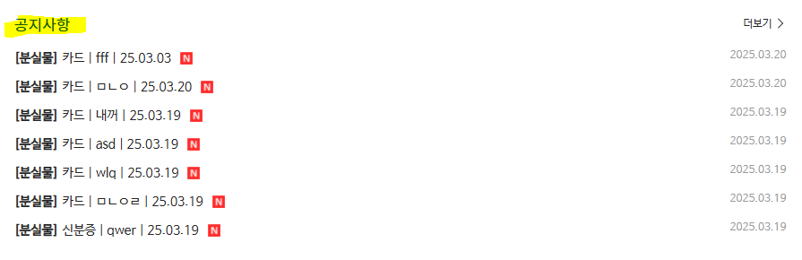
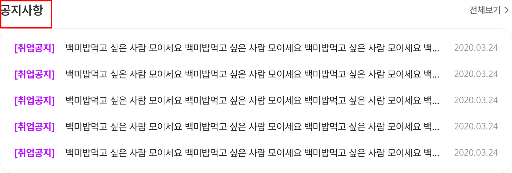

# 1-2. 메인_공지사항_클릭

원문 페이지 ID: b460221954bc821a999581d6a89b423f

> 원문 스냅샷. 명세 확정·앱 배포·수집 완료를 뜻하지 않습니다.

## 원문 속성

```json
{
  "platform": [
    "WEB"
  ],
  "url": "source-page-id:b460221954bc821a999581d6a89b423f",
  "상태": "로깅 필요",
  "이름": "1-2. 메인\\_공지사항\\_클릭",
  "태그": [
    "1. 메인_공지사항"
  ]
}
```

<details>
<summary>과거 로깅</summary>

- 설명: 메인 화면 공지사항의 더보기 버튼 클릭
- event\_label : “main\_notice\_detail”
- value : “공지사항”
- event\_category : “click”
- 참고사진



</details>

<details>
<summary>새 로깅</summary>

- 설명: 메인 화면 공지사항 영역의 제목(공지사항) 클릭.
- screen\_view: <code>main</code>
- event\_name: <code>DA2</code>
- event\_label: <code>board__main__notice_entry__title_entry__click</code>
- value: 공지사항
- event\_category: <code>click</code>

### 참고사진 (홈 공지사항 → 영역 제목 · WEB 리디자인)

<b>웹</b>

<b>참고사진 · 웹</b>

홈 공지사항 → 영역 제목. 출처: [Figma WEB 리디자인](https://www.figma.com/design/DPlcYuiFxhyT5ULbqec59i/KOIN-Web?node-id=11541-33352), 2026-11-04 원본 캡처에 코드로 빨간 네모만 추가. 빨간 네모는 기존 명세가 지칭하는 제목 위치이다. 리디자인에서 제목 자체의 클릭 가능 여부·SDK 적용은 미확인이다.


</details>
