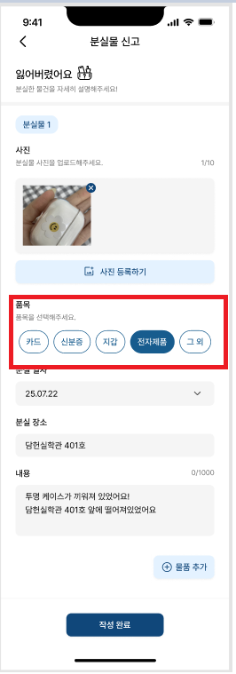

# 11-9.분실물_분실물신고_품목선택_클릭

원문 페이지 ID: b5d0221954bc82e18ecc0150291b98ab

> 사용자 제공 ZIP 내보내기 보관본. 레거시·동결·검토 상태는 원문을 따르며 코드 생성 승인·앱 배포 완료를 뜻하지 않습니다.

platform: ANDROID, IOS, WEB
상태: 완료

- 설명: 분실물 신고 글쓰기 페이지에서 특정 품목을 클릭
- event_label : “lost_item_category”
- value :  {”카드”, ”신분증”, ”지갑”, ”전자제품”, ”~~그 외~~”} 5가지 값을 추가
- → “그 외”를 “기타”로 변경(2025-02-23)
- event_category : “click”
- 참고사진

mobile_view, mobile_Web_view

WEB : 예시 화면이 습득물 신고인데 분실물 신고랑 기능이 동일해서 넣었습니다.

