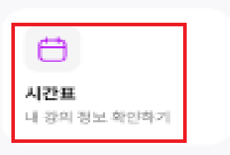

# 3-1 시간표 클릭 (과거 로깅) 2026.08.30 이후 로깅 중단

원문 페이지 ID: b5e0221954bc820b9fd481634721e54e

> 원문 스냅샷. 명세 확정·앱 배포·수집 완료를 뜻하지 않습니다.

## 원문 속성

```json
{
  "platform": [
    "ANDROID",
    "IOS",
    "WEB"
  ],
  "url": "source-page-id:b5e0221954bc820b9fd481634721e54e",
  "구분": "카테고리",
  "상태": "완료",
  "생성일": "2026-11-08T10:52:04.217Z",
  "이벤트 이름": "3-1 시간표 클릭 (과거 로깅) 2026.08.30 이후 로깅 중단"
}
```

- event\_label : category\_timetable
- value : 시간표
- event\_category : click





