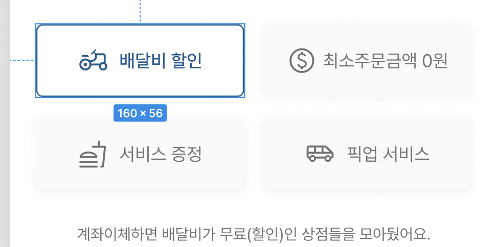
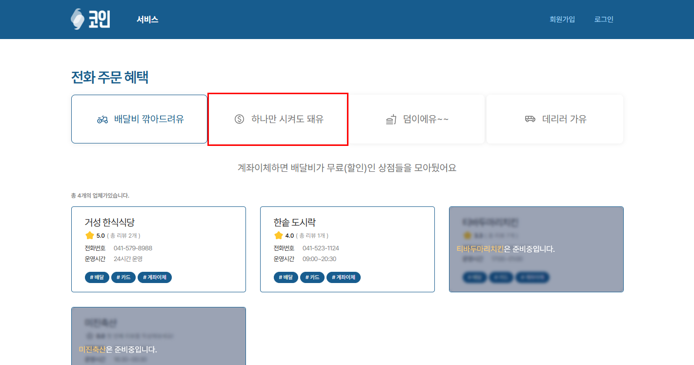
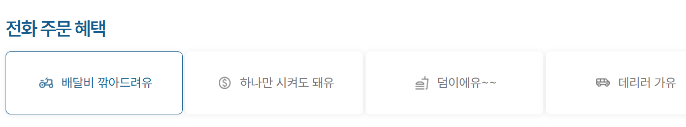

# 4-2 전화 주문 혜택 페이지 버튼 → 버튼 

원문 페이지 ID: b630221954bc82ff8d7781488310e943

> 원문 스냅샷. 명세 확정·앱 배포·수집 완료를 뜻하지 않습니다.

## 원문 속성

```json
{
  "platform": [
    "WEB",
    "ANDROID",
    "IOS"
  ],
  "url": "source-page-id:b630221954bc82ff8d7781488310e943",
  "상태": "완료",
  "생성일": "2026-11-08T10:51:47.004Z",
  "이벤트 이름": "<p>\n4-2 전화 주문 혜택 페이지 버튼 → 버튼 \n</p>",
  "태그": [
    "4. 혜택 페이지"
  ]
}
```

<details>
<summary>이전 로깅</summary>

<span color="orange">event\_params.key</span>

<ul>
<li>
event\_label : benefit\_shop\_categories
</li>
<li>
value : \{버튼\}   //  (배달비, 최소주문금액, 서비스, 픽업) 
</li>
<li>
event\_category : click <br />
</li>
<li>
previous\_page : \{이전카테고리\}
</li>
<li>
current\_page : \{현재 카테고리\}
</li>
<li>
duration\_time : 이전 카테고리에서 현 카테고리로 이동하는 시간 
</li>
</ul>



</details>

<details>
<summary>새 로깅 (26.10.17)</summary>

- 설명: 전화 주문 혜택 화면에서 혜택 카테고리 버튼(배달비, 최소주문금액, 서비스, 픽업)을 클릭하는 경우
- screen\_view: <code>shop_benefit</code>
- event\_name: <code>DA1</code>
- event\_label: <code>shop__shop_benefit__filter__category__click</code>
- value: \{사용자가 클릭한 혜택 카테고리\} (예: 배달비)
- event\_category: <code>click</code>

<details>
<summary>검토사항</summary>

- 통합 가이드: [로깅 통합 가이드](3c30221954bc8214b1c481c5bbb6fba5.md)
- label DA2 기준 정렬 (2026-10-27): <code>shop__shop_benefit__category__click</code> → <code>shop__shop_benefit__filter__category__click</code>
</details>

### 참고사진 (혜택 카테고리 버튼)

<columns>
<column ratio="50">
<b>웹</b>

<details>
<summary>참고사진 · 웹</summary>

웹 — 혜택 카테고리 버튼 클릭 (출처: stage 실제 캡처, 빨간 네모 = 클릭 위치)




</details>
</column>
<column ratio="50">
<b>모바일</b>

<details>
<summary>참고사진 · 모바일</summary>

파란색 구버전 모바일 사진 제거 (2026-10-30). 보라색 모바일 버전 확인 후 보완.
</details>
</column>
</columns>
</details>
