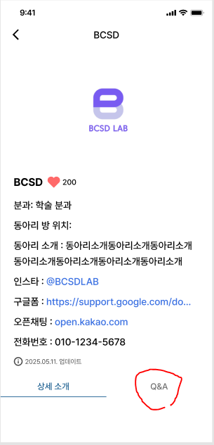
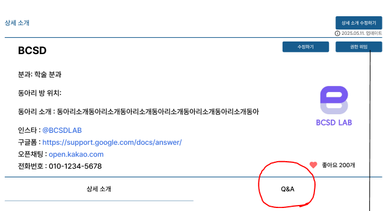

# 5-6.동아리_탭 클릭(추가사항)

원문 페이지 ID: b660221954bc82af8bb2814b7aa8574a

> 필터 밖 원본 행 복구 스냅샷. 중복·빈 페이지도 원본 ID와 속성, 본문을 개별 보존합니다. 명세 승인이나 앱 적용 완료를 뜻하지 않습니다.

대조 기록: [숨겨진 원본 42개 복구](../hidden-recovery.md)

관련 기존 보관본: [레거시 5-6.동아리_탭 클릭(추가사항)](c040221954bc83ecaccd016a9960f119.md), [레거시 5-6.동아리_탭 클릭(추가사항)](1c00221954bc82cbba2c8195fc85b251.md)

## 원문 속성

```json
{
  "platform": [
    "ANDROID",
    "IOS",
    "WEB"
  ],
  "url": "source-page-id:b660221954bc82af8bb2814b7aa8574a",
  "상태": "로깅 필요",
  "이름": "5-6.동아리\\_탭 클릭(추가사항)"
}
```

- 설명: 동아리 소개 화면에서 상세소개나 Q&A탭 클릭

클릭한 탭에 따라 value는 Q&A나 상세 소개로 부탁드립니다.

<ul>
<li>
event\_name : “CAMPUS”
</li>
<li>
event\_label : “club\_tab\_select”
</li>
<li>
value : \{”상세 소개”, “Q&A”, “모집”, “행사”\}
</li>
<li>
event\_category : “click” 
</li>
<li>
참고사진
</li>
</ul>





- 웹 참고사진



