# 7-1-2. 프로필 작성하기 내부

원문 페이지 ID: b690221954bc8289b4838195dca6b985

> 원문 스냅샷. 명세 확정·앱 배포·수집 완료를 뜻하지 않습니다.

## 원문 속성

```json
{
  "platform": [
    "WEB",
    "ANDROID",
    "IOS"
  ],
  "url": "source-page-id:b690221954bc8289b4838195dca6b985",
  "구분": "프로필",
  "상태": "로깅 필요",
  "생성일": "2026-11-08T10:52:13.334Z",
  "이벤트 이름": "7-1-2. 프로필 작성하기 내부"
}
```

<details>
<summary>이전 로깅</summary>

① 회원정보 불러오기

- event\_label : team\_recruitment\_profile\_create\_load
- value : 회원정보 불러오기
- event\_category : click

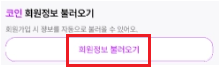

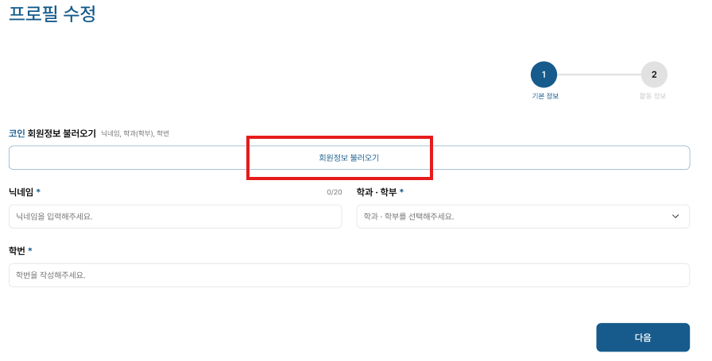

② 학과·학부 선택

- event\_label : team\_recruitment\_profile\_create\_major
- value : 사용자가 선택한 학과·학부
- event\_category : click

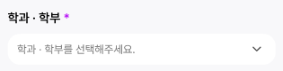

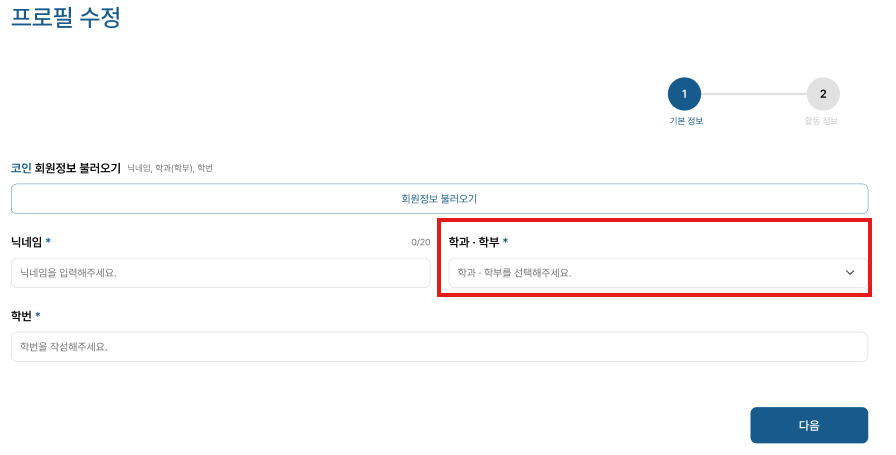

③ 기본 정보 다음 버튼 클릭

- event\_label : team\_recruitment\_profile\_create\_next
- value : 다음
- event\_category : click

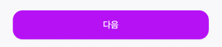

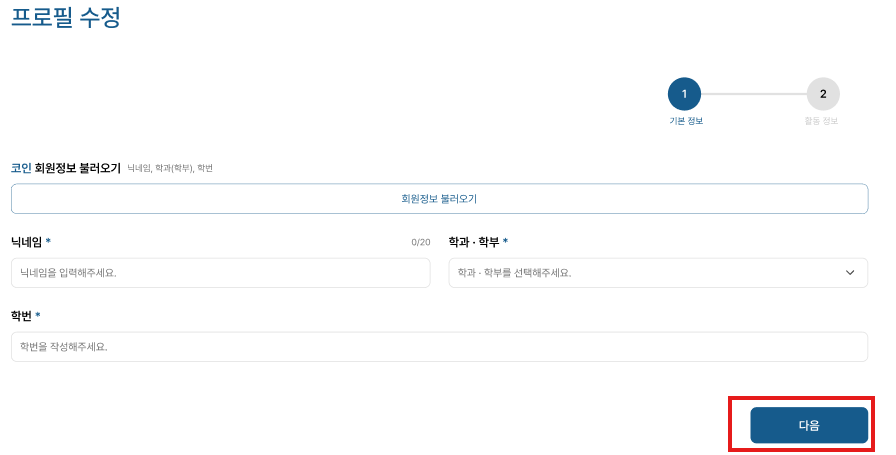

④ 기술 / 자격증 추가

- event\_label : team\_recruitment\_profile\_create\_skill\_add
- value : 기술 / 자격증 추가
- event\_category : click

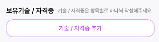

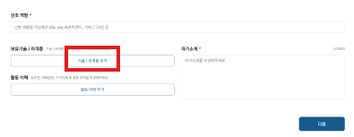

⑤ 활동 이력 추가

- event\_label : team\_recruitment\_profile\_create\_activity\_add
- value : 활동 이력 추가
- event\_category : click

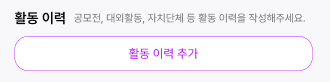

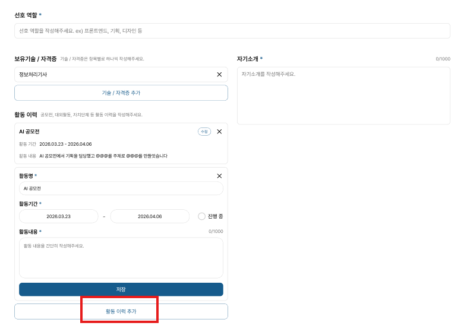

⑥ 활동 이력 추가 완료

- event\_label : team\_recruitment\_profile\_create\_activity\_add\_complete
- value : 완료
- event\_category : click

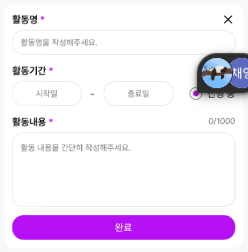

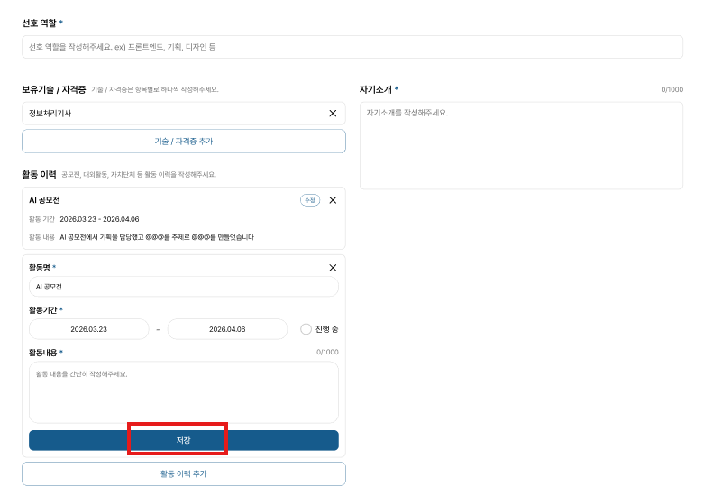

⑦ 활동 이력 수정

- event\_label : team\_recruitment\_profile\_create\_activity\_modify
- value : 수정
- event\_category : click

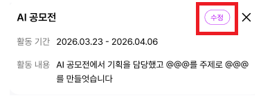

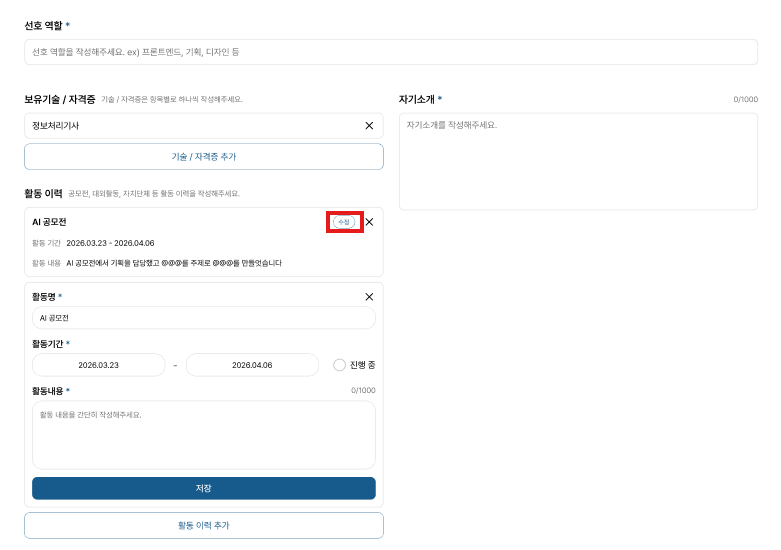

⑧ 활동 이력 수정 내용 저장

- event\_label : team\_recruitment\_profile\_create\_activity\_modify\_complete
- value : 수정하기
- event\_category : click

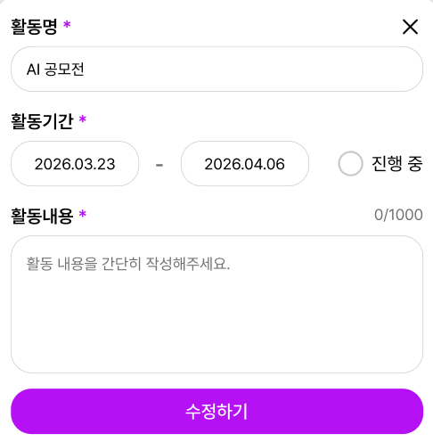

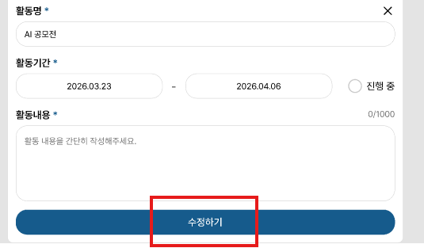

⑨ 프로필 저장 버튼 클릭

- event\_label : team\_recruitment\_profile\_create\_submit
- value : 저장하기
- event\_category : click

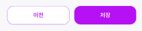


⑩ 프로필 작성 취소

- event\_label : team\_recruitment\_profile\_create\_submit\_cancel
- value : 취소하기
- event\_category : click

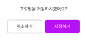

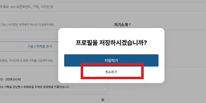

⑪ 프로필 작성 저장

- event\_label : team\_recruitment\_profile\_create\_submit\_confirm
- value : 저장하기
- event\_category : click


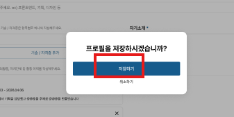
</details>

<details>
<summary>새 로깅 (26.10.17)</summary>

① 회원정보 불러오기

- 설명: 프로필 작성 화면에서 회원정보 불러오기를 클릭해 내 정보를 채우는 경우
- screen\_view: <code>team_profile_write</code>
- event\_name: <code>DA1</code>
- event\_label: <code>team_recruit__team_profile_write__team_profile_write__load__click</code>
- value: 회원정보 불러오기
- event\_category: <code>click</code>

② 학과·학부 선택

- 설명: 프로필 작성 화면에서 학과·학부 목록 중 하나를 고르는 경우
- screen\_view: <code>team_profile_write</code>
- event\_name: <code>DA1</code>
- event\_label: <code>team_recruit__team_profile_write__team_profile_write__major__select</code>
- value: \{학과·학부\} (예: 컴퓨터공학부)
- event\_category: <code>select</code>

③ 기본 정보 다음 버튼 클릭

- 설명: 프로필 작성 화면의 기본 정보 단계에서 다음 버튼을 클릭해 다음 단계로 넘어가는 경우
- screen\_view: <code>team_profile_write</code>
- event\_name: <code>DA1</code>
- event\_label: <code>team_recruit__team_profile_write__team_profile_write__next__click</code>
- value: 다음
- event\_category: <code>click</code>

④ 기술 / 자격증 추가

- 설명: 프로필 작성 화면에서 기술 / 자격증 추가 버튼을 클릭하는 경우
- screen\_view: <code>team_profile_write</code>
- event\_name: <code>DA1</code>
- event\_label: <code>team_recruit__team_profile_write__team_profile_write__skill_add__click</code>
- value: 기술 / 자격증 추가
- event\_category: <code>click</code>

⑤ 활동 이력 추가

- 설명: 프로필 작성 화면에서 활동 이력 추가 버튼을 클릭하는 경우
- screen\_view: <code>team_profile_write</code>
- event\_name: <code>DA1</code>
- event\_label: <code>team_recruit__team_profile_write__team_profile_write__activity_add__click</code>
- value: 활동 이력 추가
- event\_category: <code>click</code>

⑥ 활동 이력 추가 완료

- 설명: 활동 이력 추가 창에서 완료를 클릭해 새 활동 이력을 넣는 경우
- screen\_view: <code>team_profile_write</code>
- event\_name: <code>DA1</code>
- event\_label: <code>team_recruit__team_profile_write__team_profile_write__activity_add_confirm__click</code>
- value: 완료
- event\_category: <code>click</code>

⑦ 활동 이력 수정

- 설명: 프로필 작성 화면에서 활동 이력의 수정 버튼을 클릭하는 경우
- screen\_view: <code>team_profile_write</code>
- event\_name: <code>DA1</code>
- event\_label: <code>team_recruit__team_profile_write__team_profile_write__activity_edit__click</code>
- value: 수정
- event\_category: <code>click</code>

⑧ 활동 이력 수정 내용 저장

- 설명: 활동 이력 수정 창에서 수정하기를 클릭해 수정 내용을 저장하는 경우
- screen\_view: <code>team_profile_write</code>
- event\_name: <code>DA1</code>
- event\_label: <code>team_recruit__team_profile_write__team_profile_write__activity_edit_confirm__click</code>
- value: 수정하기
- event\_category: <code>click</code>

⑨ 프로필 저장 버튼 클릭

- 설명: 프로필 작성 화면 하단의 저장하기 버튼을 클릭해 저장 확인 팝업을 여는 경우
- screen\_view: <code>team_profile_write</code>
- event\_name: <code>DA1</code>
- event\_label: <code>team_recruit__team_profile_write__team_profile_write__open__click</code>
- value: 저장하기
- event\_category: <code>click</code>

⑩ 프로필 작성 취소

- 설명: 저장 확인 팝업에서 취소하기를 클릭해 팝업을 닫는 경우
- screen\_view: <code>team_profile_write</code>
- event\_name: <code>DA1</code>
- event\_label: <code>team_recruit__team_profile_write__team_profile_write__cancel__click</code>
- value: 취소하기
- event\_category: <code>click</code>

⑪ 프로필 작성 저장

- 설명: 저장 확인 팝업에서 저장하기를 클릭해 프로필을 최종 저장하는 경우
- screen\_view: <code>team_profile_write</code>
- event\_name: <code>DA1</code>
- event\_label: <code>team_recruit__team_profile_write__team_profile_write__confirm__click</code>
- value: 저장하기
- event\_category: <code>click</code>

<details>
<summary>검토사항</summary>

- 통합 가이드·후속: [로깅 통합 가이드](3c30221954bc8214b1c481c5bbb6fba5.md)
- ⑪ 09.12 검수에서 PC 로컬 category가 result로 찍힌 불일치 있음 → click으로 맞춰야 함
- label DA2 기준 정렬 (2026-10-27): <code>team_recruit__team_profile_write__load__click</code> → <code>team_recruit__team_profile_write__team_profile_write__load__click</code>
- label DA2 기준 정렬 (2026-10-27): <code>team_recruit__team_profile_write__major__select</code> → <code>team_recruit__team_profile_write__team_profile_write__major__select</code>
- label DA2 기준 정렬 (2026-10-27): <code>team_recruit__team_profile_write__next__click</code> → <code>team_recruit__team_profile_write__team_profile_write__next__click</code>
- label DA2 기준 정렬 (2026-10-27): <code>team_recruit__team_profile_write__skill_add__click</code> → <code>team_recruit__team_profile_write__team_profile_write__skill_add__click</code>
- label DA2 기준 정렬 (2026-10-27): <code>team_recruit__team_profile_write__activity_add__click</code> → <code>team_recruit__team_profile_write__team_profile_write__activity_add__click</code>
- label DA2 기준 정렬 (2026-10-27): <code>team_recruit__team_profile_write__activity_add__submit__click</code> → <code>team_recruit__team_profile_write__team_profile_write__activity_add_confirm__click</code>
- label DA2 기준 정렬 (2026-10-27): <code>team_recruit__team_profile_write__activity_edit__click</code> → <code>team_recruit__team_profile_write__team_profile_write__activity_edit__click</code>
- label DA2 기준 정렬 (2026-10-27): <code>team_recruit__team_profile_write__activity_edit__submit__click</code> → <code>team_recruit__team_profile_write__team_profile_write__activity_edit_confirm__click</code>
- label DA2 기준 정렬 (2026-10-27): <code>team_recruit__team_profile_write__submit__click</code> → <code>team_recruit__team_profile_write__team_profile_write__open__click</code>
- label DA2 기준 정렬 (2026-10-27): <code>team_recruit__team_profile_write__submit__cancel__click</code> → <code>team_recruit__team_profile_write__team_profile_write__cancel__click</code>
- label DA2 기준 정렬 (2026-10-27): <code>team_recruit__team_profile_write__submit__confirm__click</code> → <code>team_recruit__team_profile_write__team_profile_write__confirm__click</code>
- ⑦ 참고사진: 수정 버튼은 활동 이력을 먼저 추가해야 보여서 캡처하지 않음 (화면 모양은 7-1-1 ⑤ 참고)
- ⑧ 참고사진: 활동 이력을 먼저 추가해야 보여서 캡처하지 않음 (화면 모양은 7-1-1 ⑥ 참고)
- ⑩ ⑪ 참고사진: 저장 확인 팝업은 저장을 눌러야 열려서, stage 데이터 보호를 위해 캡처하지 않음
- ⑦ ⑧ ⑩ ⑪ 이전 로깅 사진은 플랫폼 구분 없음
- 사진은 stage 로그인 상태 캡처 (/team/profile/create 직접 접속, ②는 드롭다운을 연 상태, ④는 2단계 화면, ⑥은 활동 이력 추가를 누른 뒤 입력 폼, ⑨는 stage 버튼 문구가 '저장'). 사진 플랫폼 확인 완료 (이미지 비율 기준: 모바일, 780x1688). 이전 로깅 사진은 실측 결과 소형 크롭(가로형·정방형 위주, 세로형 없음)이라 플랫폼 판정 불가이며 이동하지 않음. 웹 사진 추가 필요
</details>

### 참고사진 (프로필 작성하기 내부)

웹 사진은 전 이벤트 없음 (추가 필요). ⑦ ⑧ ⑩ ⑪은 모바일 사진도 없음 (추가 필요).

① 회원정보 불러오기

<columns>
<column ratio="50">
<b>웹</b>

<details>
<summary>참고사진 · 웹</summary>

웹 — 사진 없음 (추가 필요)
</details>
</column>
<column ratio="50">
<b>모바일</b>

<details>
<summary>참고사진 · 모바일</summary>

모바일 — 회원정보 불러오기 (출처: stage 실제 캡처, 빨간 네모 = 클릭 위치)


</details>
</column>
</columns>

② 학과·학부 선택

<columns>
<column ratio="50">
<b>웹</b>

<details>
<summary>참고사진 · 웹</summary>

웹 — 사진 없음 (추가 필요)
</details>
</column>
<column ratio="50">
<b>모바일</b>

<details>
<summary>참고사진 · 모바일</summary>

모바일 — 학과·학부 선택 (출처: stage 실제 캡처, 빨간 네모 = 클릭 위치)

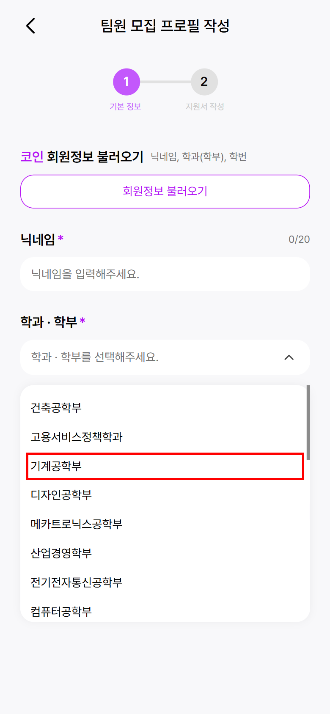
</details>
</column>
</columns>

③ 기본 정보 다음 버튼 클릭

<columns>
<column ratio="50">
<b>웹</b>

<details>
<summary>참고사진 · 웹</summary>

웹 — 사진 없음 (추가 필요)
</details>
</column>
<column ratio="50">
<b>모바일</b>

<details>
<summary>참고사진 · 모바일</summary>

모바일 — 기본 정보 다음 버튼 (출처: stage 실제 캡처, 빨간 네모 = 클릭 위치)

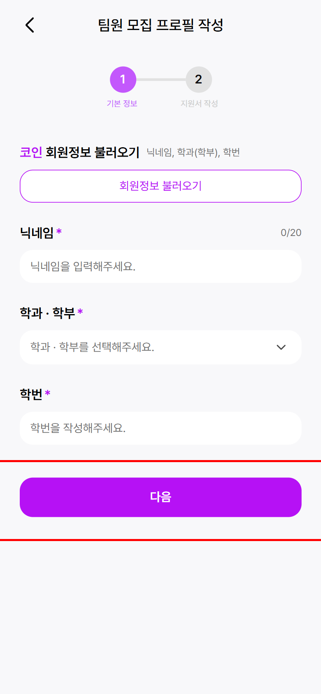
</details>
</column>
</columns>

④ 기술 / 자격증 추가

<columns>
<column ratio="50">
<b>웹</b>

<details>
<summary>참고사진 · 웹</summary>

웹 — 사진 없음 (추가 필요)
</details>
</column>
<column ratio="50">
<b>모바일</b>

<details>
<summary>참고사진 · 모바일</summary>

모바일 — 기술 / 자격증 추가 (출처: stage 실제 캡처, 빨간 네모 = 클릭 위치)

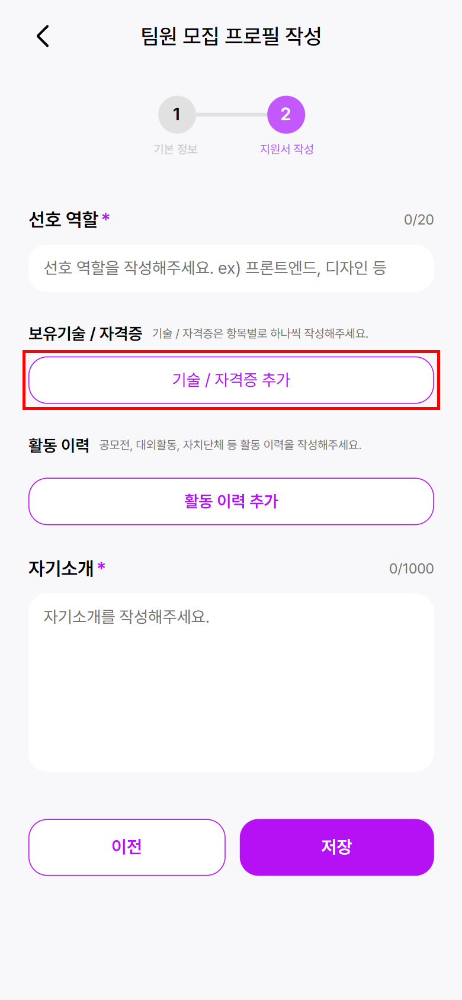
</details>
</column>
</columns>

⑤ 활동 이력 추가

<columns>
<column ratio="50">
<b>웹</b>

<details>
<summary>참고사진 · 웹</summary>

웹 — 사진 없음 (추가 필요)
</details>
</column>
<column ratio="50">
<b>모바일</b>

<details>
<summary>참고사진 · 모바일</summary>

모바일 — 활동 이력 추가 (출처: stage 실제 캡처, 빨간 네모 = 클릭 위치)

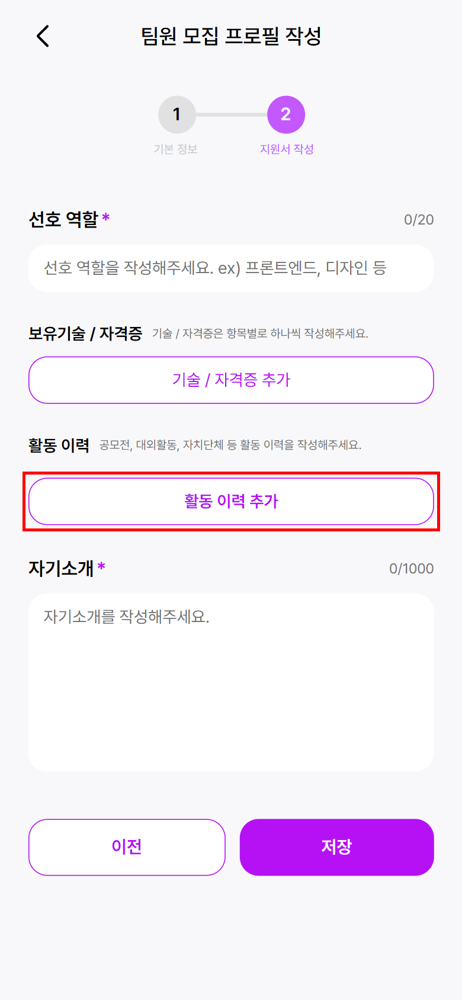
</details>
</column>
</columns>

⑥ 활동 이력 추가 완료

<columns>
<column ratio="50">
<b>웹</b>

<details>
<summary>참고사진 · 웹</summary>

웹 — 사진 없음 (추가 필요)
</details>
</column>
<column ratio="50">
<b>모바일</b>

<details>
<summary>참고사진 · 모바일</summary>

모바일 — 활동 이력 추가 완료 (출처: stage 실제 캡처, 빨간 네모 = 클릭 위치)

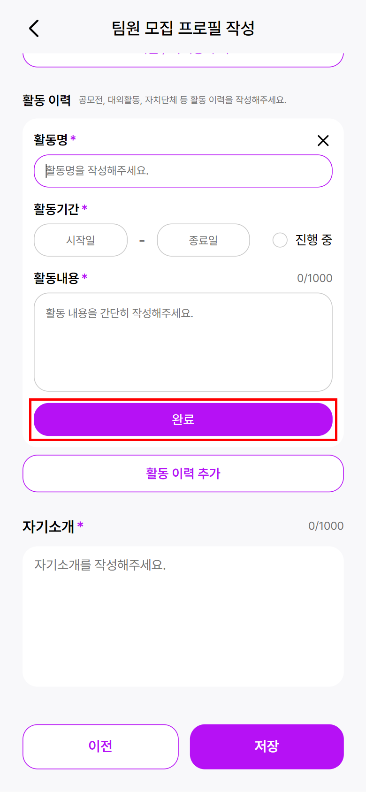
</details>
</column>
</columns>

⑦ 활동 이력 수정

<columns>
<column ratio="50">
<b>웹</b>

<details>
<summary>참고사진 · 웹</summary>

웹 — 사진 없음 (추가 필요)
</details>
</column>
<column ratio="50">
<b>모바일</b>

<details>
<summary>참고사진 · 모바일</summary>

모바일 — 사진 없음 (추가 필요)
</details>
</column>
</columns>

⑧ 활동 이력 수정 내용 저장

<columns>
<column ratio="50">
<b>웹</b>

<details>
<summary>참고사진 · 웹</summary>

웹 — 사진 없음 (추가 필요)
</details>
</column>
<column ratio="50">
<b>모바일</b>

<details>
<summary>참고사진 · 모바일</summary>

모바일 — 사진 없음 (추가 필요)
</details>
</column>
</columns>

⑨ 프로필 저장 버튼 클릭

<columns>
<column ratio="50">
<b>웹</b>

<details>
<summary>참고사진 · 웹</summary>

웹 — 사진 없음 (추가 필요)
</details>
</column>
<column ratio="50">
<b>모바일</b>

<details>
<summary>참고사진 · 모바일</summary>

모바일 — 프로필 저장 버튼 (출처: stage 실제 캡처, 빨간 네모 = 클릭 위치)

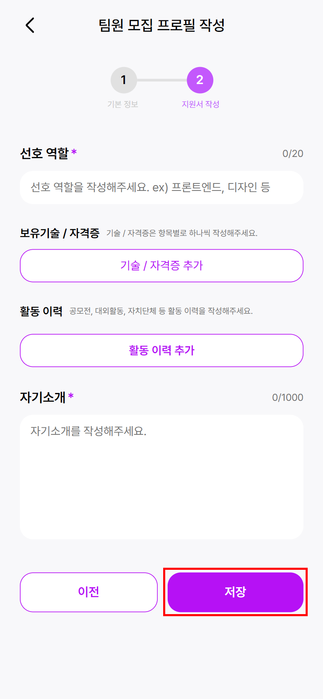
</details>
</column>
</columns>

⑩ 프로필 작성 취소

<columns>
<column ratio="50">
<b>웹</b>

<details>
<summary>참고사진 · 웹</summary>

웹 — 사진 없음 (추가 필요)
</details>
</column>
<column ratio="50">
<b>모바일</b>

<details>
<summary>참고사진 · 모바일</summary>

모바일 — 사진 없음 (추가 필요)
</details>
</column>
</columns>

⑪ 프로필 작성 저장

<columns>
<column ratio="50">
<b>웹</b>

<details>
<summary>참고사진 · 웹</summary>

웹 — 사진 없음 (추가 필요)
</details>
</column>
<column ratio="50">
<b>모바일</b>

<details>
<summary>참고사진 · 모바일</summary>

모바일 — 사진 없음 (추가 필요)
</details>
</column>
</columns>
</details>
