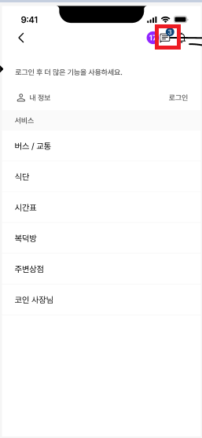

# 11-15.햄버거_쪽지_클릭

원문 페이지 ID: b6a0221954bc82a5b60a8120f0d08237

> 누락 원본 복구 스냅샷. 원본의 과거값·검토 기록을 보존하며 생성 계약으로 자동 승인하지 않습니다.

대조 기록: [87개 원본 복구 및 8개 차이 정리](../recovery-review.md)

관련 기존 보관본: [레거시 11-15.카테고리_채팅(쪽지)_클릭](0dc0221954bc8316be7a815e4460791f.md), [레거시 11-15.카테고리_채팅(쪽지)_클릭](f330221954bc83579bf5816e70758bb1.md)

## 원문 속성

```json
{
  "platform": [
    "ANDROID",
    "IOS",
    "WEB"
  ],
  "url": "source-page-id:b6a0221954bc82a5b60a8120f0d08237",
  "상태": "완료",
  "이름": "11-15.햄버거\\_쪽지\\_클릭"
}
```

<ul>
<li>
설명 : 햄버거 버튼을 누른 화면에서 쪽지 버튼 클릭
</li>
<li>
event\_label : “hamburger”
</li>
<li>
value : “쪽지<b>”</b>
</li>
<li>
event\_category : “click” 
</li>
<li>
참고사진
</li>
</ul>





<details>
<summary>검토사항</summary>


- 후속 수정 (2026-10-27): ※ 옛 사본: 현행 명세는 게시판 DB의 같은 번호 페이지 [[레거시] 11-15.카테고리_채팅(쪽지)_클릭](0dc0221954bc8316be7a815e4460791f.md) (11-15.카테고리\_채팅(쪽지)\_클릭). 이 사본은 새 로깅이 없어 변환하지 않음.

</details>
