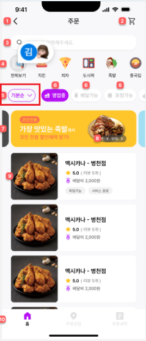
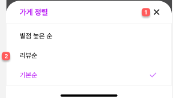

# 2-6~9 상점 카테고리 정렬 

원문 페이지 ID: b6f0221954bc83b1bd1e814b469d702e

> 원문 스냅샷. 명세 확정·앱 배포·수집 완료를 뜻하지 않습니다.

## 원문 속성

```json
{
  "platform": [
    "ANDROID",
    "IOS",
    "WEB"
  ],
  "url": "source-page-id:b6f0221954bc83b1bd1e814b469d702e",
  "상태": "완료",
  "생성일": "2026-11-12T05:07:40.637Z",
  "이벤트 이름": "<p>\n2-6\\~9 상점 카테고리 정렬 \n</p>",
  "태그": [
    "2. 상점 카테고리"
  ]
}
```

기존 기능 및 디자인 → 로깅 수정 및 추가(오른쪽 사진)

<columns>
<column ratio="50">

</column>
<column ratio="50">



</column>
</columns>

<columns>
<column ratio="50">
<span color="orange">event\_params.key</span>

<ul>
<li>
event\_label : shop\_can
</li>
<li>
value : 

- check\_open\_\{카테고리\}
</li>
<li>
event\_category : click 
</li>
</ul>
</column>
<column ratio="50">
<span color="orange">event\_params.key</span>

<ul>
<li>
event\_label : shop\_can
</li>
<li>
value : 

- check\_default\_\{카테고리\}
- check\_review\_\{카테고리\}
- check\_star\_\{카테고리\}
</li>
<li>
event\_category : click 
</li>
</ul>
</column>
</columns>


