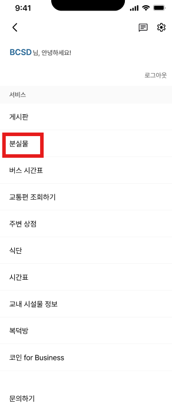
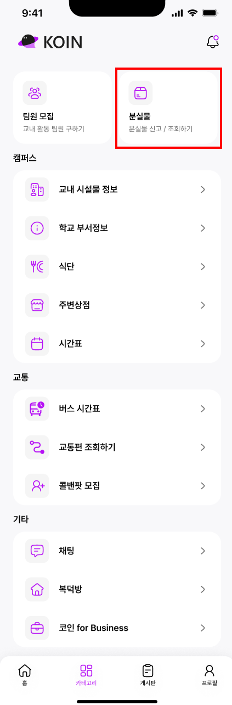

# 11-21. 카테고리_분실물_클릭

원문 페이지 ID: b770221954bc82fc9e44015bc941fd5f

> 원문 스냅샷. 명세 확정·앱 배포·수집 완료를 뜻하지 않습니다.

## 원문 속성

```json
{
  "platform": [
    "ANDROID",
    "IOS"
  ],
  "url": "source-page-id:b770221954bc82fc9e44015bc941fd5f",
  "상태": "완료",
  "이름": "11-21. 카테고리\\_분실물\\_클릭",
  "태그": [
    "11.분실물"
  ]
}
```

<details>
<summary>이전 로깅</summary>

- 설명: 햄버거 버튼을 누른 화면에서 분실물 버튼 클릭
- event\_label : hamburger
- value : 분실물
- event\_category : click
- 참고사진


</details>

<details>
<summary>새 로깅 (26.10.12) — 초안</summary>

- 설명: 메인 카테고리 화면에서 분실물 버튼을 클릭한다.
- screen\_view: <code>main_category</code>
- event\_name: <code>DA2</code>
- event\_label: <code>board__main_category__lost_item_entry__category_entry__click</code>
- value: 분실물
- event\_category: <code>click</code>

<details>
<summary>검토사항</summary>

- 통합 가이드·후속: [로깅 통합 가이드](3c30221954bc8214b1c481c5bbb6fba5.md)
- label 통일 (2026-10-27): <code>board__main_category__lost_item_entry__category_entry</code> → <code>board__main_category__lost_item_entry__category_entry__click</code>
- 화면 정의의 현행 모바일 카테고리 화면 기준으로 <code>main_category</code>를 사용한 초안입니다. 기존 햄버거 진입을 현행 카테고리 진입으로 대체합니다.
</details>

### 참고사진 (기능 표시)

<columns>
<column ratio="50">
<b>웹</b>

이 항목은 모바일 메뉴 진입 로깅입니다.
</column>
<column ratio="50">
<b>모바일</b>

<details>
<summary>참고사진 · 모바일</summary>

모바일 — 카테고리의 분실물 진입


</details>
</column>
</columns>
</details>
