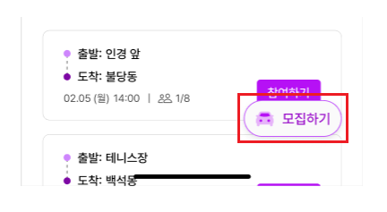
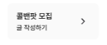
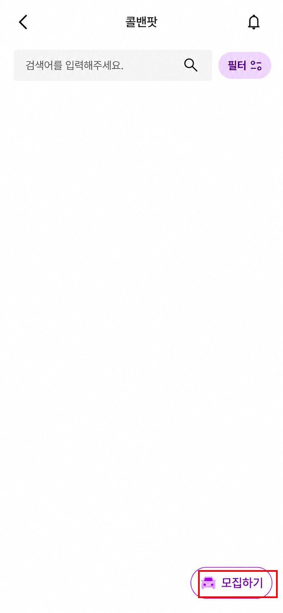

# 2-9·3-6 콜밴팟 목록 → 모집하기

원문 페이지 ID: b830221954bc828b9584014c3af65c1d

> 원문 스냅샷. 명세 확정·앱 배포·수집 완료를 뜻하지 않습니다.

## 원문 속성

```json
{
  "platform": [
    "ANDROID",
    "IOS"
  ],
  "url": "source-page-id:b830221954bc828b9584014c3af65c1d",
  "상태": "로깅 필요",
  "이름": "2-9·3-6 콜밴팟 목록 → 모집하기",
  "태그": [
    "2. 콜밴팟 찾기",
    "3. 콜밴팟 모집"
  ]
}
```

<details>
<summary>이전 로깅</summary>


<ul>
<li>
event\_name : CAMPUS
</li>
<li>
event\_category : click
</li>
<li>
event\_label : callvan\_create
</li>
<li>
value : 
</li>
</ul>



</details>

<details>
<summary>이전 로깅 \[3-6 원문\]</summary>


<ul>
<li>
event\_name : CAMPUS
</li>
<li>
event\_category : click
</li>
<li>
event\_label : main\_callvan\_write
</li>
<li>
value : 
</li>
</ul>



</details>

<details>
<summary>새 로깅 (2026-10-14) — 초안</summary>

- 설명: 콜밴팟 목록의 ‘모집하기’ 버튼을 클릭한다. (2-9: 목록에서 모집하기 클릭 / 3-6: 리디자인 메인의 ‘모집 보기’로 목록에 진입한 뒤 목록의 ‘모집하기’ 클릭. 이벤트는 두 번째 클릭에서 발생하며 두 진입 경로는 같은 클릭이므로 중복 전송하지 않는다.)
- screen\_view: <code>callvan_list</code> (2-9·3-6 동일)
- event\_label: <code>callvan__callvan_list__callvan_write__entry__click</code>
- event\_name: <code>DA2</code>
- value: 기존 미기재 유지
- event\_category: <code>click</code>

<details>
<summary>검토사항</summary>

- 통합 가이드·후속: [로깅 통합 가이드](3c30221954bc8214b1c481c5bbb6fba5.md)
- label 통일 (2026-10-27): callvan\_\_callvan\_list\_\_callvan\_write\_\_entry → callvan\_\_callvan\_list\_\_callvan\_write\_\_entry\_\_click
- 2026-10-15 대응: 리디자인 대체 동작(구 3-6)은 이 목록 모집하기 클릭과 동일하다. 중복 전송하지 않는다.
- 변경 대응(3-6 원문): 리디자인 전 메인의 글 작성 바로가기(main\_callvan\_write)를 현재 목록의 모집하기 기능으로 교체. 이름 변경과 함께 발생 위치가 메인에서 목록으로 바뀐다.
- 통합 (2026-10-27): 3-6 콜밴팟 목록 → 모집하기 (리디자인 대체) 페이지를 이 페이지로 합침 (같은 label)
</details>

### 참고사진 (기능 표시)

<b>모바일 (ANDROID, IOS) / 캡처 출처는 아래 참조</b>

<details>
<summary>참고사진 · 모바일</summary>

\[2-9 원본\] 화면 정의의 Android 실제 캡처(2026-10-13), 선명도 개선본. 이번 작업은 기존 캡처를 사용.


\[3-6 원본\] Android 실제 목록 캡처(2026-10-13)의 선명도 개선본. 목록 오른쪽 아래 ‘모집하기’를 표시.


</details>
</details>
