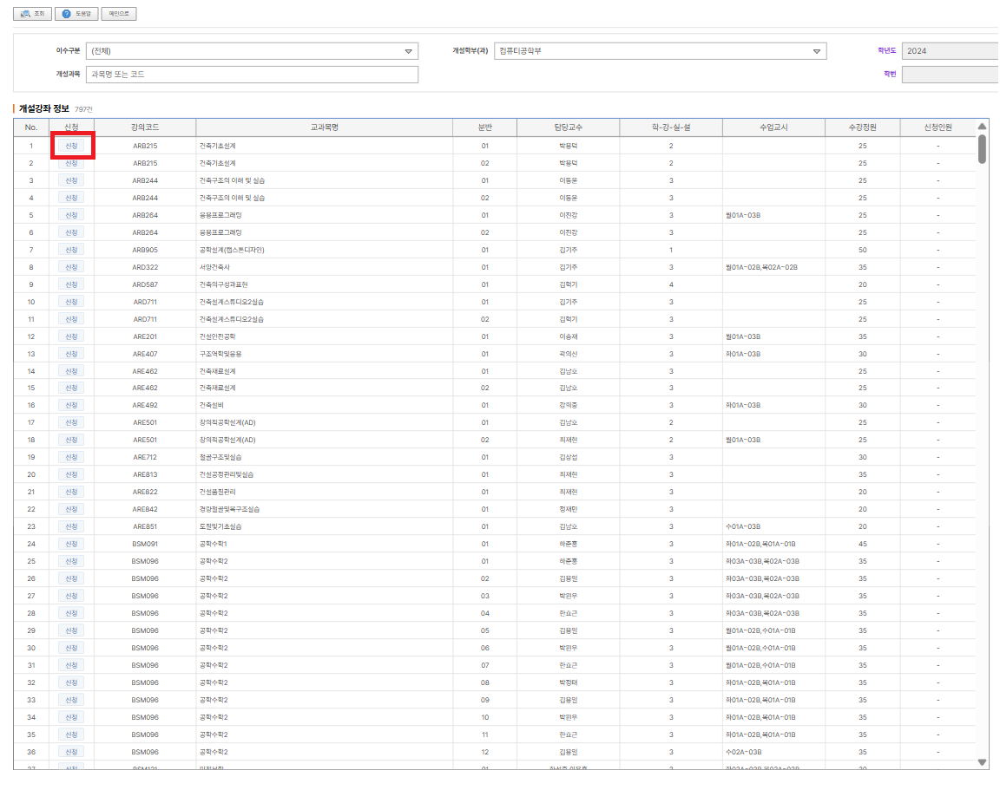
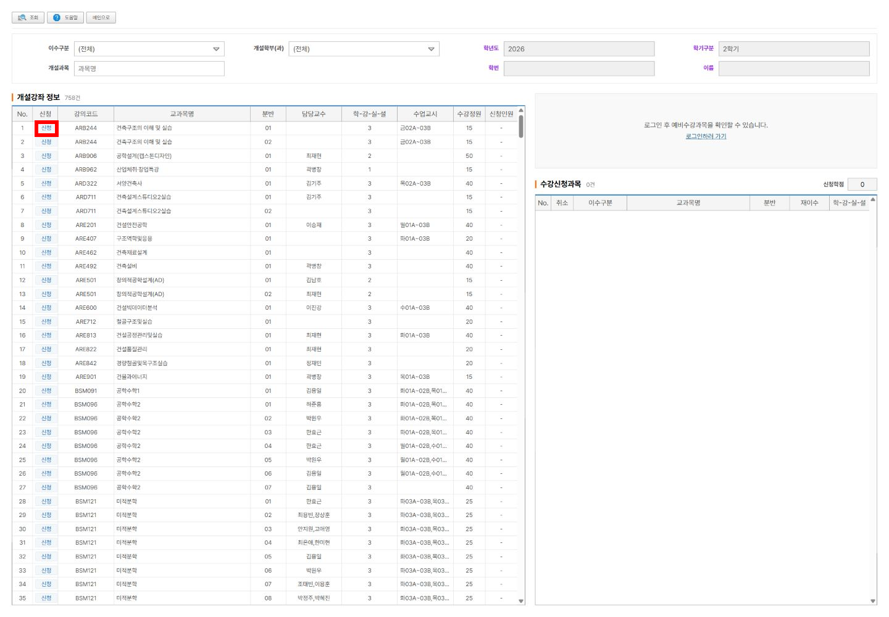

# 1-3. 모의수강신청_강좌 신청 클릭

원문 페이지 ID: b900221954bc8321aae8018a45ab2834

> 원문 스냅샷. 명세 확정·앱 배포·수집 완료를 뜻하지 않습니다.

## 원문 속성

```json
{
  "platform": [
    "WEB"
  ],
  "url": "source-page-id:b900221954bc8321aae8018a45ab2834",
  "상태": "로깅 필요",
  "이름": "1-3. 모의수강신청\\_강좌 신청 클릭",
  "태그": [
    "1. 모의수강신청_메인화면"
  ]
}
```

<details>
<summary>과거 로깅</summary>

<ul>
<li>
event\_label : “application\_training<span color="blue">\_apply</span>” 
</li>
<li>
value: 
</li>
<li>
event\_category : “click”
</li>
<li>
참고 이미지
</li>
</ul>


</details>

<details>
<summary>새 로깅</summary>

- 설명: 모의수강신청 화면에서 개설강좌 목록의 신청 버튼을 클릭한다.
- screen\_view: <code>course_practice</code>
- event\_label: <code>course_practice__course_practice__course_application__lecture__click</code>
- event\_name: <code>DA2</code>
- value: 기존 미기재 유지
- event\_category: <code>click</code>

### 참고사진 (기능 표시)

<b>웹(데스크톱)</b>

<b>참고사진 · 웹</b>

화면 정의의 실제 데스크톱 웹 캡처(2026-10-13). 이번 작업은 기존 캡처를 사용. 비로그인 상태.


</details>
