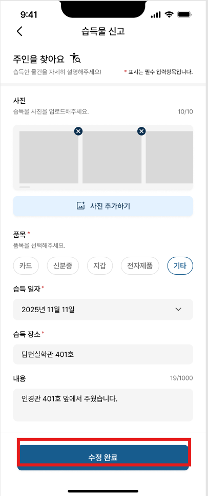
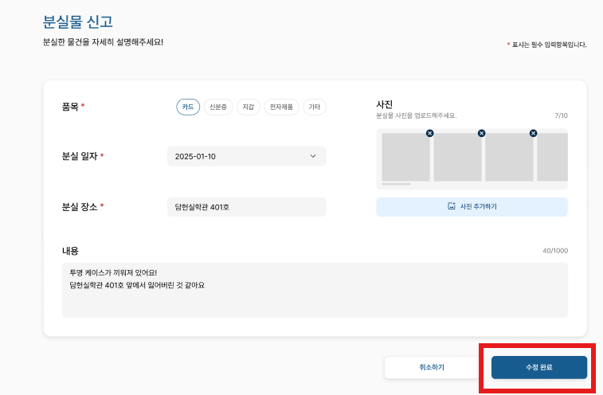
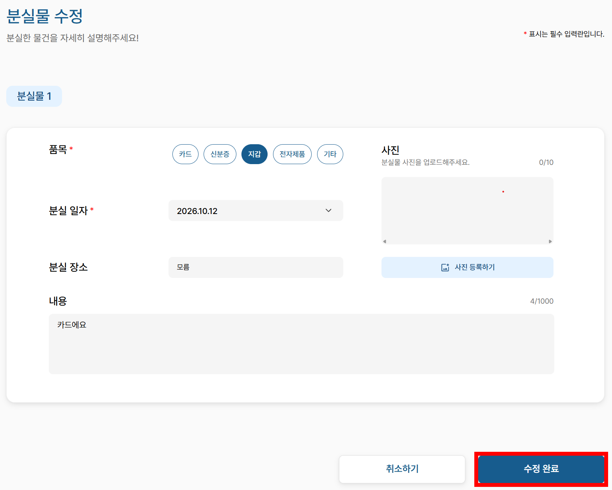
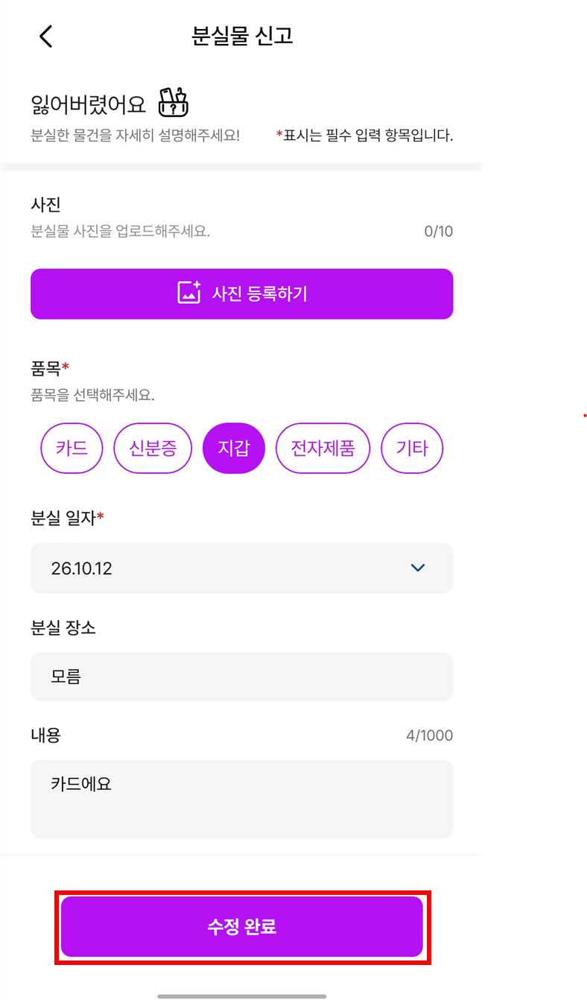

# 11-30. 분실물_수정완료_클릭

원문 페이지 ID: b950221954bc8374b6b7011f0d7dfc41

> 원문 스냅샷. 명세 확정·앱 배포·수집 완료를 뜻하지 않습니다.

## 원문 속성

```json
{
  "platform": [
    "ANDROID",
    "IOS",
    "WEB"
  ],
  "url": "source-page-id:b950221954bc8374b6b7011f0d7dfc41",
  "상태": "완료",
  "이름": "11-30. 분실물\\_수정완료\\_클릭",
  "태그": [
    "11.분실물"
  ]
}
```

<details>
<summary>이전 로깅</summary>

- 설명: 수정화면에서 수정완료 클릭
- event\_label : lost\_item\_modify\_complete
- value : ‘분실물’ or ‘습득물’
- event\_category : click
- 참고사진




</details>

<details>
<summary>새 로깅 (26.10.12) — 적용 대상 · 2026-10-16 확정</summary>

- 설명: 수정화면에서 수정완료 클릭
- screen\_view:
  - 분실물 수정: <code>lost_item_edit</code>
  - 습득물 수정: <code>found_item_edit</code>
- event\_name: <code>DA2</code>
- event\_label:
  - 분실물 수정: <code>board__lost_item_edit__lost_item_edit__submit</code>
  - 습득물 수정: <code>board__found_item_edit__lost_item_edit__submit</code>
- value: 분실물 / 습득물
- event\_category: <code>submit</code>

### 참고사진 (기능 표시)

<b>분실물 수정</b> — <code>lost_item_edit</code>

<columns>
<column ratio="50">
<b>웹</b>

<details>
<summary>참고사진 · 웹</summary>

웹 — 분실물 수정 완료


</details>
</column>
<column ratio="50">
<b>모바일</b>

<details>
<summary>참고사진 · 모바일</summary>

모바일 — 분실물 수정 완료


</details>
</column>
</columns>

<b>습득물 수정</b> — <code>found_item_edit</code>

<columns>
<column ratio="50">
<b>웹</b>

<details>
<summary>참고사진 · 웹</summary>

웹 — 습득물 수정 완료 (화면 정의의 공통 캡처)


</details>
</column>
<column ratio="50">
<b>모바일</b>

<details>
<summary>참고사진 · 모바일</summary>

모바일 — 습득물 수정 완료 (화면 정의의 공통 캡처)


</details>
</column>
</columns>

- 사진 기준 (2026-10-16 사용자 확인): 분실물 수정과 습득물 수정은 화면 제목 문구 차이만 있어 공통 사진과 텍스트 설명을 사용한다. 사용자가 작성한 설명과 첨부 사진을 유지하며 별도 사진 보완 과제로 남기지 않는다.

<details>
<summary>검토사항</summary>

- 통합 가이드·후속: [로깅 통합 가이드](3c30221954bc8214b1c481c5bbb6fba5.md)
- 확정 (2026-10-16): 실제 제공되는 분실물·습득물 수정완료 로깅으로 적용 대상이다. 분실물 수정은 <code>lost_item_edit</code>, 습득물 수정은 <code>found_item_edit</code>로 구분한다. 수정완료 버튼의 제출 시점에 전송하며 저장 성공과 구분한다.
</details>
</details>
