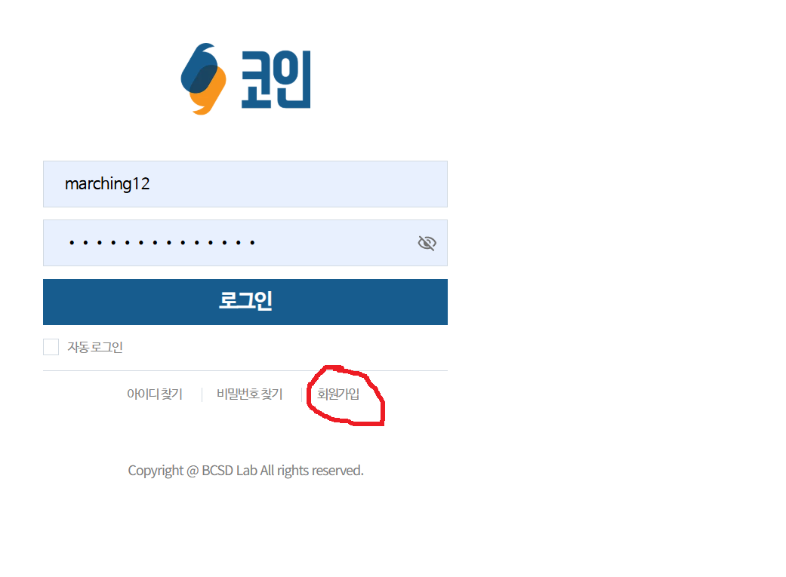
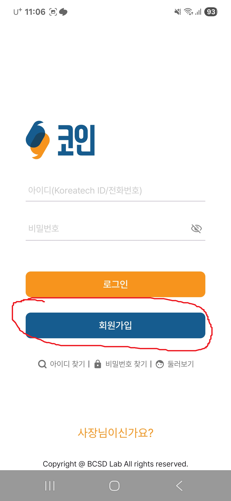
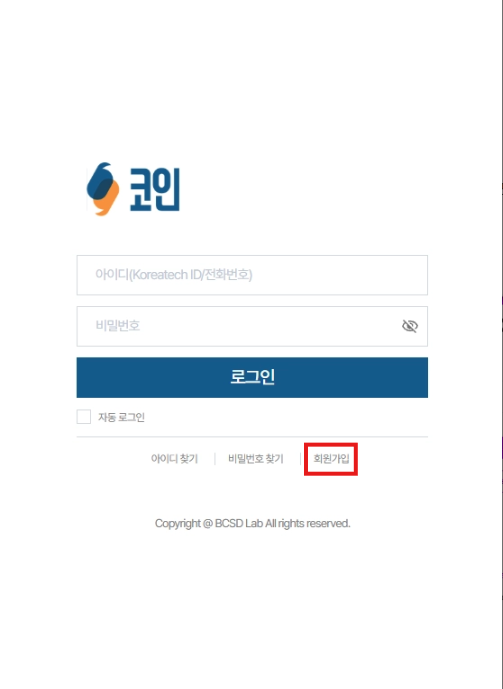
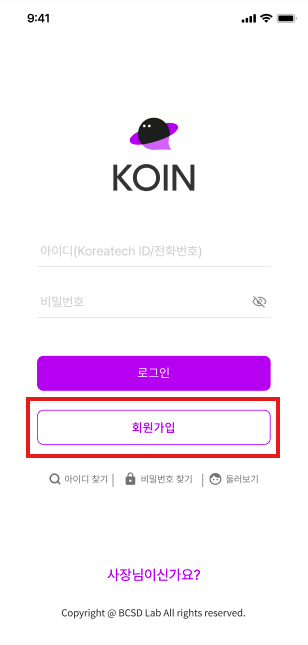

# 1-3 로그인 화면_회원가입진입(클릭)

원문 페이지 ID: b960221954bc8352a22e81bd1cb86e70

> 원문 스냅샷. 명세 확정·앱 배포·수집 완료를 뜻하지 않습니다.

## 원문 속성

```json
{
  "platform": [
    "ANDROID",
    "IOS",
    "WEB"
  ],
  "url": "source-page-id:b960221954bc8352a22e81bd1cb86e70",
  "구분": "회원가입진입",
  "상태": "로깅 필요",
  "생성일": "2026-11-12T05:07:33.201Z",
  "이벤트 이름": "1-3 로그인 화면\\_회원가입진입(클릭)",
  "태그": [
    "회원가입"
  ]
}
```

<details>
<summary>과거 로깅</summary>

- event\_label : “start\_sign\_up”
- value : “회원가입 시작<b>”</b>
- event\_category : “click”
- custom\_session\_id : \{sign\_up\}\_\{0\}\_\{플랫폼\}\_\{세션시작시간\}\_\{랜덤값\}

<b>웹</b>



<b>모바일</b>


</details>

<details>
<summary>새 로깅</summary>

- 설명: 로그인 화면의 회원가입 버튼을 클릭해 회원가입 화면으로 진입할 때 기록한다. 메인 카테고리의 회원가입 진입과 구분한다.
- event\_name: <code>DA2</code>
- screen\_view: <code>login</code>
- event\_label: <code>account__login__sign_up__entry__click</code>
- value: 회원가입 시작
- event\_category: <code>click</code>
- custom\_session\_id : \{sign\_up\}\_\{0\}\_\{플랫폼\}\_\{세션시작시간\}\_\{랜덤값\}

<b>참고사진 (기능 표시)</b>

<b>웹</b>



<b>모바일</b>


</details>
