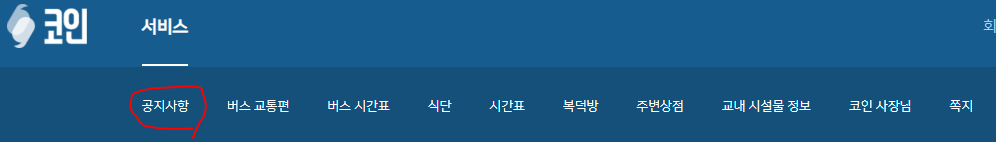

# 2-1. 헤더_공지사항_클릭

원문 페이지 ID: b9f0221954bc82f1a11c8114101c6b39

> 누락 원본 복구 스냅샷. 원본의 과거값·검토 기록을 보존하며 생성 계약으로 자동 승인하지 않습니다.

대조 기록: [87개 원본 복구 및 8개 차이 정리](../recovery-review.md)

관련 기존 보관본: [2-1. 헤더_공지사항_클릭](c6e0221954bc83ab9b86018800c682ad.md), [2-1. 헤더_공지사항_클릭](1ef0221954bc831ab54781d65126045e.md)

## 원문 속성

```json
{
  "platform": [
    "WEB"
  ],
  "url": "source-page-id:b9f0221954bc82f1a11c8114101c6b39",
  "상태": "완료",
  "이름": "2-1. 헤더\\_공지사항\\_클릭"
}
```

- 설명: 헤더 에서 공지사항 클릭
- event\_label : “header”
- value : “공지사항”
- event\_category : “click”
- 참고사진



