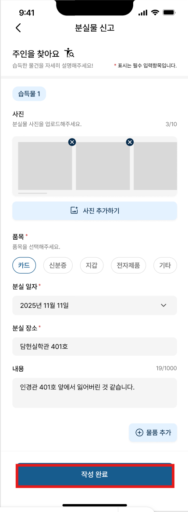
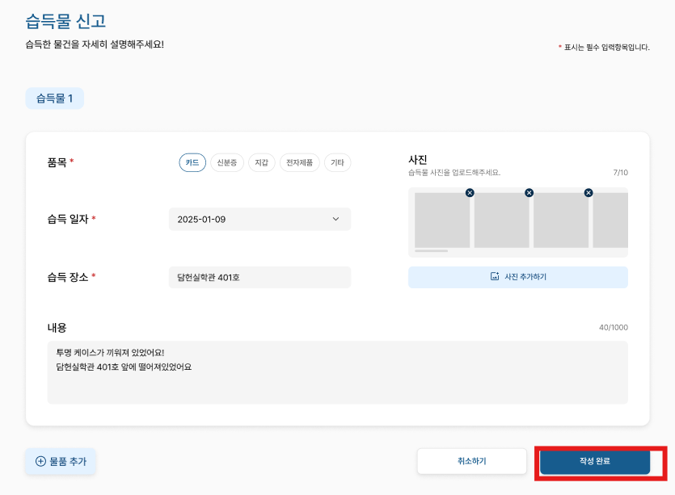
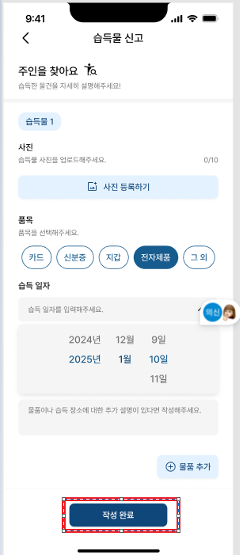
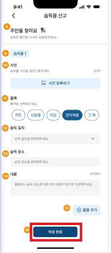
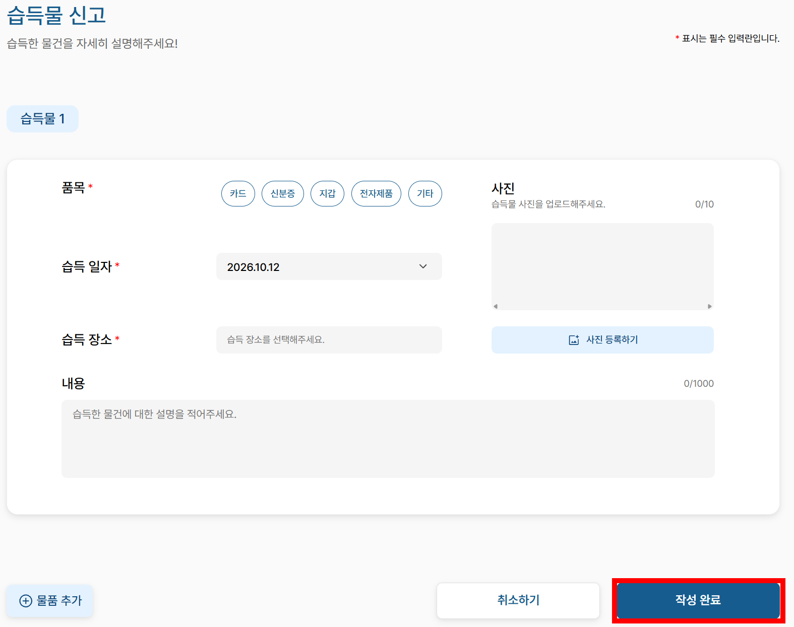
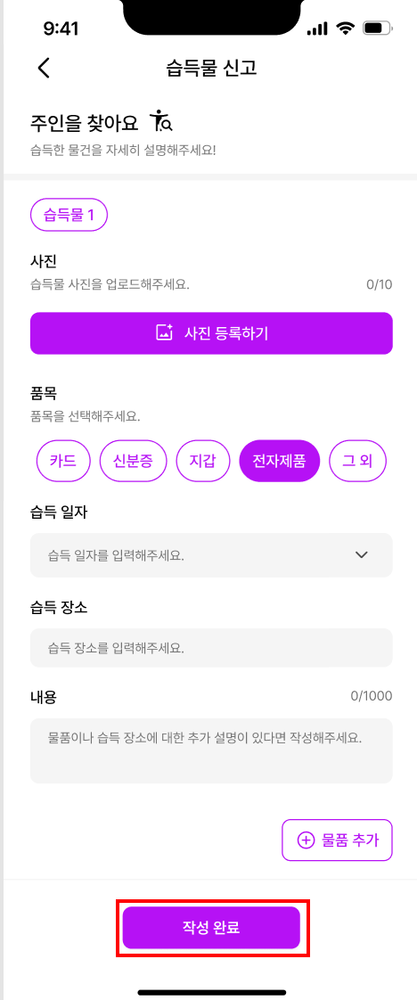

# 11-4.분실물_습득물신고_작성완료_클릭

원문 페이지 ID: ba70221954bc83ea9da38144dc40788d

> 원문 스냅샷. 명세 확정·앱 배포·수집 완료를 뜻하지 않습니다.

## 원문 속성

```json
{
  "platform": [
    "ANDROID",
    "IOS",
    "WEB"
  ],
  "url": "source-page-id:ba70221954bc83ea9da38144dc40788d",
  "상태": "완료",
  "이름": "11-4.분실물\\_습득물신고\\_작성완료\\_클릭",
  "태그": [
    "11.분실물"
  ]
}
```

<details>
<summary>이전 로깅</summary>

<ul>
<li>
설명:  습득물 신고 글쓰기 페이지에서 작성완료 클릭
</li>
<li>
event\_label : “find\_user\_write\_confirm”
</li>
<li>
value : “작성완료” 
</li>
<li>
event\_category : “click”
</li>
<li>
참고사진
</li>
</ul>





<details>
<summary>이전 참고사진</summary>




WEB Mobile View


</details>
</details>

<details>
<summary>새 로깅 (26.10.12) — 초안</summary>

- 설명: 습득물 신고 글쓰기 화면에서 작성완료 버튼을 눌러 작성 내용을 제출.
- screen\_view: <code>found_item_write</code>
- event\_name: <code>DA2</code>
- event\_label: <code>board__found_item_write__lost_item_write__submit</code>
- value: 작성완료
- event\_category: <code>submit</code>

<details>
<summary>검토사항</summary>

- 통합 가이드·후속: [로깅 통합 가이드](3c30221954bc8214b1c481c5bbb6fba5.md)
- 확정: 추가 확인 단계 없이 등록되는 작성완료 버튼을 클릭하는 순간 전송한다. 별도 등록 성공 결과 이벤트는 추가하지 않는다. 기존 category=submit을 유지한다.
</details>

### 참고사진 (기능 표시)

<columns>
<column ratio="50">
<b>웹</b>

<details>
<summary>참고사진 · 웹</summary>

웹 — 습득물 작성 완료


</details>
</column>
<column ratio="50">
<b>모바일</b>

<details>
<summary>참고사진 · 모바일</summary>

모바일 — 습득물 작성 완료


</details>
</column>
</columns>
</details>
