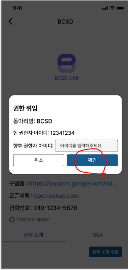
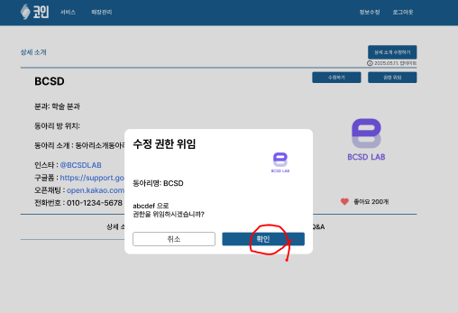

# 5-5.동아리_권한위임 확인

원문 페이지 ID: bad0221954bc82348fd501804ff990ff

> 사용자 제공 ZIP 내보내기 보관본. 레거시·동결·검토 상태는 원문을 따르며 코드 생성 승인·앱 배포 완료를 뜻하지 않습니다.

platform: ANDROID, IOS, WEB
상태: 완료

- 설명: 권한위임 팝업에서 확인버튼 클릭

주의사항: 

- 모바일 - 확인을 눌렀는데 아이디를 기입하지 않아서 처리가 안된경우와 같이 권한위임 처리가 안된 경우는 제외.
- 웹 - 웹의 경우는 재확인 팝업창을 기준으로 로깅을 진행

---

- event_name : “CAMPUS”
- event_label : “club_delegation_authority_confirm”
- value : “권한위임”
- event_category : “click”
- 참고사진

- 웹 참고사진

