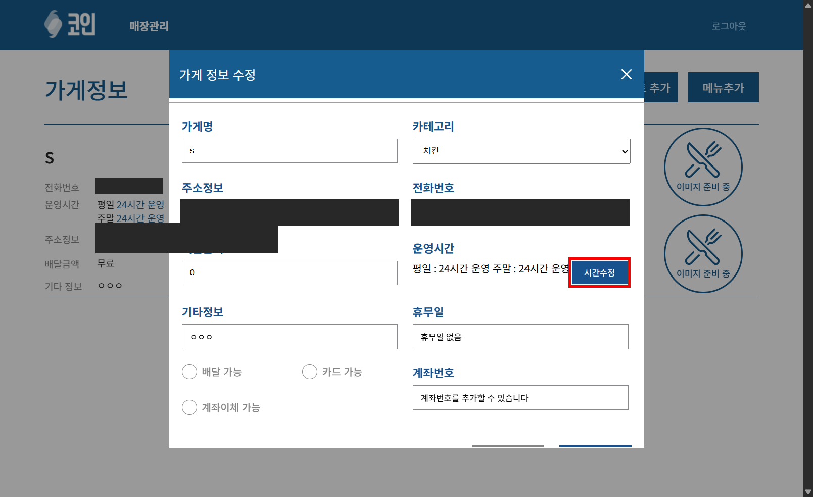

# 2-3 가게 정보 수정 - 시간 수정 

원문 페이지 ID: bb00221954bc82ea86b18188d013eb8c

> 원문 스냅샷. 명세 확정·앱 배포·수집 완료를 뜻하지 않습니다.

## 원문 속성

```json
{
  "platform": [
    "WEB"
  ],
  "url": "source-page-id:bb00221954bc82ea86b18188d013eb8c",
  "상태": "완료",
  "생성일": "2026-11-12T05:07:39.965Z",
  "이벤트 이름": "<p>\n2-3 가게 정보 수정 - 시간 수정 \n</p>",
  "태그": [
    "2. 가게 정보 수정"
  ]
}
```

<details>
<summary>과거 로깅</summary>

<span color="orange">event\_params.key</span>

- event\_label : store\_info\_edit\_time
- value : 가게 정보 시간 수정
- event\_category : click
</details>

<details>
<summary>새 로깅</summary>

- 설명: 사장님 가게 정보 수정 화면에서 운영시간의 시간수정(모바일 레이아웃은 수정) 버튼을 클릭해 운영시간 설정 창을 여는 경우
- screen\_view: <code>owner_shop_edit</code>
- event\_name: <code>DA1</code>
- event\_label: <code>owner__owner_shop_edit__shop_manage__time_edit__click</code>
- value: 운영시간 수정
- event\_category: <code>click</code>

### 참고사진 (운영시간 시간수정 버튼)

<columns>
<column ratio="50">
<b>웹</b>

<b>참고사진 · 웹</b>

웹 — 운영시간 수정 (출처: stage 실제 캡처, 빨간 네모 = 클릭 위치)


</column>
<column ratio="50">
<b>모바일</b>

<b>참고사진 · 모바일</b>

모바일 — 해당 없음 (웹 전용)
</column>
</columns>
</details>
