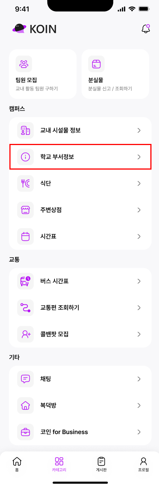
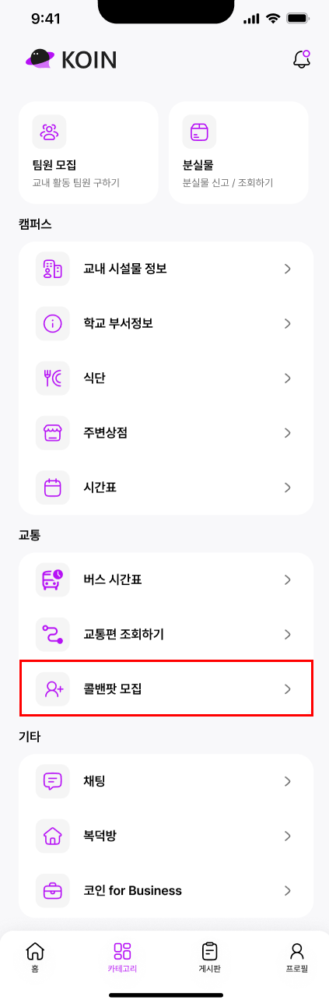
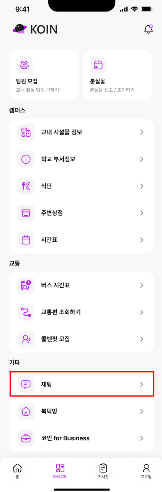

# 3-6 카테고리 내부 클릭 (현재 로깅) 2026.08.30 이후 찍히는 로깅

원문 페이지 ID: bb10221954bc8337aae781494584adee

> 원문 스냅샷. 명세 확정·앱 배포·수집 완료를 뜻하지 않습니다.

## 원문 속성

```json
{
  "platform": [
    "ANDROID",
    "IOS"
  ],
  "url": "source-page-id:bb10221954bc8337aae781494584adee",
  "구분": "카테고리",
  "상태": "완료",
  "생성일": "2026-11-08T10:52:02.183Z",
  "이벤트 이름": "3-6 카테고리 내부 클릭 (현재 로깅) 2026.08.30 이후 찍히는 로깅"
}
```

<callout icon="📌" color="blue_bg">
<b>현행 홈 대표 명세 · 이 페이지의 로깅 유지</b>

2026-11-05 사용자 지시로 카테고리 학교 부서 정보는 이 홈 명세를 기준으로 적용한다. [[레거시] 1-0-2 학교 부서정보 접근 (카테고리 진입)](b3e0221954bc8207884301a20c45b662.md)는 레거시 이력이며 별도 신규 구현·추가 전송 대상이 아니다. 아래 이전의 외부 대표 지정·두 문서 공동 계약·별개 유지 설명은 이 결정으로 대체한다. 기존 홈 라벨·value·category·event\_name·screen\_view·플랫폼·사진·발생 조건은 유지한다. SDK 단일 전송은 별도 확인한다.
</callout>

카테고리 배포 이후부터 과거 로깅은 더 이상 찍히지 않고 현재 로깅으로 찍힘


<details>
<summary>내부 로깅</summary>

① 팀원 모집

- event\_label : category\_team\_recruitment
- value : 팀원 모집
- event\_category : click


② 분실물

- event\_label : category\_lost\_and\_found
- value : 분실물
- event\_category : click


③ 교내 시설물 정보

- event\_label : category\_facility
- value : 교내 시설물 정보
- event\_category : click


④ 학교 부서 정보

- event\_label : category\_department
- value : 학교 부서 정보
- event\_category : click


⑤ 식단

- event\_label : category\_dining
- value : 식단
- event\_category : click


⑥ 주변상점

- event\_label : category\_nearby\_store
- value : 주변상점
- event\_category : click


⑦ 시간표

- event\_label : category\_timetable
- value : 시간표
- event\_category : click


⑧ 버스 시간표

- event\_label : category\_bus\_timetable
- value : 버스 시간표
- event\_category : click


⑨ 교통편 조회하기

- event\_label : category\_transportation
- value : 교통편 조회하기
- event\_category : click


⑩ 콜벤팟 모집

- event\_label : category\_callvan\_recruitment
- value : 콜벤팟 모집
- event\_category : click


⑪ 채팅

- event\_label : category\_chat
- value : 채팅
- event\_category : click


⑫ 복덕방

- event\_label : category\_room
- value : 복덕방
- event\_category : click


⑬ 코인 for Business

- event\_label : category\_koin\_for\_business
- value : 코인 for Business
- event\_category : click


</details>

<details>
<summary>새 로깅 (2026-10-14) — 대상 4개 동작 초안</summary>

<b>교내 시설물 정보</b>

- 설명: 메인 카테고리에서 교내 시설물 정보를 클릭한다.
- screen\_view: <code>main_category</code>
- event\_label: <code>facility__main_category__category_navigation__facility_entry__click</code>

<details>
<summary>참고사진 · 교내 시설물 정보</summary>

카테고리의 교내 시설물 정보 위치. 제공 캡처이며 실제 Android 출처 미확인.


</details>

<b>학교 부서 정보</b>

- 설명: 메인 카테고리에서 학교 부서 정보를 클릭한다.
- screen\_view: <code>main_category</code>
- event\_label: <code>department__main_category__category_navigation__department_entry__click</code>

<details>
<summary>참고사진 · 학교 부서 정보</summary>

카테고리의 학교 부서 정보 위치. 제공 캡처이며 실제 Android 출처 미확인.


</details>

<b>콜벤팟 모집</b>

- 설명: 메인 카테고리에서 콜벤팟 모집를 클릭한다.
- screen\_view: <code>main_category</code>
- event\_label: <code>callvan__main_category__category_navigation__callvan_entry__click</code>

<details>
<summary>참고사진 · 콜밴팟 모집</summary>

카테고리의 콜벤팟 모집 위치. 제공 캡처이며 실제 Android 출처 미확인.


</details>

<b>채팅</b>

- 설명: 메인 카테고리에서 채팅를 클릭한다.
- screen\_view: <code>main_category</code>
- event\_label: <code>chat__main_category__category_navigation__chat_entry__click</code>

<details>
<summary>참고사진 · 채팅</summary>

카테고리의 채팅 위치. 제공 캡처이며 실제 Android 출처 미확인.


</details>

- event\_name: <code>DA2</code>
- value: 교내 시설물 정보 / 학교 부서 정보 / 콜벤팟 모집 / 채팅 (선택한 기존 동작별 고정값 유지)
- event\_category: <code>click</code>

<details>
<summary>검토사항</summary>

- 중복 명세 정리 (2026-11-04 사용자 요청): 교내 시설물·채팅 카테고리 클릭은 이 홈 3-6의 기존 라벨을 현행 대표로 유지한다. 개별 시설물 [[레거시] 10-3. 카테고리_교내 시설물 정보_클릭](13a0221954bc82fa9bed81d79975357f.md)과 채팅 [[레거시] 11-15.카테고리_채팅(쪽지)_클릭](f330221954bc83579bf5816e70758bb1.md)은 레거시·참조 이력으로 보존하며 별도 추가 전송 대상으로 삼지 않는다. 기존 홈 value·category·event\_name·screen\_view·플랫폼·사진은 유지한다. 학교 부서의 별개 유지 결정과 수정 금지인 팀원 모집에는 적용하지 않는다. SDK 단일 전송은 미확인이다.
- 콜밴팟 카테고리 결정 (2026-11-01 사용자 확인): 이 홈 3-6의 기존 콜밴팟 클릭을 현행으로 유지한다. 콜밴팟 1-3 [[레거시] 1-3 카테고리 → 콜밴팟 모집](6660221954bc83c39e5b01f01296f764.md)은 레거시 이력 보존이며 별도 구현·추가 전송 대상으로 삼지 않는다. 이 문서의 기존 label·value·category·event\_name·플랫폼·사진 및 다른 세 메뉴 동작은 변경하지 않는다. 새 로깅은 만들지 않으며 실제 SDK의 기존 호출 정리와 한 번 전송은 별도 확인이 필요하다.
- 통합 가이드·후속: [로깅 통합 가이드](3c30221954bc8214b1c481c5bbb6fba5.md)
- 관련 서비스 진입 명세: [[레거시] 1-0-2 학교 부서정보 접근 (카테고리 진입)](b3e0221954bc8207884301a20c45b662.md). 사용자 확정으로 별개 유지하며, 이 항목은 공용 카테고리 메뉴 클릭(category\_navigation), 1-0-2는 부서 서비스 진입(department\_entry)을 담당한다. 한쪽을 대체하거나 합치지 않는다.
- 2026-10-15 사용자 확인: 이전 메뉴 디자인을 카테고리로 교체하므로 콜밴팟 1-3·시설물 10-3·쪽지 11-15의 현행 표기와 label을 category로 통일했다. 공용 카테고리 메뉴 클릭은 category\_navigation으로 묶고 서비스별 진입 명세와 구분한다. 학교 부서 1-0-2와의 별개 유지 기준은 아래 대응 링크를 따른다.
- 별개 유지 확정: 학교 부서 1-0-2와 이 문서 3-6을 통합하지 않는다. 3-6의 대상 4개 메뉴는 category\_navigation 기능으로 묶고 서비스별 진입 로그와 label을 구분한다. 기존 value·시점은 유지한다. 부서 1-1은 department\_main 내부 분류 선택으로 별개이며 실제 전송·수집 검수는 후속 작업이다.
- label 통일 (2026-10-27): facility/department/callvan/chat\_\_main\_category\_\_category\_navigation\_\_\{svc\}\_entry → …\_\_\{svc\}\_entry\_\_click (4건)
- 공통 문서의 관련 동작 ③ 교내 시설물, ④ 학교 부서, ⑩ 콜벤팟, ⑪ 채팅만 새 초안으로 추가. 나머지 기존 동작은 대상 제외.
</details>
</details>


