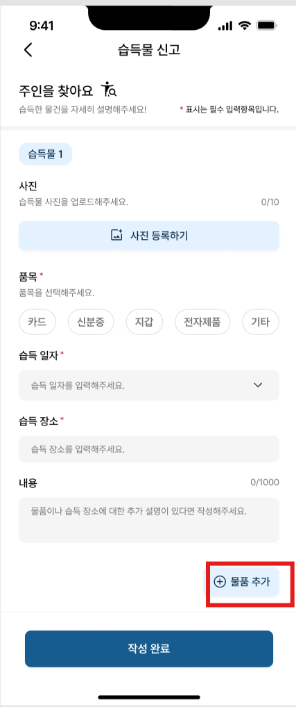
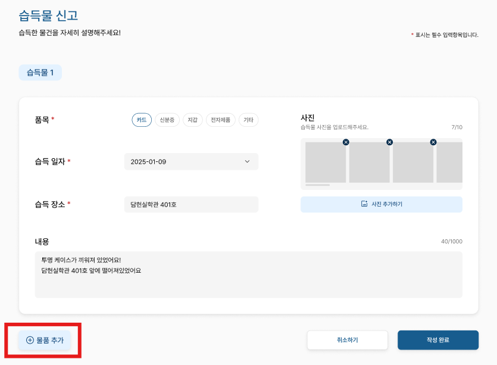
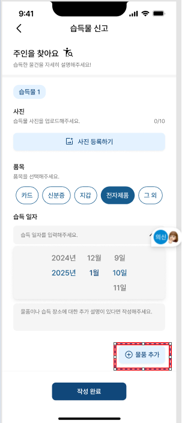
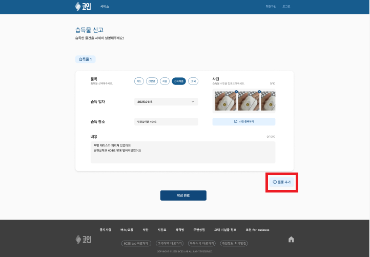
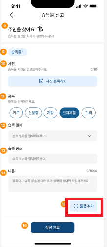
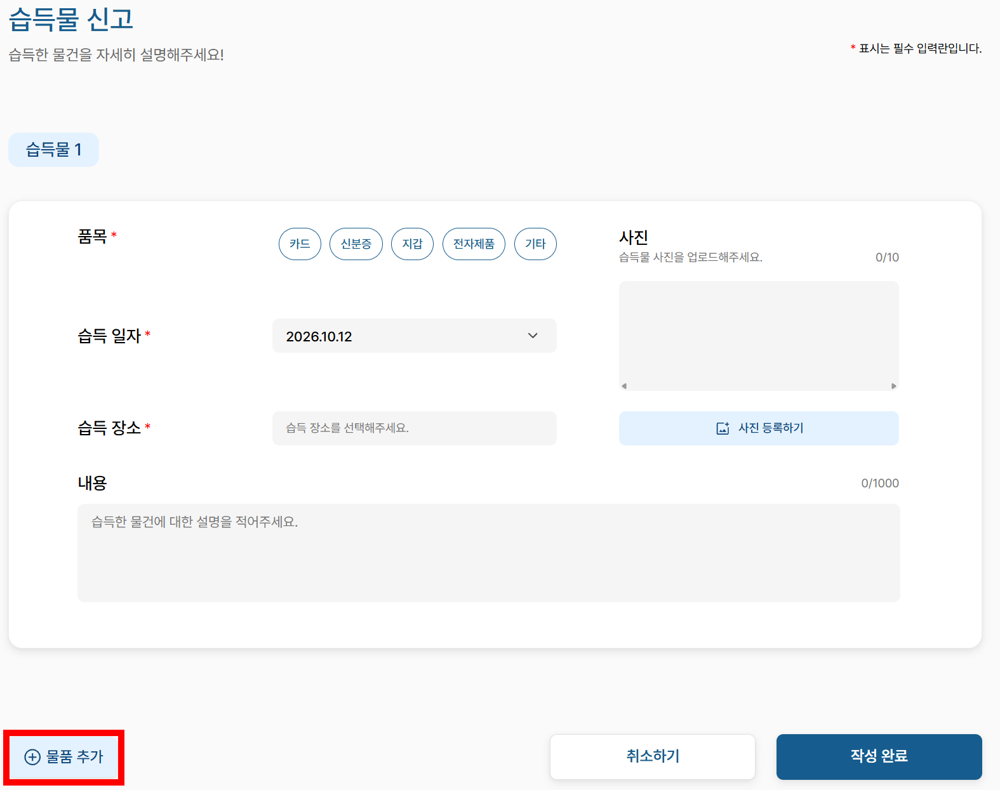
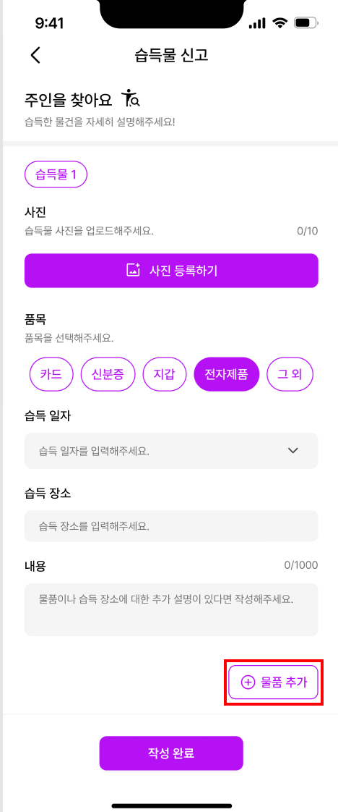

# 11-3.분실물_습득물신고_물품추가_클릭

원문 페이지 ID: bb30221954bc83a0aba1015810eb5709

> 원문 스냅샷. 명세 확정·앱 배포·수집 완료를 뜻하지 않습니다.

## 원문 속성

```json
{
  "platform": [
    "ANDROID",
    "IOS",
    "WEB"
  ],
  "url": "source-page-id:bb30221954bc83a0aba1015810eb5709",
  "상태": "완료",
  "이름": "11-3.분실물\\_습득물신고\\_물품추가\\_클릭",
  "태그": [
    "11.분실물"
  ]
}
```

<details>
<summary>과거 로깅</summary>

- 설명:   습득물 신고 글쓰기 페이지에서 물품 추가 클릭
- event\_label : “find\_user\_add\_item”
- value : “물품 추가”
- event\_category : “click”
- 참고사진





<b>이전 참고사진</b>






WEB Mobile View





</details>

<details>
<summary>새 로깅</summary>

- 설명: 습득물 신고 글쓰기 화면에서 물품 추가 버튼을 클릭.
- screen\_view: <code>found_item_write</code>
- event\_name: <code>DA2</code>
- event\_label: <code>board__found_item_write__lost_item_write__item_add__click</code>
- value: 물품 추가
- event\_category: <code>click</code>

### 참고사진 (기능 표시)

<columns>
<column ratio="50">
<b>웹</b>

<b>참고사진 · 웹</b>

웹 — 습득물 물품 추가


</column>
<column ratio="50">
<b>모바일</b>

<b>참고사진 · 모바일</b>

모바일 — 습득물 물품 추가


</column>
</columns>
</details>
