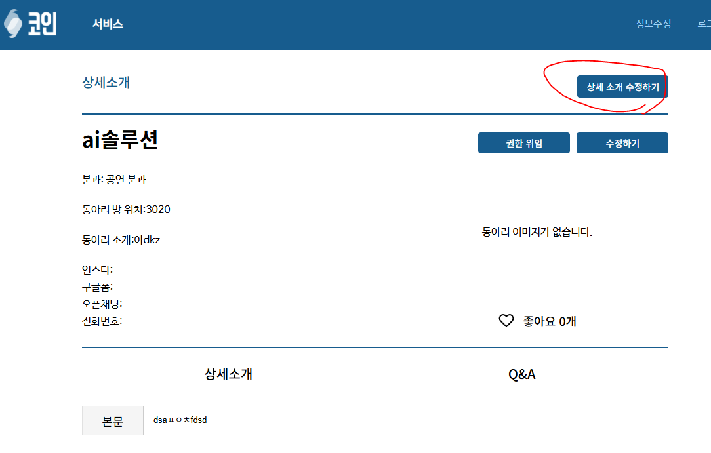
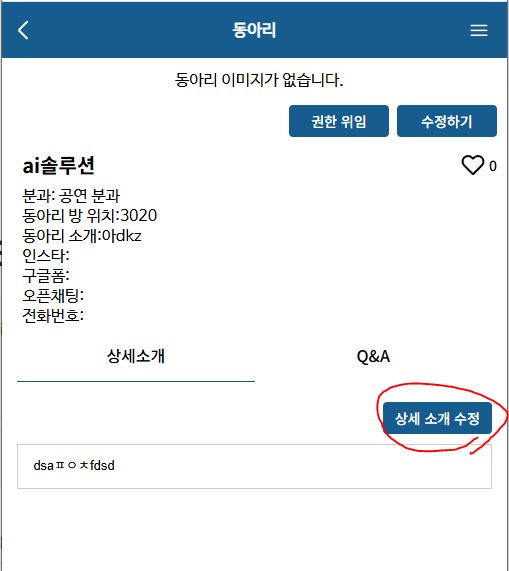

# 5-7.동아리_상세소개 수정하기 클릭

원문 페이지 ID: bcb0221954bc83dba4fb015f1947d68a

> 필터 밖 원본 행 복구 스냅샷. 중복·빈 페이지도 원본 ID와 속성, 본문을 개별 보존합니다. 명세 승인이나 앱 적용 완료를 뜻하지 않습니다.

대조 기록: [숨겨진 원본 42개 복구](../hidden-recovery.md)

관련 기존 보관본: [레거시 5-7.동아리_상세소개 수정하기 클릭](c300221954bc8368b178815f8c3f5171.md), [레거시 5-7.동아리_상세소개 수정하기 클릭](4310221954bc8258b43581efe5d48f07.md)

## 원문 속성

```json
{
  "platform": [
    "WEB"
  ],
  "url": "source-page-id:bcb0221954bc83dba4fb015f1947d68a",
  "상태": "완료",
  "이름": "5-7.동아리\\_상세소개 수정하기 클릭"
}
```

<ul>
<li>
설명: 동아리 소개 화면에서 상세소개 수정하기 클릭
</li>
<li>
event\_name : “CAMPUS”
</li>
<li>
event\_label : “club\_introduction\_correction”
</li>
<li>
value : “상세소개 수정하기”
</li>
<li>
event\_category : “click” 
</li>
</ul>


- 웹 참고사진





- 모바일 웹 뷰



