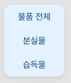
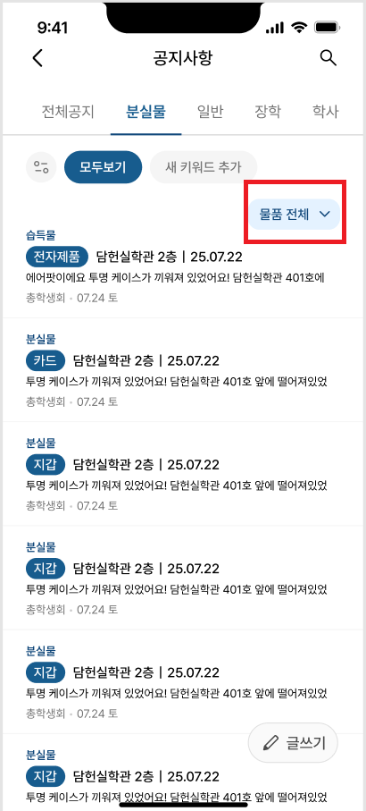
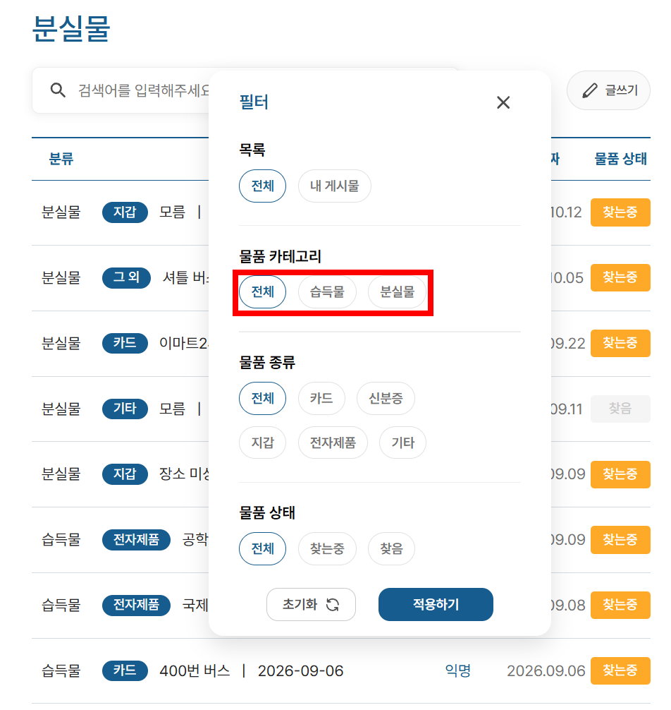
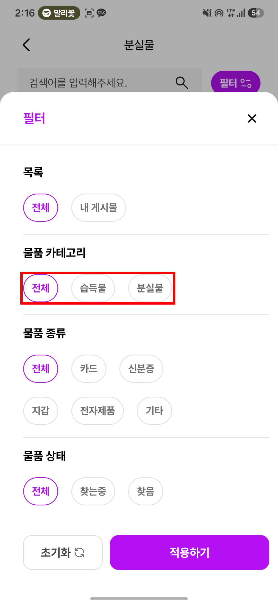

# 11-18.분실물_게시물종류_클릭 (11-23 통합)

원문 페이지 ID: bd00221954bc82628f2e01006b5fd031

> 원문 스냅샷. 명세 확정·앱 배포·수집 완료를 뜻하지 않습니다.

## 원문 속성

```json
{
  "platform": [
    "ANDROID",
    "IOS",
    "WEB"
  ],
  "url": "source-page-id:bd00221954bc82628f2e01006b5fd031",
  "상태": "레거시",
  "이름": "11-18.분실물\\_게시물종류\\_클릭 (11-23 통합)",
  "태그": [
    "11.분실물"
  ]
}
```

<callout icon="🔗">
통합 확정 (2026-10-15): 현행 구현은 [11-23. 분실물_필터_적용_클릭](6ae0221954bc83f49fde814244d6dae4.md) 하나로 통합한다. 이 11-18은 별도 전송하지 않는다. 아래 원문·통합 전 초안·사진은 이력으로 보존한다. 기능 삭제가 아니라 적용 이벤트로 통합된 항목이다.
</callout>

<details>
<summary>이전 로깅</summary>

<ul>
<li>
설명 : 분실물 게시글 목록에서 첨부파일에 표시된 버튼을 클릭하여 3개의 버튼중 1개의 버튼을 클릭
</li>
<li>
event\_label : “item\_post\_type”
</li>
<li>
value : “물품 전체<b>”, “분실물”, “습득물”</b>
</li>
<li>
event\_category : “click” 
</li>
<li>
참고사진
</li>
<li>
WEB, MOBILE\_WEB\_VIEW는 디자인 에서 해당 기능이 없었습니다.
</li>
</ul>




</details>

<details>
<summary>통합 전 초안 (26.10.12 · 현행 별도 전송 제외)</summary>

- 설명: 분실물 게시글 목록에서 첨부파일에 표시된 버튼을 클릭하여 3개의 버튼중 1개의 버튼을 클릭
- screen\_view: <code>lost_item_list</code>
- event\_name: <code>DA2</code>
- event\_label: <code>board__lost_item_list__lost_item_filter__post_type_selection</code>
- value: “물품 전체” / “분실물” / “습득물”
- event\_category: <code>select</code>
- 플랫폼 확인 완료: ANDROID·IOS·WEB 속성은 사용자 확인 완료. 2026-10-15 실제 WEB 필터에서도 전체·습득물·분실물 선택을 확인했다. 11-23과의 통합 및 value 구조는 검토중이며 이 명세의 선택 이벤트는 아직 통합하지 않았다. 통합 제안은 아래 가이드를 참조한다.
- 통합 기준·결정: [로깅 통합 가이드](3c30221954bc8214b1c481c5bbb6fba5.md)

### 참고사진 (기능 표시)

<columns>
<column ratio="50">
<b>웹</b>

<details>
<summary>참고사진 · 웹</summary>

웹 — 필터의 물품 카테고리 선택


</details>
</column>
<column ratio="50">
<b>모바일</b>

<details>
<summary>참고사진 · 모바일</summary>

모바일 — 필터의 물품 카테고리 선택


</details>
</column>
</columns>

- 사진 기준: 추가 이미지의 필터에서 전체·습득물·분실물 선택을 표시했다. 2026-10-15 실제 WEB에서 현행 필터의 대응 기능을 확인했다. 이전 드롭다운 원문은 보존하고 통합 여부는 별도 검토중이다.
</details>
