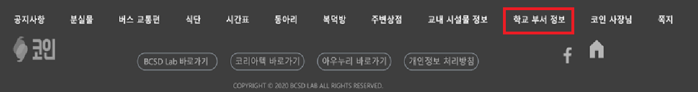
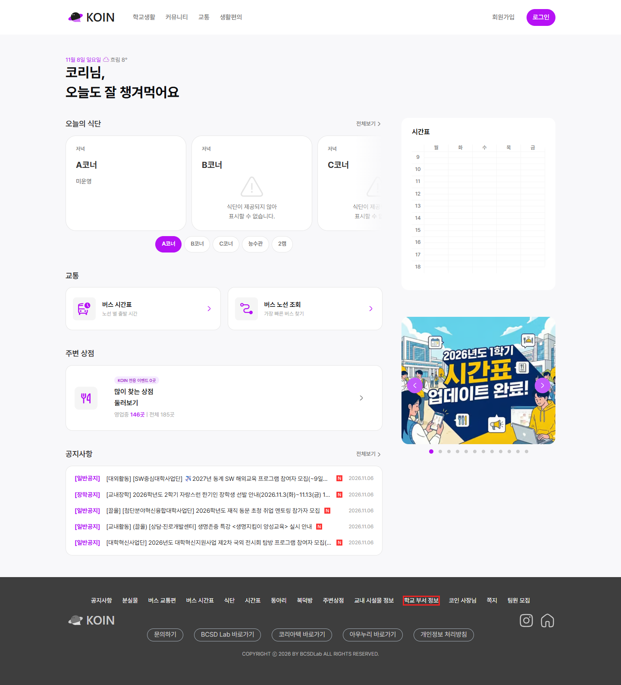

# 1-0-1 학교 부서 정보 접근 (푸터 진입)

원문 페이지 ID: bd00221954bc837d8fae81ea1e55201b

> 원문 스냅샷. 명세 확정·앱 배포·수집 완료를 뜻하지 않습니다.

## 원문 속성

```json
{
  "platform": [
    "WEB"
  ],
  "url": "source-page-id:bd00221954bc837d8fae81ea1e55201b",
  "구분": "학교 부서정보",
  "상태": "완료",
  "생성일": "2026-11-12T05:08:04.473Z",
  "이벤트 이름": "1-0-1 학교 부서 정보 접근 (푸터 진입)"
}
```

<details>
<summary>과거 로깅</summary>

- event\_label : footer
- value : 학교 부서 정보
- event\_category : click



</details>

<details>
<summary>새 로깅</summary>

- 구체적 발생 조건: WEB 리디자인의 공통 하단 푸터에서 ‘학교 부서 정보’ 텍스트를 클릭한다.
- screen\_view: <code>footer</code>
- event\_label: <code>department__footer__department_entry__footer_entry__click</code>
- event\_name: <code>DA2</code>
- event\_category: <code>click</code>
- value: 학교 부서 정보

### 참고사진 (기능 표시)

<b>웹(데스크톱)</b>

<b>참고사진 · 웹 (Stage 실제 화면)</b>

2026-11-08 [Stage 실제 서비스](https://stage.koreatech.in/) · PC 1440px 브라우저에서 직접 촬영했다. 빨간 테두리는 해당 명세의 버튼 위치다. 현재 WEB 위치 확인에는 이 실제 화면을 우선한다. 모바일 사진·기존 로깅 필드·DB 플랫폼 속성은 유지한다. 화면 확인은 SDK 전송·GA4 수집 검수 완료를 뜻하지 않는다.


</details>
