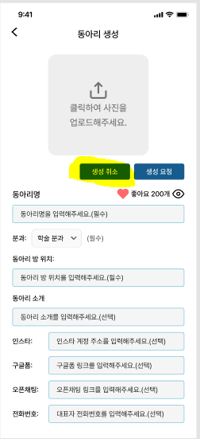
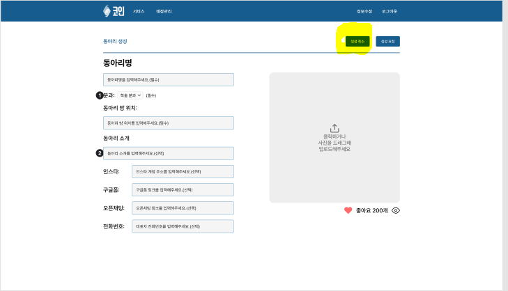

# 3-1. 동아리_동아리 생성취소

원문 페이지 ID: bd10221954bc8385b5548139a64578d4

> 사용자 제공 ZIP 내보내기 보관본. 레거시·동결·검토 상태는 원문을 따르며 코드 생성 승인·앱 배포 완료를 뜻하지 않습니다.

platform: ANDROID, IOS, WEB
상태: 완료

- 설명: 동아리 생성 화면 에서 생성 취소 클릭
- event_name : “CAMPUS”
- event_label : “club_create_cancel”
- value : “생성취소”
- event_category : “click”
- 참고사진

- 웹 참고사진

