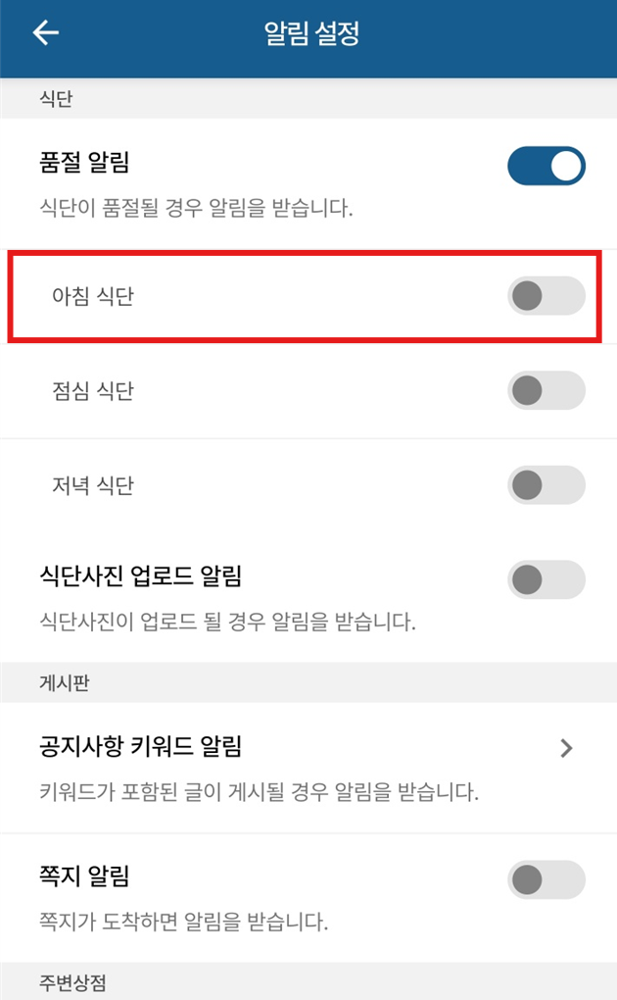

# 5-3. (Android / iOS) 알림설정_품절_식사시간_토글

원문 페이지 ID: bfe0221954bc829dac0501c57175d4e1

> 원문 스냅샷. 명세 확정·앱 배포·수집 완료를 뜻하지 않습니다.

## 원문 속성

```json
{
  "platform": [
    "ANDROID",
    "IOS"
  ],
  "url": "source-page-id:bfe0221954bc829dac0501c57175d4e1",
  "상태": "완료",
  "생성일": "2026-11-12T05:07:50.179Z",
  "이름": "5-3. (Android / iOS) 알림설정\\_품절\\_식사시간\\_토글",
  "태그": [
    "5. 알림설정 페이지 (Android / iOS)"
  ]
}
```

<details>
<summary>과거 로깅</summary>

- 설명 : 품절 알림에서 아침 식단 클릭
- event\_label : “notification\_breakfast\_sold\_out”
- value : “on/off<b>”</b>
- event\_category : “click”
- 참고사진


</details>

<details>
<summary>새 로깅</summary>

- 설명: 프로필 → 설정 → 알림 화면의 품절 알림에서 식사 시간(아침/점심/저녁)별 토글을 켜거나 끄는 경우
- screen\_view: <code>notification_config</code>
- event\_name: <code>DA1</code>
- event\_label: <code>cafeteria__notification_config__sold_out_meal__toggle</code>
- value: \{식사 시간\}\_\{켜짐/꺼짐\} (예: 아침\_켜짐)
- event\_category: <code>toggle</code>

### 참고사진 (품절 알림 식사시간 토글)

<columns>
<column ratio="50">
<b>웹</b>

<b>참고사진 · 웹</b>

해당 없음 (앱 전용)
</column>
<column ratio="50">
<b>모바일</b>

<b>참고사진 · 모바일</b>

앱 전용 화면 (웹 없음), 앱 캡처 필요
</column>
</columns>
</details>
