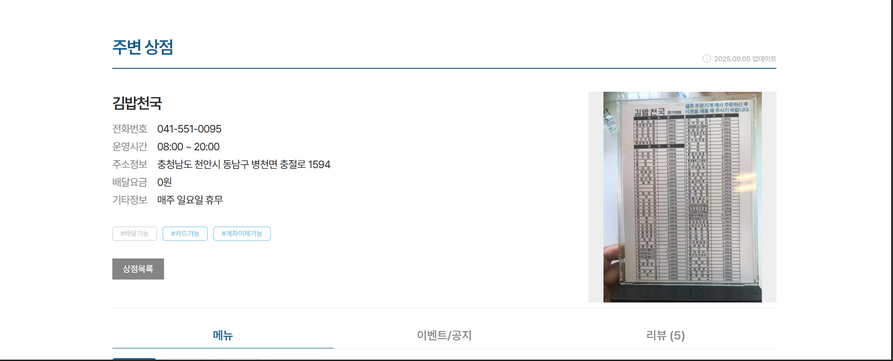
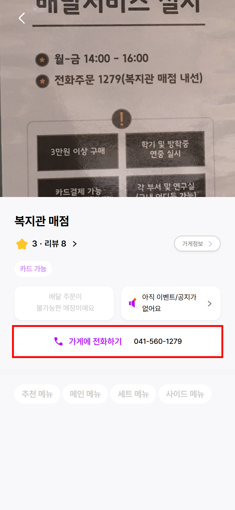
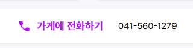

# 3-2 상점상세 전화 (클릭) 

원문 페이지 ID: c040221954bc83b392f501953747255d

> 원문 스냅샷. 명세 확정·앱 배포·수집 완료를 뜻하지 않습니다.

## 원문 속성

```json
{
  "platform": [
    "WEB",
    "ANDROID",
    "IOS"
  ],
  "url": "source-page-id:c040221954bc83b392f501953747255d",
  "상태": "완료",
  "생성일": "2026-11-08T10:51:47.240Z",
  "이벤트 이름": "<p>\n3-2 상점상세 전화 (클릭) \n</p>",
  "태그": [
    "3. 상점 상세 페이지"
  ]
}
```

<details>
<summary>이전 로깅</summary>

<span color="orange">event\_params.key</span>

<ul>
<li>
event\_label : shop\_call
</li>
<li>
value : \{상점이름\} 
</li>
<li>
event\_category : click
</li>
</ul>


<ul>
<li>
duration\_time : 상점 상세페이지로 들어와서 전화를 하기까지 걸린시간. 
</li>
</ul>


---

<p>
시간 측정시 주의 사항 : 
</p>

<ol>
<li>
상점 상세페이지에서 어떤 행위를 하던 상관 없음. (스크롤, 사진누르기 등) 
</li>
<li>
첫번째 전화후 두번째 전화는 어떻게 측정하나요? <br />→ 두번째 전화도 상점 상세페이지 부터 전화 버튼 누른 시간까지 측정하면 됩니다.
</li>
</ol>


---

<h3>
오류사항 
</h3>

---

<p>
안드로이드 
</p>

<ol>
<li>
로그인 찍히는 이슈 
</li>
</ol>


[해결 (1)](9830221954bc8291b37c0168763b2ca9.md)
</details>

<details>
<summary>새 로깅 (26.10.17)</summary>

- 설명: 상점 상세 화면에서 전화 버튼을 클릭하는 경우
- screen\_view: <code>shop_detail</code>
- event\_name: <code>DA1</code>
- event\_label: <code>shop__shop_detail__contact__phone__click</code>
- value: \{상점이름\} → ex) OO치킨, OO피자 등등 (예: 복지관 매점)
- event\_category: <code>click</code>

<details>
<summary>검토사항</summary>

- 통합 가이드: [로깅 통합 가이드](3c30221954bc8214b1c481c5bbb6fba5.md)
- 웹: 오른쪽 하단에 전화 아이콘 있음 - 데스크탑으로 보면 보이는데 노트북으로 보면 안보임…
- 명세 중복 정리 (2026-10-27): <code>shop__shop_detail__contact__phone__click</code>의 기준 명세는 [3-2 상점상세 전화 (클릭) ](c040221954bc83b392f501953747255d.md). 상점 상세의 같은 전화 버튼이며 이전 진입 경로만 다르다. 같은 사용자 동작은 한 번만 전송하며, 문서가 여러 개라는 이유로 추가 이벤트를 보내지 않는다. 기존 value·플랫폼·발생 시점은 유지한다.
- label DA2 기준 정렬 (2026-10-27): <code>shop__shop_detail__call__click</code> → <code>shop__shop_detail__contact__phone__click</code>
</details>

### 참고사진 (전화 버튼 클릭)

<columns>
<column ratio="50">
<b>웹</b>

<details>
<summary>참고사진 · 웹</summary>

웹 — 전화 버튼 클릭 (출처: 기존 캡처)


</details>
</column>
<column ratio="50">
<b>모바일</b>

<details>
<summary>참고사진 · 모바일</summary>

모바일 — 전화 버튼 클릭 (출처: stage 실제 캡처, 빨간 네모 = 클릭 위치)




</details>
</column>
</columns>
</details>
