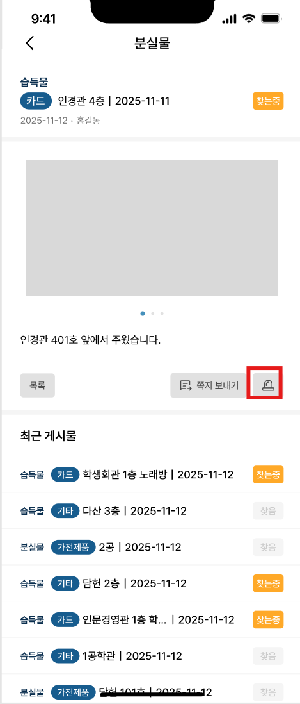
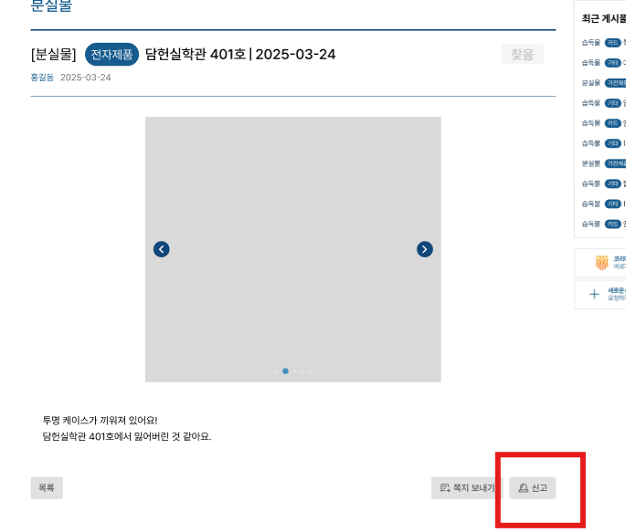
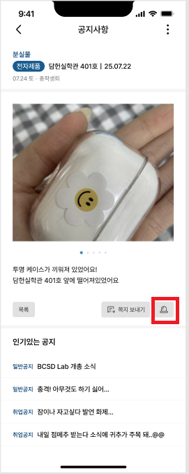
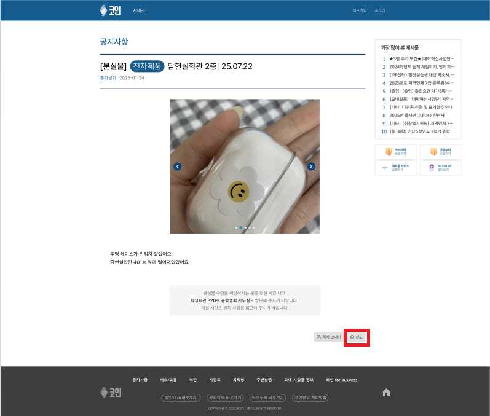
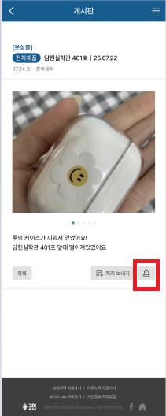
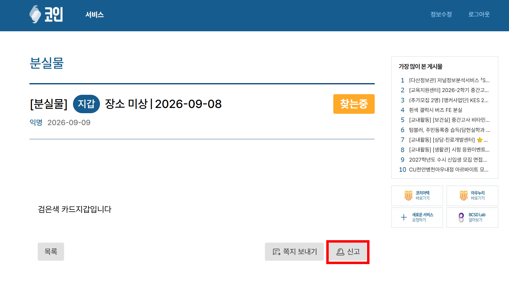
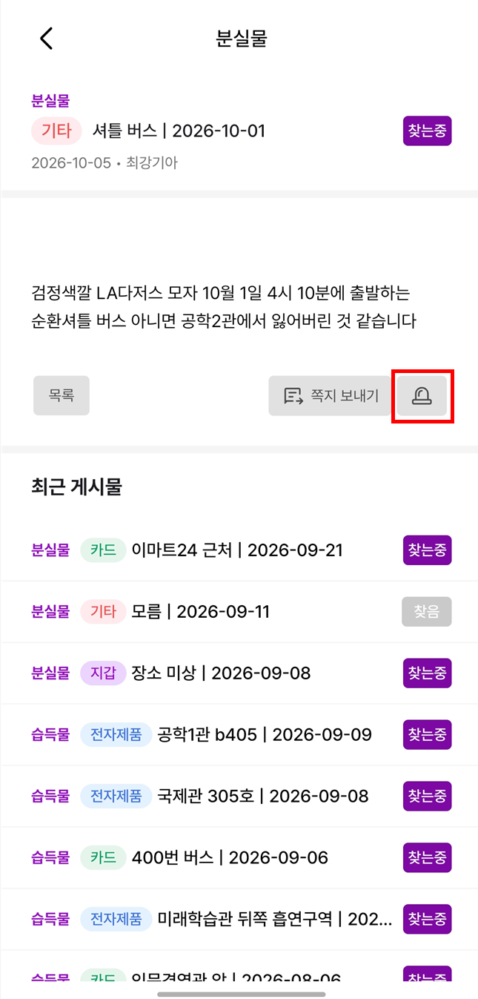

# 11-13.분실물_신고하기_클릭

원문 페이지 ID: c050221954bc821db0610121570a8c2c

> 원문 스냅샷. 명세 확정·앱 배포·수집 완료를 뜻하지 않습니다.

## 원문 속성

```json
{
  "platform": [
    "ANDROID",
    "IOS",
    "WEB"
  ],
  "url": "source-page-id:c050221954bc821db0610121570a8c2c",
  "상태": "완료",
  "이름": "11-13.분실물\\_신고하기\\_클릭",
  "태그": [
    "11.분실물"
  ]
}
```

<details>
<summary>이전 로깅</summary>

- 설명:  게시글에서 신고하기 버튼 클릭
- event\_label : “item\_post\_report”
- value : “신고하기”
- event\_category : “click”
- 참고사진





<details>
<summary>이전 참고사진</summary>

mobile\_view




WEB




mobile\_Web\_view


</details>
</details>

<details>
<summary>새 로깅 (26.10.12) — 초안</summary>

- 설명: 게시글에서 신고하기 버튼 클릭
- screen\_view: <code>lost_item_detail</code>
- event\_name: <code>DA2</code>
- event\_label: <code>board__lost_item_detail__lost_item_report__entry__click</code>
- value: 신고하기
- event\_category: <code>click</code>

<details>
<summary>검토사항</summary>

- label 통일 (2026-10-27): <code>board__lost_item_detail__lost_item_report__entry</code> → <code>board__lost_item_detail__lost_item_report__entry__click</code>
</details>

### 참고사진 (기능 표시)

<columns>
<column ratio="50">
<b>웹</b>

<details>
<summary>참고사진 · 웹</summary>

웹 — 신고


</details>
</column>
<column ratio="50">
<b>모바일</b>

<details>
<summary>참고사진 · 모바일</summary>

모바일 — 신고 아이콘


</details>
</column>
</columns>
</details>
