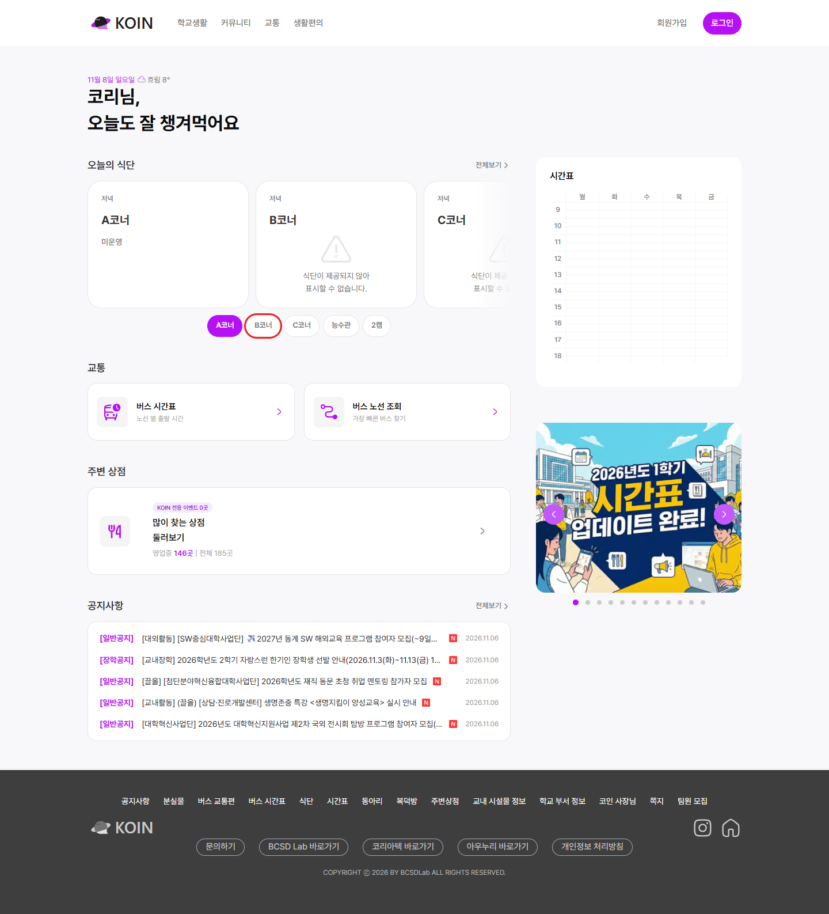
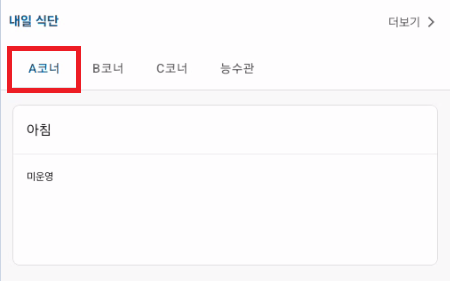
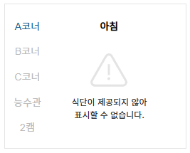

# 1-3.메인_식단_A코너_클릭 (레거시)

> 원본 복구 대조: [별도 원본 ID 1560221954bc83afacc8015e25700762](1560221954bc83afacc8015e25700762.md)와 [차이 정리](../recovery-review.md)를 참고하세요. 기존 값은 과거 기록으로 유지합니다.

원문 페이지 ID: c250221954bc8318b85201e8c22f915d

> 원문 스냅샷. 명세 확정·앱 배포·수집 완료를 뜻하지 않습니다.

## 원문 속성

```json
{
  "platform": [
    "ANDROID",
    "IOS",
    "WEB"
  ],
  "url": "source-page-id:c250221954bc8318b85201e8c22f915d",
  "상태": "완료",
  "생성일": "2026-11-12T05:07:48.701Z",
  "이름": "1-3.메인\\_식단\\_A코너\\_클릭 (레거시)",
  "태그": [
    "1. 메인_식단"
  ]
}
```

<details>
<summary>현재 WEB 참고사진 · Stage 실제 배포 화면</summary>

2026-11-08 [Stage 실제 서비스](https://stage.koreatech.in/) · PC 1440px 브라우저에서 직접 촬영했다. 빨간 테두리는 해당 명세의 버튼 위치다. 아래의 Figma 리디자인 시안·이전 WEB 캡처는 이력으로 보존하며, 현재 WEB 위치 확인에는 이 실제 화면을 우선한다. 모바일 사진·기존 로깅 필드·DB 플랫폼 속성은 유지한다. 화면 확인은 SDK 전송·GA4 수집 검수 완료를 뜻하지 않는다.


</details>

<callout icon="📁" color="gray_bg">
<b>레거시 보존 · 현행 새 로깅은 홈으로 이관</b>

- 2026-11-04 사용자 지시로 이 페이지는 이력만 보존한다.
- 현행 기준 명세: [1-4 식단 코너 클릭](03a0221954bc82988da80160ab26ee4c.md).
- 이관 후 event\_label: <code>main__main__corner__select</code>. 아래 이관 전 라벨·값·사진은 보존 기록이며 별도 신규 구현·추가 전송 대상으로 사용하지 않는다.
- 실제 SDK 전환·배포·수집 중단 여부는 미확인이다. 기존 플랫폼과 상태 속성은 유지했다.
</callout>

<details>
<summary>이전 로깅</summary>

- 설명 : 메인화면에서 A코너 버튼 클릭
- event\_label : “main\_menu\_corner”
- value : “A코너<b>”</b>
- event\_category : “click”
- 참고사진




- 웹


</details>
