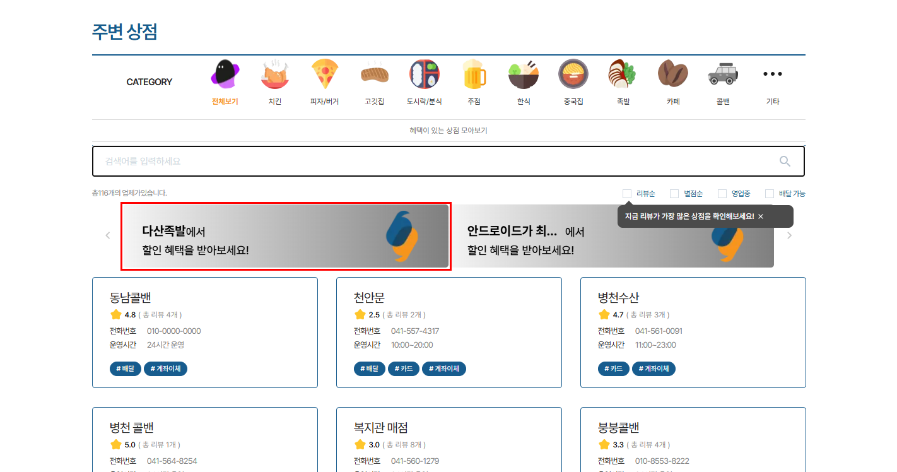
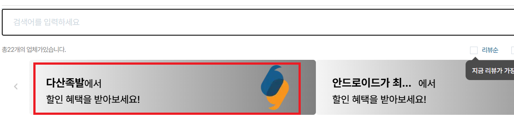

# 2-3 상점카테고리 이벤트 (클릭) 

원문 페이지 ID: c280221954bc822b81ed81eca5996597

> 원문 스냅샷. 명세 확정·앱 배포·수집 완료를 뜻하지 않습니다.

## 원문 속성

```json
{
  "platform": [
    "WEB",
    "ANDROID",
    "IOS"
  ],
  "url": "source-page-id:c280221954bc822b81ed81eca5996597",
  "상태": "완료",
  "생성일": "2026-11-12T05:07:37.481Z",
  "이벤트 이름": "<p>\n2-3 상점카테고리 이벤트 (클릭) \n</p>",
  "태그": [
    "2. 상점 카테고리"
  ]
}
```

<details>
<summary>과거 로깅</summary>

<span color="orange">event\_params.key</span>

<ul>
<li>
event\_label : shop\_categories\_event
</li>
<li>
value : \{가게이름\}
</li>
<li>
event\_category : click 
</li>
</ul>
</details>

<details>
<summary>새 로깅</summary>

- 설명: 상점 목록 화면에서 이벤트 중인 가게(이벤트 배너/표시)를 클릭하는 경우
- screen\_view: <code>shop_list</code>
- event\_name: <code>DA1</code>
- event\_label: <code>shop__shop_list__shop_event__entry__click</code>
- value: \{가게이름\} (예: 복지관 매점)
- event\_category: <code>click</code>

### 참고사진 (이벤트 가게 클릭)

<columns>
<column ratio="50">
<b>웹</b>

<b>참고사진 · 웹</b>

웹 — 상점 목록 이벤트 가게 클릭 (출처: stage 실제 캡처, 빨간 네모 = 클릭 위치)




</column>
<column ratio="50">
<b>모바일</b>

<b>참고사진 · 모바일</b>

없음
</column>
</columns>
</details>
