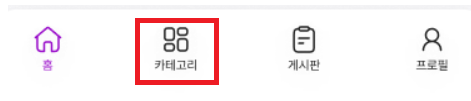

# 2-2 네비게이션 바 카테고리 클릭

원문 페이지 ID: c2a0221954bc83d08bb781131aa1d6b6

> 원문 스냅샷. 명세 확정·앱 배포·수집 완료를 뜻하지 않습니다.

## 원문 속성

```json
{
  "platform": [
    "ANDROID",
    "IOS",
    "WEB (모바일)"
  ],
  "url": "source-page-id:c2a0221954bc83d08bb781131aa1d6b6",
  "구분": "네비게이션 바",
  "상태": "완료",
  "생성일": "2026-11-12T05:08:01.570Z",
  "이벤트 이름": "2-2 네비게이션 바 카테고리 클릭"
}
```

<details>
<summary>과거 로깅</summary>

- event\_label : nav\_category
- value : 카테고리
- event\_category : click





</details>

<details>
<summary>새 로깅</summary>

<b>카테고리</b>

- 설명: 공용 하단 네비게이션 바에서 카테고리 항목을 눌러 카테고리 메뉴를 열 때 기록한다. 메뉴 내부 서비스 클릭과 구분한다.
- screen\_view: <code>main</code>
- event\_name: <code>DA2</code>
- event\_label: <code>main__main__navigation__category_menu_entry__click</code>
- value: 카테고리
- event\_category: <code>click</code>
</details>
